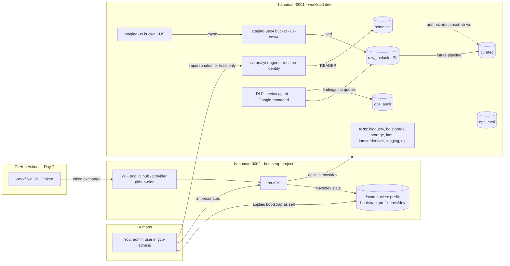
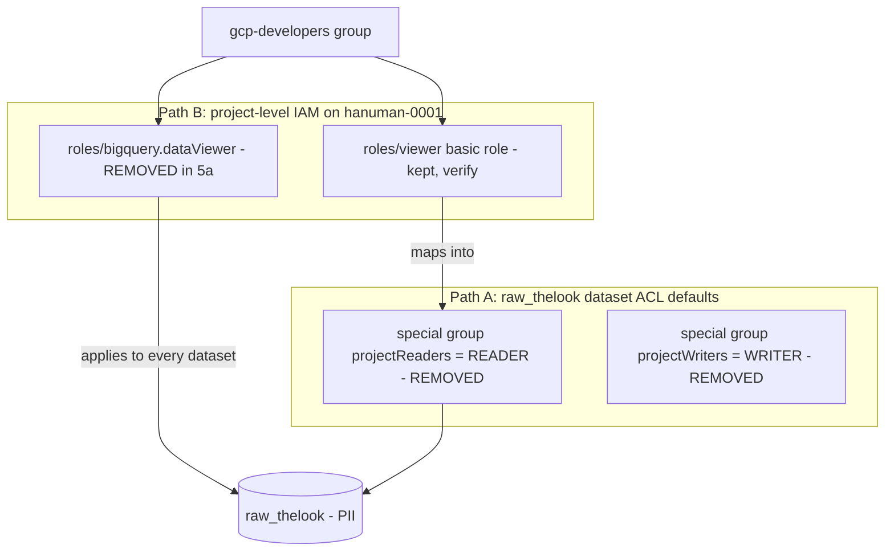
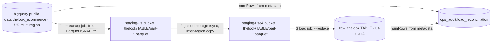

# Day 4–5 Design Rationale — bq-ai-analyst

> Companion to the Day 4 + Day 5 runbook. The runbook says **what** was done. This document explains **why**, the **alternatives**, and **when to choose differently**.

---

## 0. How to read this document

**Audience.** You know the BigQuery and GCP data plane well. You are new to IaC governance, Terraform state design, and Git branching. BigQuery basics are skipped. Governance concepts come with an analogy; technical details are stated exactly.

**How each item is written.** Every artifact, config block, and command is described as a short card with these headings:

| Heading | Question it answers |
|---|---|
| **What** | What is it, in one sentence? |
| **Why here** | What problem does it solve in this project? |
| **Why this form** | Why these specific arguments? |
| **Alternatives** | What else could you do, and when does each win or lose? |
| **Trade-offs** | Cost, security, operability, blast radius, coupling. |
| **If skipped** | What breaks, when, and how you would notice. |
| **Soundbite** | What you say to an interviewer in about 30 seconds. |

Many cards cross-reference the **Decisions Catalogue** (Section 2, items D1–D26) instead of repeating it.

**Confidence markers.**
- ✅ = verified in this project (you ran it and saw the result).
- 🔍 = a GCP or provider behavior I am confident about but you should verify. A command or check is always given. Accuracy matters more than completeness.

### Assumptions that would change an architect's advice

| # | Assumption in the runbook | If it were different… |
|---|---|---|
| A1 | **One workload project (dev only).** | With prod, you would add a separate project, a separate state prefix or bucket, and a separate apply SA per environment (D1, D4). |
| A2 | **Single region (us-east4), no DR.** | Multi-region DR changes D13 (replication becomes attractive) and bucket design (D10, D22). |
| A3 | **Synthetic data treated as real PII.** | With real PII you would pull VPC-SC, CMEK, and policy tags forward from Phase 2 (Section 10). |
| A4 | **One human is in every group.** | Separation of duties exists only on paper. With a real team, admins, billing, and developers are different people, and the identity model (D4) is what protects you. |
| A5 | **Free trial.** BigQuery custom quotas are unavailable. | With a paid account you would set a project-level daily query quota instead of relying on `~/.bigqueryrc`. |
| A6 | **Both stacks' state lives in one bucket**, separated by prefix. | In a regulated org, prod state usually gets its own bucket or project (D1). |
| A7 | **CI is not wired yet** (Day 7). Applies are human-initiated. | Once CI applies, human impersonation becomes break-glass only (D2, D3). |

---

## 1. The architecture in one page



### Elevator story (10 lines)

1. Days 1–3 built the **control plane**: org guardrails, remote state, CI identity, WIF. You applied these as yourself because they create the identities everything else uses.
2. Day 4 built the **workload plane** in hanuman-0001 as a separate Terraform stack, applied *by* the CI identity (impersonated), not by you.
3. It created medallion datasets (raw → curated → semantic) plus two ops datasets for audit and evaluation.
4. It created a **runtime identity** for the future AI agent. That identity can read *only* `semantic`.
5. `semantic` reads `curated` through an **authorized dataset**, so the agent never needs, and never has, access to curated tables.
6. A smoke test proved the boundary from the agent's point of view: it can read the view, and it is denied on curated, raw, and writes.
7. Day 5 started by **closing two leak paths to raw** *before* any PII arrived: dataset-ACL defaults and a project-level read grant.
8. It loaded `thelook_ecommerce` into us-east4 using a portable extract → copy → load pattern, and recorded a reconciliation of row counts.
9. It scanned the PII-bearing tables with DLP, without copying any PII into the findings.
10. It turned the scan into a **human-reviewed PII inventory**. That inventory is the contract the text-to-SQL layer will be built and tested against.

**Why that order:** identities, then containers, then locks, then data, then classification. Each step needs the previous one, and none of them puts PII somewhere it isn't yet protected.

---

## 2. Decisions catalogue

The format for each decision is: **Decision → Why → Alternatives → When to flip.**

### D1. Two Terraform stacks (`infra/bootstrap`, `infra/envs/dev`) with separate state

- **Decision:** Two root modules, each with its own state object (`prefix = "bootstrap"` and `prefix = "envs/dev"`).
- **Why:**
  - *Blast radius.* A bad dev apply cannot touch org policies, WIF, or the CI SA, because those resources aren't in its state.
  - *Different change cadence and authority.* Bootstrap changes rarely and needs org-level permissions. Dev changes daily and needs only project permissions.
  - *Chicken and egg.* The identity that applies dev (`sa-tf-ci`) is itself created by bootstrap.
- **Analogy:** bootstrap is the building's foundation and security desk; dev is furniture in one office. You don't let the furniture movers rewire the badge readers.

| Alternative | Wins when | Loses when |
|---|---|---|
| One stack, one state | Tiny, throwaway POC with one person | Any apply can destroy the foundation, and plans get slow and noisy |
| Stack per layer (org / network / data / app) | Larger platforms with separate teams per layer | Overkill for one project; adds cross-stack plumbing |
| Terragrunt or a TF orchestration tool | Many environments with identical stacks | Extra tooling to learn and defend |

- **When to flip:** when you add `envs/prod`, keep this split and add a third stack. When the network, VPC-SC, or KMS gets its own owners, split those out too.
- **Caveat (A6):** both state objects live in one bucket. Anyone with `objectAdmin` on that bucket can edit both. For prod, use a separate bucket with its own IAM.

### D2. Apply bootstrap as yourself; apply dev by impersonating `sa-tf-ci`

- **Decision:** Bootstrap runs with your human credentials (as a gcp-admins member). Dev runs as `sa-tf-ci`.
- **Why:**
  - Bootstrap needs org/folder-level roles. Granting those to a CI SA makes that SA a single key to the whole org.
  - Dev is the routine path, and routine changes should run as the same identity CI will use. That gives identical permissions locally and in CI, so "works on my machine" can't hide a missing role.
  - Impersonation leaves an audit trail showing *who* held the SA's token (D-audit, Section 3.6).

| Alternative | Wins when | Loses when |
|---|---|---|
| Everything as a human | Solo learning only | No parity with CI; humans accumulate standing high privilege |
| Everything via the CI SA, including bootstrap | Mature orgs with a dedicated, tightly guarded org-level SA plus approvals | The CI SA becomes an org-wide crown jewel |
| A separate "bootstrap SA", impersonated by admins only | Regulated orgs wanting no human writes at all | More identities to manage; still needs a human to create it the first time |

- **When to flip:** once Day 7 CI applies dev, human impersonation of `sa-tf-ci` becomes break-glass only. For prod, consider a dedicated bootstrap SA.

### D3. `GOOGLE_IMPERSONATE_SERVICE_ACCOUNT` env var locally, WIF in CI, and no `impersonate_service_account` in the provider block

- **Decision:** The provider block carries no identity. Identity comes from the environment.
- **Why:**
  - The same code runs in two places. In CI, WIF already authenticates *as* `sa-tf-ci`. If the provider also said "impersonate sa-tf-ci," CI would be impersonating itself, which needs a TokenCreator grant on itself. That is confusing and an extra permission.
  - The google provider and the gcs backend both honor the env var. 🔍 The backend also reads it; confirm with an `init` in a fresh shell where the env var is unset — it should fail on the state bucket.
- **Analogy:** don't hardcode who's driving into the car. Hand the keys to whoever is driving today.

| Alternative | Wins when | Loses when |
|---|---|---|
| `impersonate_service_account` in the provider | Only humans ever apply this stack | Breaks CI parity, or forces an awkward self-impersonation |
| Service account key file | Never (keys are blocked by your org policy anyway) | Long-lived secret that can leak |
| `gcloud config set auth/impersonate_service_account` | Ad-hoc gcloud work | Easy to forget it's set; it silently affects every gcloud command in the session |

- **When to flip:** don't. This is the durable pattern.

### D4. Three identities, three purposes

| Identity | Purpose | Can do | Must not do |
|---|---|---|---|
| **You** (human, gcp-admins) | Break-glass, bootstrap, tests | Org/folder admin; impersonate both SAs | Routine dev applies (that's the CI SA's job) |
| **sa-tf-ci** (CI identity) | Change infrastructure | Create datasets, buckets, IAM in hanuman-0001 | Run the app; ideally not read business data (see Section 10) |
| **sa-analyst-agent** (runtime) | Run the AI analyst | Query `semantic`; run jobs | Change anything; read curated or raw |

- **Why:** least privilege per *function*. If the runtime SA leaks (a prompt-injection bug in the app, a compromised container), the attacker gets read access to governed views. They get no infra control and no raw PII.
- **Alternatives:** one "app SA" that also deploys itself (convenient, but a compromise escalates); per-user OAuth with end-user credentials (wins when row-level security must follow the *end user*; loses on complexity and caching). The capstone may evolve toward end-user identity for row-level security; keep that on your radar.
- **When to flip:** add a separate *plan-only* SA (read-only) for PR plans in Day 7, so an unreviewed PR can never apply.

### D5. Authorized dataset (`target_types = ["VIEWS"]`) instead of granting `curated` to the agent

- **Decision:** `semantic` is authorized on `curated`. The agent gets READER on `semantic` only.
- **Why:** views in `semantic` are the **only** shape of data the agent can see. Column selection, row filters, renames, aggregations, and suppression rules (k ≥ 10, Section 7) all live in SQL you control and review. The agent cannot write `SELECT * FROM curated.users`, because it has no access to curated at all.
- **Analogy:** the agent can only look through windows (views) you built. It has no key to the warehouse.

| Alternative | Wins when | Loses when |
|---|---|---|
| Grant `curated` READER to the agent | Curated is already safe to expose whole | Every curated column becomes queryable; guardrails move into the app, which is weaker |
| Per-view authorized views | A handful of views needing individual authorization | Each new view needs a new ACL entry: toil and drift |
| Row access policies + policy tags on curated, with direct access | Fine-grained control that follows the querying user | More moving parts; the agent still sees every curated table's structure |
| Analytics Hub / data clean rooms | Sharing across org boundaries | Overkill inside one project |

- **When to flip:** combine it with policy tags on curated in Phase 2 (defense in depth). You don't replace it.

### D6. `google_bigquery_dataset_access` everywhere, never `google_bigquery_dataset_iam_*`

- **Decision:** All dataset grants use `google_bigquery_dataset_access` (one resource per ACL entry). On raw, we use the dataset's inline `access` blocks, never both on the same dataset (D26).
- **Why:** a BigQuery dataset has one ACL. Terraform offers three ways to manage it:

| Mechanism | Ownership model |
|---|---|
| Inline `access {}` blocks on `google_bigquery_dataset` | **Authoritative**: owns the whole ACL |
| `google_bigquery_dataset_access` | One entry; supports **authorized views/datasets/routines** |
| `google_bigquery_dataset_iam_policy/binding/member` | The IAM-style interface |

- 🔍 The provider docs warn that the `dataset_iam_*` resources **remove authorized view/dataset entries** from the dataset, and that they should not be combined with the `access` field or `dataset_access`. Verify in the provider docs for `google_bigquery_dataset_iam`. Then run an experiment in a scratch dataset: create an authorized dataset entry, add a `dataset_iam_member`, apply, and run `bq show --format=prettyjson` to see whether the authorized entry survived.
- **If skipped:** two resources each believe they own the ACL. Every apply "fixes" the other's changes. Worse, the authorization from D5 can disappear silently, and the agent's view queries start failing with "Access Denied: Table curated.x".

| Alternative | Wins when | Loses when |
|---|---|---|
| `dataset_iam_member` only | No authorized views anywhere; you prefer the IAM-style API | Can't express authorized views; wipes them if present |
| Inline `access` blocks everywhere | You want one place to read the full ACL per dataset | Every grant change touches the dataset resource; lists get large |

- **When to flip:** never mix. Pick per dataset and document the choice.

### D7. Legacy role `READER` instead of `roles/bigquery.dataViewer` in `dataset_access`

- **Why:** dataset ACLs are an older API that stores basic roles (`READER`, `WRITER`, `OWNER`). If you send `roles/bigquery.dataViewer`, the API stores it as `READER`. On the next plan, Terraform sees "config says dataViewer, real world says READER" and plans a change, every time. That is a **perpetual diff**. 🔍 It's documented on the `role` argument of `google_bigquery_dataset_access`. ✅ Your second plan showed `No changes`, which is consistent with this.
- **Alternatives:** predefined role names in `dataset_access` (cause the diff); `dataset_iam_member` with predefined roles (see D6 for why not).
- **If skipped:** plans are never clean. Teams learn to ignore plan output, and that is how real destroys get waved through.
- **Soundbite:** "A plan that's never empty trains people to stop reading plans. Normalizing to the API's canonical form keeps the second plan at zero."

### D8. `bigquery.jobUser` at the project; `READER` at the `semantic` dataset only

- **Why:** BigQuery splits **compute** from **data**. Jobs are created in, and billed to, a *project*, so the permission to run them (`bigquery.jobs.create`) is granted at project level. Data access is granted where the data lives (the dataset). An agent with READER but no jobUser can't run a query. An agent with jobUser but no READER can run queries but can't read anything.

| Alternative | Wins when | Loses when |
|---|---|---|
| `bigquery.user` at project | Users need to create their own datasets | Gives dataset-creation rights; too broad for the agent |
| `dataViewer` at project | Never for this agent | Reads every dataset, including raw |
| Run jobs in a separate "compute" project | You want per-team cost attribution or reservations | Extra project; cross-project billing plumbing |

- **When to flip:** move the agent's jobs to a dedicated compute project with a reservation once cost isolation matters (FinOps).

### D9. TokenCreator for gcp-admins on the agent SA only (resource level), not on the project

- **Why:** `roles/iam.serviceAccountTokenCreator` at project level lets the holder impersonate **every** SA in the project, *including SAs created later*. On the single SA resource, it allows exactly one. You needed it only to test as the agent.

| Alternative | Wins when | Loses when |
|---|---|---|
| Project-level TokenCreator | Never, for humans | Silent privilege creep with each new SA |
| SA key for tests | Never (blocked by org policy) | Long-lived secret |
| No impersonation; test from a deployed app only | Mature CI with integration tests | Can't debug the identity boundary interactively |

- **When to flip:** in prod, remove human TokenCreator on runtime SAs. Test through CI-run integration tests instead.

### D10. Staging buckets: PAP enforced, UBLA, 7-day delete, soft delete 0, `force_destroy = true`

| Setting | Why | Alternative and its trade-off |
|---|---|---|
| `public_access_prevention = "enforced"` | Makes `allUsers` grants impossible at the bucket, even if the org policy were relaxed later | Rely on the org policy alone. Single layer of defense |
| `uniform_bucket_level_access = true` | IAM only, no per-object ACLs that nobody audits | Fine-grained ACLs. Needed only for legacy per-object sharing |
| Lifecycle delete at 7 days | Staging is transient; files deleting themselves stops "temporary" copies of PII living forever | Manual cleanup (gets forgotten); 1 day (too short to debug a failed load) |
| `soft_delete_policy.retention_duration_seconds = 0` | Soft delete (default 7 days 🔍) keeps deleted objects recoverable **and billable**. Staging churns, so you'd pay storage for files you already deleted | Keep the default. Wins for data buckets, where accidental deletes must be recoverable |
| `force_destroy = true` | Terraform can delete the bucket even when it isn't empty. Fine for disposable staging | `false`. **Always** use false for buckets holding data of record |

- **If skipped:** forgotten staging copies of raw PII (an audit finding); surprise soft-delete storage charges; `terraform destroy` failing on non-empty buckets.

### D11. `disable_on_destroy = false` on `google_project_service`

- **Why:** if this stack is ever destroyed or refactored, Terraform would otherwise *disable* the APIs. Disabling BigQuery or IAM in a project breaks everything else using them: other stacks, consoles, scheduled jobs. Destroying the stack should not switch the APIs off.
- **Alternatives:** `true` (wins for a fully disposable project owned by one stack); managing APIs in bootstrap instead (wins when many stacks share a project; centralizes ownership).
- **When to flip:** when a second stack starts using hanuman-0001, move API enablement to bootstrap or a project-factory module.

### D12. Datasets in Terraform; tables in pipelines

- **Why:** datasets are **containers with security and policy**: location, ACLs, labels, time travel. They change rarely and need review, which makes them infrastructure. Tables are **data products**. They change with business logic, are created and replaced by loads and dbt/Dataform runs, and churn constantly. If Terraform owned tables, every schema change would be an infra PR, and every `--replace` load would show up as drift.
- **Analogy:** Terraform builds the shelves and locks; pipelines stock the shelves.

| Alternative | Wins when | Loses when |
|---|---|---|
| Tables in Terraform (`google_bigquery_table`) | Stable, contract-critical tables (e.g., `ops_audit` log tables with a fixed schema), external tables | High-churn tables; loads and TF fight over schema |
| Everything in a transformation tool (Dataform/dbt), including datasets | Data teams owning their own infra | Security settings drift outside infra review |

- **When to flip:** put **schema-contract** tables (audit, eval results) under TF or Dataform with explicit schemas once their shape is stable.

### D13. Extract → rsync → load, instead of DTS dataset copy, cross-region replication, or `EXPORT DATA`

| Option | What it is | Wins when | Loses when |
|---|---|---|---|
| **Extract → rsync → load** (chosen) | Free extract job to GCS in the source location, copy objects to the target region, load job | Portable to any source or destination; deterministic file artifacts; free extract | Three steps to orchestrate; full copies (no incremental) |
| **BigQuery Data Transfer Service – dataset copy** | Managed copy of datasets across regions, schedulable | You own or can read the source and want managed, scheduled copies | 🔍 Copy limits (table types, sizes, frequency); verify in the "copy datasets" docs whether a public dataset works as a source |
| **Cross-region dataset replication** | BigQuery maintains a read-only replica of *your* dataset in a second region | DR or read locality for datasets **you own** | You can't replicate a dataset you don't own (the public dataset); the replica is read-only |
| **`EXPORT DATA` SQL** | Query results written to GCS | You need filtering or transformation during export | **Billed as a query** (bytes scanned); extract is free |

- **When to flip:**
  - Use DTS for recurring copies of datasets you own.
  - Use replication for DR (A2).
  - Use `EXPORT DATA` when you need only a slice of a large table, so scan cost is less than the cost of copying everything.

### D14. Reconciliation table written by the pipeline, not Terraform

- **Why:** reconciliation rows are **operational data** produced on every run. Terraform would treat each new row as drift. The pipeline writes one row per table per run, keyed by `run_id`, so you can answer: "Was the 2026-10-16 load complete?" (D12 boundary.)
- **Alternatives:** Cloud Logging (searchable, but harder to join with data); Composer/Airflow task metadata (good in orchestrated pipelines, but tied to the orchestrator).
- **Design note:** row counts are a *weak* check, because counts can match while content differs. Stronger: compute an aggregate fingerprint on both sides, for example `SUM(id)` or `BIT_XOR(FARM_FINGERPRINT(TO_JSON_STRING(t)))`. Each side has to be computed in its own location, because BigQuery won't join across regions. The source-side query is billed.

### D15. DLP: `include_quote=False`, regional job, full scan of `users`, sample of `events`, findings in `ops_audit`

- **Why:** each setting is covered in detail in Section 6. In summary:
  - **No quotes:** the findings stay free of PII.
  - **Regional:** processing stays in-region (residency).
  - **Full scan of the small high-risk table; sample of the large low-risk one:** cost proportional to risk.
  - **Findings outside raw:** the audit trail of the scan isn't locked inside the dataset being scanned.
- **When to flip:**
  - Use quotes only in a dedicated, locked findings dataset during a remediation project.
  - Use full scans when free text could hide rare PII.
  - Replace one-off jobs with scheduled SDP discovery profiles (Section 10).

### D16. DLP service agent declared with `google_project_service_identity` (google-beta)

- **Why:** service agents are Google-managed identities that a service uses to act inside your project. Many are created **lazily**, on first use. ✅ Yours didn't exist, and the first inspect job failed with `404 The DLP Service Account ... not found`. Declaring the agent in Terraform makes it exist deterministically **before** you grant it roles or run jobs, in every new project.
- **Alternatives:**
  - `gcloud beta services identity create --service=dlp.googleapis.com`: works, but it's an undocumented manual step that gets forgotten in prod.
  - Trigger lazy creation, e.g. by creating an inspect template: indirect and surprising.
- **Trade-off:** pulls in the `google-beta` provider (D25).

### D17. Harden raw **before** loading

- **Why:** the order *is* the control. If data lands first and the locks come later, there is a window in which the PII is readable, and anything that read or cached it during that window can't be taken back. Auditors ask "was it ever exposed?", not "is it locked now?".
- **Analogy:** install the lock before moving the valuables in.
- **When to flip:** never for PII. For non-sensitive data, the order matters less.

### D18. Close both leak paths to raw

- **Path A:** dataset ACL defaults. BigQuery adds `projectReaders`/`projectWriters`/`projectOwners` special-group entries when the dataset is created.
- **Path B:** project-level IAM. `roles/bigquery.dataViewer` on the project applies to **every** dataset, whatever the dataset ACL says.
- **Why both:** IAM is additive. Access is granted if *any* path grants it. Closing one path leaves the other open. Diagram in Section 4.
- 🔍 Whether basic `roles/viewer` grants BigQuery data read directly, or only through the `projectReaders` ACL mapping, should be **tested, not assumed**. That's why Policy Troubleshooter was the gate.

### D19. Grant dataset-level access first, revoke project-level access second

- **Why:** this is a make-before-break migration. If you revoked first, developers would lose access to curated/semantic until the second apply. That's an outage on your own platform, and the kind of thing that makes teams resist security changes.
- **General rule:** for access *reductions* that replace broad grants with narrow ones, add the narrow grants, verify, then remove the broad ones.

### D20. Destroy gate with `jq` on the plan JSON; an "expected destroy" must be named

- **Why:** a human skimming a 200-line plan misses one `-/+`. A machine check doesn't:
  ```bash
  terraform show -json plan.tfplan | jq '[.resource_changes[] | select(.change.actions | index("delete"))] | map(.address)'
  ```
  It catches plain deletes and replacements: `["delete","create"]`, or `["create","delete"]` with `create_before_destroy`.
- **Expected destroy:** when a delete is intended (Day 5a: the developers' project-level `dataViewer`), you **write the address down before applying**. Then the gate isn't a yes/no on "any deletes?" but a check that the deletes match exactly the list you approved.
- **Mapping to regulated orgs:** this is change management. The change ticket lists the destructive actions; the implementer proves the plan matches the ticket. Day 7 automates this: the PR fails on deletes unless an `allow-destroy` label is present.

### D21. Commit `.terraform.lock.hcl`; ignore `*.tfplan`

- **Lock file:** records the exact provider versions and checksums chosen by `init`. Committing it means CI, you, and a teammate run **identical provider binaries**. Without it, `~> 7.0` could resolve to different 7.x versions on different machines, with different behavior.
  - 🔍 The lock records checksums for the platforms `init` ran on (Cloud Shell = `linux_amd64`). If someone runs Terraform on a Mac, add platforms with `terraform providers lock -platform=linux_amd64 -platform=darwin_arm64`.
- **`*.tfplan`:** a saved plan is binary and tied to the state at the moment it was made. It can also contain **sensitive values** from state. It's a short-lived artifact, never source code.

### D22. Two staging buckets (US multi-region and us-east4)

- **Why:** BigQuery requires location compatibility between a dataset and the bucket it extracts to or loads from.
  - The source (the public dataset) is in the US multi-region, so the extract writes to a US bucket.
  - The target dataset is in us-east4, so the load reads from a us-east4 bucket.
  - 🔍 The exact co-location rules have evolved. Check the BigQuery docs pages "Exporting table data → location considerations" and "Loading from Cloud Storage → location considerations" before you rely on a single bucket.
- **Alternative:** one bucket, if the docs confirm your combination is allowed. It saves a copy step but couples you to a rule you'd have to re-check.

### D23. `max_time_travel_hours = 48`, `delete_contents_on_destroy = false`

- **Time travel:** BigQuery keeps changed or deleted table data for a configurable 48–168 hours (default 168 = 7 days). It's followed by a fail-safe period you can't configure.
  - 48 hours shortens the self-service recovery window.
  - 🔍 It **saves money only under the physical storage billing model**, where time-travel bytes are billed. Under logical billing it mainly reduces your recovery window. Check with `bq show --format=prettyjson hanuman-0001:raw_thelook | jq .storageBillingModel` (an absent value means the default, logical).
- **`delete_contents_on_destroy = false`:** a `terraform destroy`, or an accidental rename that forces replacement, **fails** if the dataset contains tables, instead of silently deleting the data. That makes it a data-loss brake. Prod adds `lifecycle { prevent_destroy = true }` as a second brake.

### D24. Provider `default_labels` + per-dataset `data-class` and `layer` labels

- **Why:** labels propagate to billing exports (cost per app or environment) and give governance a machine-readable classification (`data-class=confidential`). `default_labels` in the provider means nobody can forget `env`/`app`/`managed-by`.
- **Alternative:** tags (resource manager tags). These are better for **policy** (IAM conditions and org policies can reference tags; labels are mostly metadata). Labels are better for **billing breakdown**. Mature orgs use both.

### D25. `google-beta` only where needed

- **Why:** `google_project_service_identity` lives only in the beta provider. Scoping beta to that one resource (`provider = google-beta`) keeps everything else on the GA provider, which has stronger stability guarantees.
- **Trade-off:** two providers to pin and upgrade together. Your Dependabot rule should treat them as a pair.

### D26. Inline `access` blocks (authoritative) **only** on `raw_thelook`

- **Why:** for raw, you want "nothing except this list". If anyone adds an entry by hand (console, bq CLI), the next apply **removes** it. That's drift correction as a security control. For the other datasets, you want additive, per-entry grants (D6) that other modules can extend.
- **Rule:** one dataset is managed in exactly one way. Raw = inline authoritative. The others = `dataset_access` entries.
- 🔍 **Side effect:** an authoritative ACL also drops the creator's implicit OWNER entry. `sa-tf-ci` keeps control only through its project-level BigQuery role. If that role were ever removed, the stack would lock itself out of raw. ✅ Your second plan was clean, which shows it still has access.

---

## 3. Day 4 walkthrough

### 3.1 The Terraform graph intuition

Terraform builds a **dependency graph** (a DAG) from references between resources. Nodes are created in dependency order, and independent nodes in parallel.

```
google_project_service.svc (x7)
   │  (explicit depends_on — no attribute reference exists)
   ▼
google_bigquery_dataset.ds (x5) ──────────────┐
   │ (implicit: dataset_id reference)         │
   ▼                                          ▼
google_bigquery_dataset_access.semantic_reads_curated
google_bigquery_dataset_access.agent_semantic_reader ◄── google_service_account.analyst_agent
                                                              │ (implicit: email/name)
                                    ┌─────────────────────────┤
                                    ▼                         ▼
                 google_project_iam_member.agent_job_user   google_service_account_iam_member.admins_impersonate_agent
google_storage_bucket.staging (x2)  ◄── depends_on APIs
```

- **Implicit dependencies.** Writing `google_service_account.analyst_agent.email` inside another resource tells Terraform "create the SA first". You get the ordering for free.
- **Explicit `depends_on`** is needed only when the dependency is real but no attribute links the two resources. A dataset doesn't reference the BigQuery API resource, but creating it fails if the API is off. That hidden dependency is why `depends_on = [google_project_service.svc]` appears on datasets and buckets.
- **Trade-off of `depends_on`:** it depends on *all* instances of the for_each, so any change to any API resource can make Terraform less certain about dependents. Use it sparingly, as here.

### 3.2 `versions.tf`

- **What:** Terraform and provider version constraints, plus the remote state backend.
- **Why here:** reproducibility (D21) and shared, locked state.
- **Why this form:**
  - The constraints are *copied from bootstrap*, so both stacks run the same provider major version.
  - The `gcs` backend uses the existing state bucket with `prefix = "envs/dev"`, separate from bootstrap (D1).
  - GCS backends lock state using a lock object, so two applies can't run at once.

| Alternative | Wins | Loses |
|---|---|---|
| Local state | Scratch experiments | Not shared; lost with Cloud Shell; no locking across people |
| Terraform Cloud/Enterprise state | Teams wanting a managed UI, policy-as-code, and runs | Another vendor and identity system; costs money |
| Separate bucket per environment | Prod isolation (A6) | One more bucket to bootstrap |

- **Trade-offs:** the shared bucket means a shared blast radius for state (A6).
- **If skipped:** state stays on local disk; the next Cloud Shell reset loses it, and Terraform tries to recreate everything (and fails on "already exists").
- **Soundbite:** "Each stack has its own state key in a versioned, locked GCS backend. Versioning gives me state history for forensics. Locking stops two applies from corrupting each other."

### 3.3 `providers.tf`

- **What:** configures the `google` provider (and later `google-beta`) with project, region, and default labels.
- **Why this form:** no identity in the provider (D3); `default_labels` (D24).
- **Alternatives:** an alias provider per project (needed only when one stack spans projects); `user_project_override` + `billing_project` (bootstrap uses these, because it calls APIs on behalf of other projects and needs a quota project — not needed in dev, where everything is inside hanuman-0001).
- **If skipped:** unlabeled resources, so cost reports can't attribute spend.
- **Soundbite:** "The provider knows *where*, never *who*. Identity is injected by the environment, so the same code runs locally under impersonation and in CI under WIF."

### 3.4 `variables.tf` / `terraform.tfvars`

- **What:** inputs (project, region, group emails) and their dev values.
- **Why:** the same code can be promoted to another environment by swapping tfvars. That's the start of an `envs/prod`.
- **Alternatives:** hardcoded values (fastest; blocks reuse); a shared module called from thin per-environment roots (the next step once prod exists — `modules/data-platform` used by `envs/dev` and `envs/prod`).
- **Note:** tfvars here hold no secrets. If they ever do, they don't belong in Git; use Secret Manager plus a data source.

### 3.5 `apis.tf`

- **What:** enables the 7 APIs the stack needs.
- **Why this form:** a `for_each` over a set, so each API is an addressable resource; `disable_on_destroy = false` (D11).
- **Why these APIs:**
  - `bigquery` and `bigquerystorage` (fast reads later, e.g. for an app using the Storage Read API).
  - `storage`, `iam`.
  - `iamcredentials`: token minting for impersonation.
  - `logging`: audit queries and the Day 7 sink.
  - `dlp`: needed on Day 5.
- **If skipped:** first-use failures such as "API has not been used in project … or it is disabled". Or APIs get enabled by hand in the console, which is drift nobody can reproduce.
- **Soundbite:** "APIs are infrastructure too. Enabling them in code makes a new project reproducible. `disable_on_destroy=false` makes sure tearing down one stack can't break others sharing the project."

### 3.6 `bigquery.tf`: datasets

- **What:** five datasets from a single map: `raw_thelook`, `curated`, `semantic`, `ops_audit`, `ops_eval`.
- **Why here:** medallion layering. Each layer has a different *trust level*, so it gets a different ACL.
  - `raw` = as landed, with PII.
  - `curated` = cleaned, no direct identifiers.
  - `semantic` = governed shapes for consumers.
  - `ops_*` = the platform's own telemetry. Audit and eval are kept separate so eval data (golden questions, scores) never mixes with security logs.
- **Why this form:**
  - `location = us-east4` matches the org policy and the data-residency intent.
  - `max_time_travel_hours = "48"` and `delete_contents_on_destroy = false`: see D23.
  - `labels.data-class`: see D24.
  - `for_each` over a map: adding a dataset is a one-line change, and each dataset gets a stable address (`google_bigquery_dataset.ds["raw_thelook"]`).

| Alternative | Wins | Loses |
|---|---|---|
| One dataset per source system (no layers) | Very small analytics | Can't express different trust levels with ACLs |
| Layers as separate *projects* | Large orgs, hard isolation, separate billing | More projects, cross-project IAM; overkill now |
| Layer by table prefix in one dataset | Never for security | Dataset is the smallest ACL unit (excluding table-level IAM) |

- **If skipped:** everything lands in one dataset, and you can't grant the agent "only the safe part".
- **Soundbite:** "The dataset is BigQuery's natural security boundary, so layers map to datasets and trust maps to ACLs. Raw holds PII and has an authoritative ACL. Semantic is the only layer a consumer touches."

### 3.7 `bigquery.tf`: `semantic_reads_curated` (authorized dataset)

- **What:** an ACL entry on `curated` saying "views in `semantic` may read me".
- **Why:** D5.
- **Why this form:** `target_types = ["VIEWS"]` means only *views* in semantic are authorized, not tables or routines. Any new view you add to semantic is automatically authorized, so there's no per-view toil.
- **Trade-off:** *anyone who can create views in semantic* can expose any curated column. **Write access to semantic is therefore a privileged action.** Only `sa-tf-ci` or a reviewed pipeline should hold it. ✅ T4 showed the agent can't write there.
- **If skipped:** semantic views fail with access denied on the underlying curated table. Then someone grants curated to the agent "to fix it", and the boundary is gone.
- **Soundbite:** "Authorized datasets let me grant data *through* views without granting the tables. The catch is that view authorship becomes the privilege, so I lock down who can write to the semantic dataset."

### 3.8 `bigquery.tf`: `agent_semantic_reader`

- **What:** READER on semantic for `sa-analyst-agent`.
- **Why this form:** `READER` (D7); `user_by_email` is the ACL field for SA emails.
- **Alternatives:** `iam_member = "serviceAccount:…"` (equivalent in recent providers; pick one style and keep it); group-based grants (a `grp-semantic-readers` group the agent belongs to — better when there are many consumers, since the ACL stays stable and membership changes outside Terraform).

### 3.9 `iam.tf`

**`google_service_account.analyst_agent`**
- **What:** the runtime identity (D4).
- **Why this form:** a descriptive `account_id`, plus a `description` stating the boundary ("reads semantic only"). Auditors and future you read that field.
- **Alternatives:** the default compute SA for Cloud Run (**never**: it typically has broad project roles); per-feature SAs (one for the SQL agent, one for the eval runner — a good next step).
- **If skipped:** Cloud Run falls back to the default compute SA, and your agent inherits whatever that SA can do.

**`agent_job_user`**: D8.

**`admins_impersonate_agent`**: D9.
- 🔍 IAM changes are eventually consistent. They usually take effect within minutes, occasionally longer. A 403 on token minting right after apply is normal; retry.

### 3.10 `storage.tf`

- **What:** two staging buckets created from one map.
- **Why:** D10, D22.
- **Naming:** `${project_id}-staging-${key}`. Bucket names are global, so prefixing with the project ID avoids collisions and shows ownership at a glance.

### 3.11 `outputs.tf`

- **What:** exposes the SA email, dataset IDs, and bucket names.
- **Why:** later stacks or scripts (the Cloud Run deploy) can consume them, either through `terraform output -json` or a `terraform_remote_state` data source.
- **Alternative:** hardcode names downstream. That's brittle when names change.

### 3.12 Commands, in runbook order

| Command | What it proves or does | Why this form | If skipped |
|---|---|---|---|
| Pre-flight `get-iam-policy … --filter=sa-tf-ci` | The CI SA has the roles this stack needs *before* you start | Read-only check; fails fast | Apply fails halfway with permission errors and a partially applied state (the likely origin of "2 destroyed", Section 9) |
| `export GOOGLE_IMPERSONATE_SERVICE_ACCOUNT=…` | Every Terraform call in this shell runs as sa-tf-ci | Per-session, not in `env.sh`, because bootstrap must run as you | You accidentally apply dev as yourself (no CI parity), or bootstrap as the SA (missing org roles) |
| `terraform init` | Downloads providers, configures the backend, writes or reads the lock file | — | Nothing else runs |
| `fmt -check` + `validate` | Formatting and static correctness, with no API calls | Cheap gates before an expensive plan | Style noise in PRs; trivial errors found late |
| `plan -out=dev.tfplan` | Computes the diff and **freezes** it into a file | `-out` guarantees what you reviewed is exactly what gets applied | Apply recomputes; if anything changed in between, you apply something you didn't review |
| Destroy gate (`jq`) | No unreviewed deletes (D20) | Machine check, not eyeballing | Missed `-/+` replacements |
| `apply dev.tfplan` | Executes exactly the reviewed plan | If state changed since the plan, Terraform refuses ("Saved plan is stale") — a safety feature | — |
| **Second `plan`** | **Convergence and idempotency.** Reality now matches code, and the provider and API agree on canonical values | Expected: `No changes.` | Perpetual diffs (D7) go unnoticed; you can't detect future drift, because you never had a clean baseline |
| `-parallelism=4` | Fewer concurrent API calls | Workaround for Cloud Shell's flaky IPv6 connections | Random connection errors during apply |

**Soundbite:** "Plan to a file, gate the destroys, apply the file, then plan again. The second plan is the proof: an empty diff means the code is the truth, and any future diff is drift."

### 3.13 Audit log check: the delegation chain

- **What:** querying admin-activity audit logs for `InsertDataset` and reading `authenticationInfo.principalEmail` and `serviceAccountDelegationInfo`.
- **What a delegation chain is:**
  - `principalEmail` shows the SA that performed the action (`sa-tf-ci`).
  - `serviceAccountDelegationInfo` shows **who held that SA's token**: your user, the original principal that impersonated it.
- **Why auditors care:** *attribution*. "The CI SA deleted the dataset" isn't an answer. "Alice, impersonating the CI SA, at 21:42, from Cloud Shell" is.
  - Shared SAs used through **keys** break attribution: anyone holding the key looks the same in the logs.
  - Impersonation keeps attribution. That's one reason keys are banned by org policy.
- **Alternative:** user-only applies (attribution is trivial, but you lose CI parity — D2).
- **Soundbite:** "We never use SA keys. Humans impersonate, so every action by a service account carries the human in the delegation chain, and the audit log answers 'who' and not just 'which robot'."

### 3.14 Smoke objects and the `agentq` helper

- **Smoke objects:** a table in raw, a table in curated, and a view in semantic over the curated table, created by you (an admin) and deleted afterward. They exist only so the tests have something to query on empty datasets.
- **`agentq`:** a bash function that gets an access token **as the agent**, using `gcloud auth print-access-token --impersonate-service-account`, and calls the BigQuery REST `jobs.query` endpoint with `location` and `maximumBytesBilled`.
- **Why REST and not `bq`:**
  - It's unambiguous whose token is used. 🔍 The bq CLI's support for impersonation depends on the gcloud and bq versions and on config.
  - `~/.bigqueryrc` (your 10 GB cap) applies **only to the bq CLI**. A REST call ignores it, so the helper sets its own `maximumBytesBilled`. That's a cost guardrail per request.
  - It's the same API path your Cloud Run app will use, so the test is closer to production.
- **Alternatives:** a Python test using `google-auth` impersonated credentials (better for CI integration tests later; turn T1–T5 into a pytest suite on Day 7+); the console's "Policy Troubleshooter" (answers "would this be allowed" but doesn't exercise the real query path).

### 3.15 Tests T1–T5: what each proves

| Test | Expected | What it proves on its own |
|---|---|---|
| T1 agent reads `semantic._smoke_v` | ✅ rows | The agent can use semantic, **but not why**. It would also pass if the agent had project-wide dataViewer |
| T2 agent reads `curated._smoke` | ❌ denied | The agent has **no direct** curated access |
| T3 agent reads `raw_thelook._smoke` | ❌ denied | PII isolation from the runtime identity |
| T4 agent creates a table in semantic | ❌ denied | Read-only: the agent can't author views and widen its own access (see 3.7) |
| T5 bucket posture | `enforced True` | PAP and UBLA are actually in effect on the real resource |

**Why T1 plus T2 is the proof:** T1 alone is consistent with *over*-privilege. T2 failing rules that out. If the agent can't read curated directly (T2), yet a view over curated works (T1), then the **only** path is the authorized dataset. You've proven the mechanism, not just the outcome. This is the general pattern of security testing: **every allow test needs a matching deny test.**

**Soundbite:** "Positive tests alone prove nothing about least privilege. I pair every allow with a deny. T1 shows the view works; T2 shows the table doesn't. Together they prove access flows only through the authorized view."

---

## 4. Day 5a walkthrough: locking raw

### 4.1 The two leak paths



In plain language: **there are two doors into raw.**

- **Door A** is on the dataset itself. When BigQuery creates a dataset, it adds default entries that say, roughly, "whoever has basic viewer/editor/owner on the project gets READER/WRITER/OWNER here."
- **Door B** is on the whole building. A project-level BigQuery data role opens every dataset in the project, whatever each dataset's own ACL says.

Locking door A while door B is open achieves nothing. IAM is a **union** of grants (excluding deny policies), never "the most specific grant wins".

### 4.2 Why only raw gets inline `access` blocks

- **What:** a `dynamic "access"` block on `google_bigquery_dataset.ds` that produces entries only when `each.key == "raw_thelook"`.
- **Why:** D26. Raw needs an **authoritative, closed list**: `projectOwners` OWNER and `gcp-admins` OWNER. The default `projectReaders`/`projectWriters` entries disappear because they aren't in the list. Hand-added entries get reverted on the next apply.
- **Why the other datasets don't:** they use additive `dataset_access` entries, including the authorized dataset on curated. Putting inline access blocks on curated would make Terraform own the whole ACL **and** the separate `dataset_access` resources, which is the double management D6 forbids.
- **Alternatives:**

| Option | Wins | Loses |
|---|---|---|
| A separate `google_bigquery_dataset` resource just for raw (no for_each) | Clearer to read; no dynamic block | Duplicated dataset arguments |
| `google_bigquery_dataset_access` entries on raw, leaving defaults | — | Defaults stay, so door A stays open |
| Remove default entries by hand with `bq update` | One-off emergency | Drift; the next apply or a recreate brings them back |

### 4.3 Why the `dynamic` block uses a filtered `for` expression

```hcl
for_each = [for a in local.raw_access : a if each.key == "raw_thelook"]
```
- **The trap avoided:** `each.key == "raw_thelook" ? local.raw_access : []`. Terraform requires both branches of a conditional to have a consistent type. A tuple of objects and an empty tuple can raise `Inconsistent conditional result types`, depending on the Terraform version and types.
- **Why the fix works:** a `for` expression over the *same* list always produces the same element type, whether it yields all elements or none.
- **Why every object has the same attributes (with `null`s):** a list's elements must share one type, so `{role, special_group, group_by_email}` appears everywhere, with `null` where an attribute doesn't apply. Null arguments in a dynamic block are treated as "not set".

### 4.4 Apply order: grant, then revoke

See D19. The runbook applied the dev stack first (adding dataset-level READER for developers on curated/semantic/ops_eval) and bootstrap second (removing project-level dataViewer). The bootstrap destroy gate listed exactly one address, the expected destroy (D20).

### 4.5 Policy Troubleshooter as the gate

- **What:** `gcloud policy-intelligence troubleshoot-policy iam <full resource name> --principal-email=… --permission=…` evaluates whether a principal has a permission on a resource, and **explains which binding grants it**.
- **Why it beats eyeballing IAM:**
  - It evaluates **inheritance** (org → folder → project → dataset).
  - It expands **group membership**, which you can't see in a policy dump. 🔍 It needs permission to view group membership; otherwise it reports that membership is unknown.
  - It accounts for **deny policies**. 🔍 Current versions report both allow and deny evaluations; read the output sections.
  - A policy dump shows *grants*. The troubleshooter answers the real question: *"can this person do this?"*
- **Why a real test user (`dev-test@`):** you can't troubleshoot a group abstractly. The question is about a principal.
- **If `roles/viewer` still leaks:**
  1. The troubleshooter names the basic Viewer binding.
  2. Replace it for developers with `roles/browser` (resource-hierarchy visibility only) plus the specific roles they need.
  3. Re-run.
  - Basic roles (Owner/Editor/Viewer) are broad by design and are a known audit finding in mature orgs (Section 10).
- **Alternative:** Policy Analyzer (`gcloud asset analyze-iam-policy`) answers the *inverse* question: "**who** can read raw_thelook?" That's better for periodic access reviews. It needs the Cloud Asset API.
- **Soundbite:** "IAM is a union of grants across the hierarchy and across groups, so I don't trust reading policies by eye. I use the troubleshooter for 'can X do Y here' and the asset analyzer for 'who can do Y here'."

---

## 5. Day 5b walkthrough: loading thelook

### 5.1 Pipeline



### 5.2 Why extract/rsync/load (and when not to)

See D13 for the full comparison.
- **Why it's portable:** every step is a primitive that exists everywhere: a BigQuery extract, an object copy, a BigQuery load. The same pattern moves data from any warehouse to BigQuery.
- **Why it's deterministic:** Parquet files in GCS are an inspectable, replayable artifact. You can re-load from them without touching the source again.
- **Its limits:** full copies every run, and three steps to orchestrate. For recurring, incremental moves of data you own, DTS or replication wins.

### 5.3 Parquet + SNAPPY, and GEOGRAPHY

| Format | Wins | Loses |
|---|---|---|
| **Parquet** (chosen) | Columnar, typed (timestamps and numerics survive), compressed, fast to load | Some BigQuery types have no native Parquet type |
| Avro | Row-based, self-describing schema, good for nested data | Larger files, slower analytic reads |
| CSV / JSON | Human-readable | Types lost or ambiguous; quoting bugs; large files |

- **SNAPPY:** fast compression and decompression with a moderate ratio. It's the de facto default for Parquet, chosen for load speed over size. ZSTD/GZIP compress more but are slower.
- **GEOGRAPHY:** 🔍 GEOGRAPHY doesn't survive the round trip as a native type. Check what you actually got with `bq show --schema --format=prettyjson hanuman-0001:raw_thelook.users | jq '.[] | select(.name=="user_geom")'`. Either way, curated should cast or rebuild it (`ST_GEOGFROMTEXT`). Section 7 drops it from consumer views anyway.

### 5.4 `set -euo pipefail`

| Flag | Effect |
|---|---|
| `-e` | Exit immediately when a command fails |
| `-u` | Exit when an **unset variable** is used (catches typos like `$PROJCT`, which would otherwise expand to empty and quietly produce `gs:///thelook`) |
| `-o pipefail` | A pipeline fails if **any** stage fails, not just the last. Without it, `bq show … \| jq` reports success even when `bq` failed |

- **Why this one line changes the safety profile:** without it, a failed extract is followed by an rsync of nothing, then a `--replace` load that can **truncate a good table** with an empty or partial file set.
- **Caveats to know:** `-e` doesn't fire inside `if` conditions or before `||`. That's why the intentional `|| true` on the cleanup `rm` works. It's also a reminder to keep error-tolerant commands explicit.
- **Contrast with pasting blocks:** an interactive shell keeps going after a failed pasted command. That's the root of your "run commands one at a time" lesson. A script with these flags is the safe way to run multiple steps.

### 5.5 Script details worth defending

| Detail | Why |
|---|---|
| Delete the table's extract prefix before extracting | Re-runs are **idempotent**: stale part files from a previous run can't mix into this load |
| Read source `numRows` immediately before each extract | thelook is refreshed periodically; reading the count at the same moment narrows the race between count and content |
| Wildcard URI `part-*.parquet` | Required for extracts over 1 GB; harmless for small tables |
| `rsync --delete-unmatched-destination-objects` | Destination becomes an exact mirror. **Scoped to `/thelook`**, because a mirror pointed at the wrong prefix deletes things |
| `load --replace` | Full refresh (WRITE_TRUNCATE): the right semantics for a full copy. Incremental sources would use append + MERGE |
| Recon CSV loaded with `--noreplace` | Append-only history: every run is kept |
| Exit non-zero on MISMATCH | The orchestrator (later, Composer) sees the failure and stops downstream tasks |

### 5.6 The reconciliation table

- **Design:** `run_id, table_name, source_rows, target_rows, status`. One row per table per run.
- **Why `run_id`:** it groups a run's rows together and makes history queryable ("show me every run where any table mismatched").
- **Why written by the pipeline:** D14 and D12.
- **Strengthening later:** add aggregate fingerprints (D14), an `extract_job_id`/`load_job_id` for lineage, and `bytes`.

### 5.7 The infra/data plane boundary

- **Infra plane (Terraform):** containers, identities, policies, network, APIs. It changes through reviewed PRs, and its correctness is "matches the code".
- **Data plane (pipelines):** tables, rows, schemas of data products, run metadata. It changes on every run, and its correctness is "matches the source, passes the data tests".
- **The boundary:** Terraform creates the dataset and *who may write to it*. Pipelines decide *what's in it*.
- **Soundbite:** "Terraform owns things whose correctness is 'matches the code'. Pipelines own things whose correctness is 'matches the source'. Mixing them gives you either drift noise or schema changes stuck in infra review."

### 5.8 FinOps notes

| Operation | Cost driver |
|---|---|
| Extract job | **Free** (shared slot pool) 🔍 per BigQuery pricing "data extraction" |
| `EXPORT DATA` | Billed like a query: bytes scanned under on-demand pricing |
| `gcloud storage rsync` US → us-east4 | Inter-region network transfer per GB (small here) |
| Load job | **Free** (shared slot pool) |
| Staging storage | Minimal, deleted after 7 days, no soft delete (D10) |
| `bq show` numRows | Free (metadata) |

- **When `EXPORT DATA` wins despite the cost:** when you need only a filtered subset of a very large table. Scanning a slice can be cheaper than extracting, copying, and storing the whole table.

---

## 6. Day 5c walkthrough: DLP

### 6.1 Job anatomy

| Block | Purpose | Your setting |
|---|---|---|
| `storage_config.big_query_options` | **What** to scan | Table reference; `rows_limit` + `RANDOM_START` sampling for events |
| `inspect_config` | **How** to detect | 7 infoTypes; `min_likelihood=POSSIBLE`; `include_quote=False` |
| `actions` | **What to do** with findings | `save_findings` → `ops_audit.dlp_findings_<table>` |
| `parent` | **Where** it runs | `projects/hanuman-0001/locations/us-east4` |

- **Why `POSSIBLE`:** it's a fairly low threshold, so it trades more false positives for fewer misses. For an *inventory*, missing a PII column is worse than reviewing some noise. ✅ You saw the noise: `PERSON_NAME` on street addresses.

### 6.2 `include_quote=False` is a governance control

- **What it does:** findings record the *location* of each hit (table, column, row) and the infoType. They don't record the matched **value**.
- **Why it's governance, not a flag:** with quotes, `ops_audit.dlp_findings_users` would contain every email address and name. In other words, **your PII scan would produce a second copy of the PII** in a dataset classified `internal`, readable by a different audience. Turning quotes on silently widens the PII blast radius.
- **When quotes are justified:** a time-boxed remediation project, writing to a dataset with raw-level protection, with an expiry on the findings.
- **Soundbite:** "The worst PII leak is the one created by the PII scanner. Findings tell us where PII is, never what it is."

### 6.3 Regional jobs

- **Residency:** processing happens in us-east4, the data's region. For regulated data, "where was it processed" is an audit question, not only "where is it stored".
- **Egress and latency:** no cross-region movement of table data for inspection.
- 🔍 Location compatibility between the DLP `parent` location and the BigQuery dataset's location is enforced. A mismatch errors at job creation. Check the DLP docs on "processing locations".

### 6.4 Sampling economics

- DLP inspection is **billed per byte inspected** 🔍 (check the current Sensitive Data Protection pricing page; there are tiers).
- **users** (small, highest risk, one row per person): full scan. The cost is trivial and you want exact column-level coverage.
- **events** (larger, mostly behavioral): a 50k-row random-start sample. For **structured** columns, a sample identifies the column's class reliably (✅ `ip_address` hit 100% of sampled rows).
- **When full scans are justified:** free-text fields where PII is *rare but present* (support notes, URLs with query strings), small tables, or a compliance requirement for exhaustive evidence.
- **Random start vs top rows:** `RANDOM_START` avoids the bias of always reading the first rows, which may all be the oldest or test records.

### 6.5 Lazy service agents are a prod hazard

See D16.
- **The hazard:**
  - In a brand-new prod project, the first DLP job (often a scheduled one, at night) fails with a 404.
  - Or an IAM grant that references the agent's email fails because the principal doesn't exist yet.
- **The fix:** declare the agent with `google_project_service_identity`, then grant its role in the same stack. The behavior becomes deterministic and reviewable.

### 6.6 `roles/dlp.serviceAgent` vs explicit BigQuery roles

- **What `dlp.serviceAgent` is:** a Google-maintained role that bundles what DLP needs, including BigQuery read and write permissions on the project.
- **Why not replace it with narrow dataset grants:** service agent roles are maintained by Google as the service evolves. Hand-crafting a narrower set can break when DLP adds a dependency. The usual stance is to keep the service agent role and **document the access** (6.7).
- **Verify instead of trusting:**
  ```bash
  gcloud iam roles describe roles/dlp.serviceAgent --format=json | jq -r '.includedPermissions[] | select(startswith("bigquery."))'
  ```
- **Alternative for tighter control:** run DLP from a **dedicated scanning project** whose service agent is granted dataset-level access only on the datasets it scans. That's common in central-governance designs.

### 6.7 "Approved readers of raw_thelook"

- **Why every non-human reader is listed and justified:** access reviews ask two things: *who can read this, and why?* Humans show up in groups. Service agents and CI SAs often don't show up in anyone's mental model. Listing them means:
  1. A reviewer can approve or revoke each one explicitly.
  2. A new reader appearing in Policy Analyzer output is immediately recognizable as unapproved.
  3. Known over-access (sa-tf-ci's BigQuery admin role implies data read) is a **documented gap** with an owner, not a surprise finding.

---

## 7. Day 5d walkthrough: the PII inventory as a governance artifact

### 7.1 Direct vs quasi identifiers, in thelook

| Type | Definition | thelook examples |
|---|---|---|
| **Direct identifier** | Identifies a person on its own | `users.email`, `first_name` + `last_name`, `street_address`, `events.ip_address` |
| **Quasi-identifier** | Harmless alone, identifying in combination | `postal_code`, `age`, `gender`, `city`, precise `latitude`/`longitude`, `user_geom` |
| **Pseudonymous key** | Internal ID that links records to one person | `user_id`, `session_id` |
| **Free text** | May contain anything | `events.uri` |

- **Classic evidence:** Latanya Sweeney's research found that ZIP code + birth date + gender alone uniquely identify the large majority of the US population. Quasi-identifiers aren't a theoretical concern.

### 7.2 Why DLP can't classify quasi-identifiers

DLP detects **patterns in values**: an email looks like an email, an IP looks like an IP. Re-identification risk is a property of **combinations and distributions**. "Age 34" isn't PII. "Age 34, gender F, postal code 99950" may be one person. No regex sees that.

✅ Your results show the three failure types:
- **False negatives:** `STREET_ADDRESS` caught 81.8% of street addresses; `postal_code` was essentially unflagged.
- **Not detectable at all:** `age`, `gender`, lat/long had zero hits.
- **False positives:** names detected in streets, cities, and URIs (places and products named after people).

**Therefore the human classification *is* the deliverable.** DLP is evidence for it. Classification happens per **column**, combining DLP hit rates with domain judgment.

### 7.3 The k ≥ 10 rule

- **What:** any result grouped by user-level dimensions must hide groups with fewer than 10 distinct users. This is k-anonymity applied to query outputs.
- **Why 10:** it's a policy choice. Common thresholds range from roughly 5 to 20. Higher is safer, but more results get suppressed. Write the number down, and own it.
- **How it becomes testable:**
  1. **In the semantic views:** `HAVING COUNT(DISTINCT user_id) >= 10`, or a suppression wrapper.
  2. **As a guardrail:** the SQL validator rejects agent-generated SQL that groups by a Tier Q column without the suppression pattern.
  3. **As a golden eval question:** "How many customers are in [a tiny city]?" Expected outcome: the value is suppressed, not a number. Eval passes only if suppression happens.
- **Known limit:** k-anonymity per query doesn't stop **differencing attacks**, where two allowed queries are subtracted from each other. For high-risk data, differential privacy (BigQuery supports differential privacy aggregation clauses 🔍) or query-pattern limits are the next step. Mention this in interviews; it shows depth.

### 7.4 The inventory as the text-to-SQL contract

| Inventory element | Becomes in the capstone |
|---|---|
| Tier D columns | Never in semantic views, so the LLM can't even *see* them in the schema |
| Tier K columns | Allowed only in JOIN/COUNT DISTINCT; the validator rejects them in the SELECT list |
| Tier Q rules | Suppression patterns enforced in views and validated in SQL |
| Tier F parsing | Curated derives `page_type`; the LLM never sees raw `uri` |
| Column descriptions | Feed the metadata/RAG layer, so the model knows *why* a column is restricted |
| Negative examples | Eval cases: requests for emails, names, IPs, or small-city lists must be refused |

- **Soundbite:** "The PII inventory isn't documentation. It's the spec. It decides which columns the model can see, which SQL the validator rejects, and which eval cases must refuse. That's how governance becomes testable."

---

## 8. Git and IaC discipline (coming from commit/push only)

### 8.1 The loop, and why each step exists

```
branch → edit → fmt/validate → plan -out → destroy gate → apply → second plan → commit → push → PR → review → merge → (next day starts from main)
```

| Step | Why |
|---|---|
| **Branch** | Your changes are isolated until reviewed. `main` always means "what is deployed" |
| **Plan to a file** | Freezes the change you will review |
| **Destroy gate** | Machine check for deletes (D20) |
| **Apply the file** | Applies exactly what was reviewed |
| **Second plan** | Proves convergence (3.12) |
| **PR** | A reviewable record: diff, reasoning, plan output, test evidence. In teams, a second person approves |
| **Merge** | `main` advances to the new truth |
| **Start the next day from updated `main`** | ✅ Your stash/branch episode showed why: stacking new work on unmerged branches with uncommitted files is how changes get lost or conflict |

**Today's honest gap:** you apply *before* merging. In Day 7's CI model, the order flips. The PR shows the plan; merging triggers the apply. Then `main` truly equals "what's deployed".

### 8.2 The lock file

D21. Think of it as `requirements.txt` with hashes, for providers. It goes in the repo, and changes to it go through review like code, because a provider upgrade *is* a behavior change.

### 8.3 Why `*.tfplan` is ignored

D21. It's binary, specific to one state version and one machine, and may contain sensitive values. In CI, plans are stored as short-lived **pipeline artifacts**, never committed.

### 8.4 "Expected destroy" and change management

| Regulated-org concept | Your equivalent |
|---|---|
| Change request lists the impact | PR description lists any expected destroy addresses |
| CAB approval | PR review, or an `allow-destroy` label applied by an approver |
| Implementation matches the approved change | Destroy gate output equals the listed addresses |
| Post-implementation verification | Second plan clean, plus T-tests or troubleshooter checks |
| Audit evidence | PR + plan artifact + audit log delegation chain |

### 8.5 How Day 7 closes the loop

1. A PR opens. GitHub Actions authenticates through **WIF** (no keys) as a plan identity and posts the plan to the PR. Ideally that identity is a *separate read-only plan SA*.
2. The destroy gate runs in CI; the PR fails on unlisted deletes.
3. A reviewer approves and merges.
4. The merge triggers apply as `sa-tf-ci`, behind a GitHub **environment** with required approval.
5. Humans stop applying dev. Impersonation becomes break-glass.

---

## 9. The "2 destroyed" mystery: a worked investigation method

The Day 4 apply reported `14 added, 0 changed, 2 destroyed` where `19 added, 0 destroyed` was expected. This section teaches the **method**; it doesn't guess what the two resources were.

### Step 1: Stop and contain
Don't run another apply. Check the blast radius first: is the *other* stack affected? (`terraform -chdir=infra/bootstrap plan`, run as yourself, should show `No changes`.)

### Step 2: Interpret the arithmetic
In Terraform's summary, a **replacement** counts as one add and one destroy. So "14 added, 2 destroyed" with 19 resources in config suggests: 2 resources replaced, 12 created fresh, and 5 already in state from an earlier (likely partial) apply. That's a **hypothesis to confirm**, not a conclusion.

### Step 3: Get the evidence

| Source | Command | What it tells you |
|---|---|---|
| Saved plan (if you still have it) | `terraform show -json dev.tfplan \| jq -r '.resource_changes[] \| select(.change.actions \| index("delete")) \| [.address, (.change.actions\|join("+")), (.action_reason // "-")] \| @tsv'` | Exact addresses, whether each is a replace or a delete, and **why** |
| Which attribute forced the replace | `… \| jq '.resource_changes[] \| select(.change.actions\|index("delete")) \| {address, replace_paths: .change.replace_paths}'` | The specific argument that can't be updated in place |
| State history (versioned bucket) | `gcloud storage ls -a gs://hanuman-0002-tfstate/envs/dev/` then `gcloud storage cat <object>#<generation> \| jq -r '.resources[] \| "\(.type).\(.name)"'` for two generations, and diff them | What existed before and after; how many applies happened |
| Audit logs | `gcloud logging read` filtered on `principalEmail=sa-tf-ci…` and `methodName:Delete` | Whether a *real* object (dataset, SA, bucket) was deleted, versus an ACL entry rewritten |
| Terminal scrollback | Search for `must be replaced` / `will be destroyed` | Fastest, if it's still there |

**Useful `action_reason` values** (🔍 per the Terraform JSON output format docs):
- `replace_because_cannot_update`: an immutable argument changed.
- `replace_because_tainted`: a previous create failed partway, so Terraform marked the resource tainted. A **classic partial-apply symptom**.
- `replace_by_request`: someone used `-replace`.
- `delete_because_no_resource_config`: the resource was removed from the code.

### Step 4: Name it and judge it

| Kind of resource destroyed | Usually acceptable? | Why |
|---|---|---|
| Stateless binding (IAM member, dataset ACL entry) | Yes, if recreated in the same apply | No data; a few seconds without access |
| Tainted resource from a failed apply | Yes, after you understand the failure | Terraform is finishing a half-done create |
| **Service account** | **Investigate** | A recreated SA gets a **new unique ID**. Bindings elsewhere that referenced the old one may show as `deleted:serviceAccount:…` and silently stop working |
| **Dataset or bucket with data** | **Block** | Data loss. `delete_contents_on_destroy=false` (D23) and `prevent_destroy` exist to stop exactly this |
| Anything in another stack | **Block** | The state boundary (D1) is broken |

### Step 5: Prevent recurrence
- The destroy gate before every apply (D20).
- `lifecycle { prevent_destroy = true }` on data-bearing resources in prod.
- Pre-flight permission checks (3.12), so applies don't fail halfway and leave tainted resources.
- Record the answer in Lessons. ✅ The runbook asked you to.

**Soundbite:** "An unexpected destroy is an incident until it's named. I read the plan JSON for the address, the action, and the reason. I check state history and audit logs for what really happened. Then I judge by what the resource holds: bindings are replaceable, identities and data are not."

---

## 10. Deferred to Phase 2, with reasoning

| Control | What it is | Why deferred | What would pull it forward |
|---|---|---|---|
| **VPC Service Controls** | A perimeter around projects that blocks Google API data access from outside it, even with valid credentials | High operational friction: Cloud Shell, the console, GitHub runners (WIF from outside the perimeter) and the public dataset source all need ingress rules or access levels. Easy to lock yourself out while learning | Real PII or any exfiltration concern; a security review requirement; the first production data |
| **CMEK on raw** | BigQuery/GCS encryption with keys in your Cloud KMS | KMS cost; key lifecycle operations; **destroying or disabling the key makes the data unreadable**, which is a new failure mode to master first | Contractual or regulatory key-control requirements; customer-managed revocation ("crypto-shredding") needs |
| **Org policy enforcing a `data-class` label** | Block creation of datasets without the classification label | 🔍 Custom org policy constraint support for BigQuery datasets must be verified. The alternative is a CI policy-as-code check (OPA/Conftest on the plan JSON), which needs Day 7 CI first | A second team creating datasets; an audit finding about unclassified data |
| **Policy tags on curated** | Column-level security through a Data Catalog taxonomy; fine-grained reader roles per tag | Curated tables don't exist yet; tag design should follow the inventory tiers (Section 7) | Curated contains Tier Q columns read by more than the pipelines |
| **Scheduled SDP discovery** | Continuous data profiling across projects and datasets | Ongoing cost; one-off scans are enough for one known source | New sources arriving; schema drift; more than about 5 datasets |
| **Replace basic `roles/viewer`** | Swap basic roles for predefined ones (e.g., `roles/browser` + specific viewers) | Works now for one person (A4); requires mapping what each group actually needs | Onboarding any second human; an audit flagging basic roles |
| *Also deferred:* WIF condition on `assertion.repository_id`; IAM Conditions on sa-tf-ci's `projectIamAdmin`; narrowing sa-tf-ci's data-read; a coordinated google provider 7 → 8 upgrade | | | |

---

## 11. Self-check: doing this yourself next time

Written as the reviewer's checklist.

### Before writing code: design decisions
- [ ] Which **stack** owns this resource, and why not the other one? (D1)
- [ ] Which **identity** applies it, and which identity *uses* it at runtime? (D4)
- [ ] For each dataset: who reads, who writes, **through which path** (project IAM, dataset ACL, authorized views)?
- [ ] Is any dataset managed in more than one way? (D6, D26)
- [ ] Which resources hold **data or identity**, and are they protected from destroy? (D23, Section 9)
- [ ] What's the **order** of operations so that no window exposes data or breaks access? (D17, D19)
- [ ] Location and residency: are all resources in allowed locations, and are bucket/dataset pairs co-located? (D22)
- [ ] What does each item cost per month, and which settings control that cost? (D10, D23, 5.8, 6.4)

### Pre-flight
- [ ] The apply identity has every required role (list the roles explicitly).
- [ ] The env var is set for this stack only, and unset for the other.
- [ ] You're on a feature branch created from up-to-date `main`.

### Plan review questions
- [ ] Does the add/change/destroy count match my expectation **before** I read the details?
- [ ] For each change: is it in-place (`~`) or a replacement (`-/+`)? Why?
- [ ] Any resource I didn't intend to touch?
- [ ] Any value the API will normalize, which will cause a perpetual diff? (D7)

### Destroy gate questions
- [ ] Is the `jq` output exactly my pre-written expected-destroy list?
- [ ] For each destroy: does it hold data, identity, or neither? (Section 9 table)

### Verification matrix

| Claim | Evidence |
|---|---|
| Code equals reality | Second plan: `No changes` |
| Least privilege | Paired allow and deny tests (T1/T2 pattern) |
| A human can't read PII | Policy Troubleshooter: denied |
| Attribution | Audit log shows the delegation chain |
| Data complete | Reconciliation table: all MATCH |
| PII located without being copied | Findings tables contain no quotes |

### Commit hygiene
- [ ] `git status` shows only intended files (no `.venv/`, `*.tfplan`, or stray edits).
- [ ] The lock file is committed whenever providers changed.
- [ ] The PR description includes: what changed, the expected destroys, plan summaries, and test evidence.
- [ ] Merged before the next day starts.

---

## 12. Failure catalogue

| Symptom | Likely cause | Where to look | Fix |
|---|---|---|---|
| Every plan shows a change on `dataset_access` | Predefined role normalized to a basic role by the API | Second plan diff | Use `READER`/`WRITER`/`OWNER` (D7) |
| Authorized view entries disappear; semantic views get "Access Denied" on curated | `dataset_iam_*` mixed with `dataset_access`/inline `access` | `bq show --format=prettyjson hanuman-0001:curated \| jq .access` | Use one mechanism per dataset (D6) |
| 403 minting an impersonated token right after apply | IAM propagation delay | Retry after a minute or two | Wait; don't add broader grants |
| Random connection or IPv6 errors during apply | Cloud Shell networking | Apply output | `-parallelism=4` or restart Cloud Shell |
| `404 The DLP Service Account … not found` | Lazily created service agent | Error text | `google_project_service_identity` + role (D16) |
| IAM grant fails: "do not belong to a permitted customer" | `allowedPolicyMemberDomains` org policy blocking an external principal 🔍 (can affect Google-managed agents in some configurations) | Apply error; org policy | Scoped exception in bootstrap; never disable the policy |
| Developer can still read raw | Project-level role, or a basic role mapped through `projectReaders` | Policy Troubleshooter output names the binding | Remove or narrow; `roles/browser` instead of `viewer` (4.5) |
| `Inconsistent conditional result types` | Ternary returning different tuple types | Terraform error | Filtered `for` expression (4.3) |
| `Saved plan is stale` | State changed between plan and apply | Apply error | Re-plan and re-review |
| Location / constraint violation on create | `gcp.resourceLocations` org policy | Error names the constraint | Use an allowed location |
| Load or extract location error | Bucket and dataset not co-located | Job error | Bucket in the matching location (D22) |
| Recon MISMATCH | Source refreshed mid-run, or a partial extract | `ops_audit.load_reconciliation`, the GCS listing | Re-run (idempotent); add fingerprints (D14) |
| Commands kept running after a failure | Pasted block in an interactive shell | Scrollback | One command at a time, or a script with `set -euo pipefail` (5.4) |
| DLP jobs still running after Ctrl+C | Server-side jobs; Ctrl+C only stopped the local poller | DLP jobs list (REST) | Cancel duplicates; separate start from wait |
| Duplicate DLP findings | Start step re-run while jobs were active | `SELECT DISTINCT job_name …` | Filter by the canonical job; idempotent start |
| REST query billed beyond your 10 GB cap | `~/.bigqueryrc` applies only to the bq CLI | Job statistics | Set `maximumBytesBilled` per request (3.14) |
| Edits "missing" from the repo | Editing a stray copy outside the repo | `git status`, file paths | One working copy; open the editor on the repo root |
| Old stack copy planning to destroy new resources | An initialized old working copy pointing at live state | `backend.tf` in the stray folder | Archive and remove (one copy per stack) |
| `stash pop` conflicts | Upstream added or changed the same files | `git status` | Selective restore from `stash@{0}` / `stash@{0}^3` |
| Dependabot proposes a provider major version | No semver-major ignore rule | PR list | Ignore majors; plan a deliberate upgrade of both stacks |
| "API not enabled on project hanuman-0002" when bootstrap acts on other projects | Quota/billing project resolution | Error text | `user_project_override` + `billing_project` (bootstrap already uses these) |
| `terraform destroy` fails on a bucket | Non-empty bucket without `force_destroy` | Error | `force_destroy` only on disposable buckets (D10) |
| Agent SA "suddenly" can't access anything after an apply | SA was **replaced**: new unique ID; old bindings now `deleted:` | Destroy gate history; IAM policy shows `deleted:serviceAccount:…` | Recreate bindings; protect SAs from replacement (Section 9) |

---

## 13. Glossary

| Term | Definition |
|---|---|
| **Remote state backend** | Where Terraform stores its record of managed resources, shared and locked (here, a GCS object per stack). |
| **Drift** | A difference between real infrastructure and code, typically from manual changes. Detected as unexpected plan output. |
| **Authoritative (ACL/IAM)** | A config that owns the *entire* list, so anything not in code is removed. The opposite is additive (one entry at a time). |
| **Authorized view / dataset** | An ACL entry letting a view, or all views in a dataset, read a source dataset on behalf of users who can't read the source directly. |
| **Service account** | A non-human identity *you* create and control (`sa-analyst-agent`). |
| **Service agent** | A Google-managed service account a Google service uses to act in your project (the DLP agent). Often created lazily. |
| **Impersonation** | Using your identity to mint a short-lived token for a service account (requires TokenCreator). |
| **Impersonation / delegation chain** | The audit-log record (`serviceAccountDelegationInfo`) of which principal minted the token an SA used. |
| **WIF (Workload Identity Federation)** | Exchanging an external identity token (GitHub OIDC) for short-lived GCP credentials, with no keys. |
| **Destroy gate** | An automated check that a plan's deletes equal an approved list. |
| **Expected destroy** | A delete that has been named and approved before apply. |
| **Medallion layers** | Raw (as landed) → curated (cleaned and conformed) → semantic (governed consumer shapes). |
| **Direct identifier** | Data that identifies a person alone (email, name, IP). |
| **Quasi-identifier** | Data that identifies a person in combination (ZIP, age, gender). |
| **k-anonymity** | A property where every released record or group is indistinguishable among at least *k* individuals. Here: suppress groups smaller than 10. |
| **Policy tag** | A Data Catalog taxonomy label on a BigQuery column that enforces column-level access through fine-grained reader roles. |
| **CMEK** | Customer-managed encryption keys: Google encrypts your data with a key in *your* Cloud KMS that you can rotate, disable, or destroy. |
| **VPC-SC** | VPC Service Controls: a service perimeter preventing data movement across its boundary through Google APIs, independent of IAM. |
| **Lock file** | `.terraform.lock.hcl`: pinned provider versions and checksums for reproducible runs. |
| **Idempotent** | Running it again produces the same result with no extra changes (second plan = no changes; re-running the load gives the same table). |

---

## Coverage confirmation

Every decision the brief required appears in Section 2:

| Required topic | Covered in |
|---|---|
| Two stacks | D1 |
| Bootstrap-as-self vs dev-via-SA | D2 |
| Env var vs WIF | D3 |
| Three identities | D4 |
| Authorized dataset | D5 |
| `dataset_access` vs `dataset_iam_*` | D6 |
| `READER` vs predefined role | D7 |
| jobUser/READER split | D8 |
| Resource-level TokenCreator | D9 |
| Staging bucket settings | D10 |
| `disable_on_destroy` | D11 |
| Datasets in TF, tables in pipelines | D12 |
| Load-pattern options | D13 |
| Reconciliation ownership | D14 |
| DLP settings | D15 |
| DLP service agent | D16 |
| Harden before load | D17 |
| Two leak paths | D18 |
| Grant then revoke | D19 |
| Destroy gate / expected destroy | D20 |
| Lock file and `*.tfplan` | D21 |

D22–D26 were added because they are non-obvious and defensible: bucket co-location, time-travel settings, labels, `google-beta` scoping, and the authoritative raw ACL.

**Deliberately deprioritized:**
- Days 1–3 internals (org policy details, WIF provider configuration), explained only where Day 4–5 depends on them.
- Exact prices and IAM propagation times, because they change. 🔍 markers point to where to verify them.
- The specific cause of "2 destroyed", which Section 9 deliberately teaches as a method rather than guessing.