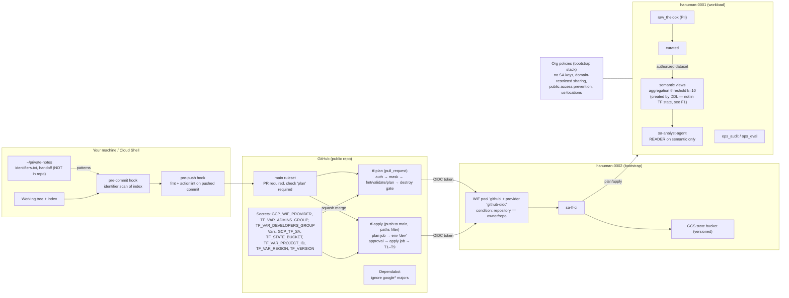

# Day 9 — Identifier incident closure, repo hardening, ADR-0001, Phase 1 close

> Repo: `bq-ai-analyst` · Dates: 2026-10-26 → 2026-10-27 · Tag at close: `phase1-complete` → `dfd409b`
> PRs covered: #20 (PR-2), #21 (PR-2b), #22 (PR-E), #26 (ADR-0001), #28 (test SUMMARY)

This file contains **no** organization ID, project number, folder ID, billing account, Cloud Identity customer ID, domain, or personal email. Project IDs (`hanuman-0001`, `hanuman-0002`) and the state bucket name appear on purpose: Day 9 recorded them as *accepted risk* (see §4.17).

---

## Contents

- [0. How to read this document](#0-how-to-read-this-document)
- [0.5 Review of Day 9: what I would change](#05-review-of-day-9-what-i-would-change)
- [1. Architecture on one page](#1-architecture-on-one-page)
- [2. Concepts primer](#2-concepts-primer)
- [3. Build-from-scratch walkthrough](#3-build-from-scratch-walkthrough)
- [4. Artifact-by-artifact deep dive](#4-artifact-by-artifact-deep-dive)
- [5. Decision tables](#5-decision-tables)
- [6. Verification](#6-verification)
- [7. Break-it labs](#7-break-it-labs)
- [8. Troubleshooting](#8-troubleshooting)
- [9. Reuse kit](#9-reuse-kit)
- [10. Self-test](#10-self-test)
- [11. Glossary and further reading](#11-glossary-and-further-reading)
- [12. Self-test answers](#12-self-test-answers)
- [13. What I was unsure about (verify these)](#13-what-i-was-unsure-about-verify-these)

---

## 0. How to read this document

**Audience.** A GCP data engineer who knows BigQuery, IAM and DLP well, knows what Terraform does, and has used Git only as `commit`/`push`. The goal is that you can defend every Day 9 decision in a design review and redo the work in a new project without this file open.

**Depth.** Each concept is defined the first time it appears. Commands are copied from what was actually run on Day 9, or from files in the repo. Anything not in the repo or the Day 9 session is marked **[ASSUMPTION]** or **[SUGGESTION]**.

**Prerequisites.** You should have read, or at least skimmed:
- `docs/day4_5.md` (dev stack, datasets, authorized access, DLP)
- `docs/day7.md` (semantic views, aggregation threshold, CI plan/apply, destroy gate)
- `docs/explanation.md` (bootstrap: org policies, WIF, state bucket)

**What Day 9 was, in one paragraph.** On Day 8 we discovered that identifiers (org ID, project numbers, billing account, domain, Cloud Identity customer ID) had been committed to a now-public repo and printed into public CI logs. Day 9 removed them from the current code, stopped CI from printing them, deleted the old logs, added guardrails so it cannot happen silently again, cleaned up CI configuration, ran a one-hour spike to decide the transformation tool (ADR-0001), and closed Phase 1 with a checkpoint and a Git tag.

**How to use the sections.**
- Rebuild in a new project: §3 + §9.
- Defend a choice: §4 + §5.
- Prove it works: §6.
- Build intuition: §7.
- Something broke: §8.

---

## 0.5 Review of Day 9: what I would change

You asked me to say plainly where the work is questionable. I re-read the repo at `dfd409b` after the session. These are ordered by importance. Two of them (F1, F3) trace back to my own guidance during the session.

| # | Finding | Severity | What I would do |
|---|---|---|---|
| **F1** | **ADR-0001's premise is wrong.** It says "A. Terraform-managed views (current)". The repo has **no** `google_bigquery_table` resources. The semantic views are created by hand-run DDL (`sql/semantic/*.sql` via `bq query`; see `docs/day7.md` §3.2). Terraform owns only the *datasets* and the *authorized-dataset grant* (`google_bigquery_dataset_access.semantic_reads_curated`). I introduced the wrong premise on Day 9 ("views as Terraform `google_bigquery_table` (current)") and it went into the ADR. Consequence: the decision "keep A" keeps a status quo that does not exist. The privacy views are outside state, outside plan, and outside CI. Today the only thing protecting them is the T1–T9 access test. | **High** | Supersede ADR-0001 with ADR-0002 (see §5.4). Whether the Google provider can express `privacy_policy` on a view is **[UNVERIFIED]**. If it can't, that's probably why Day 7 used DDL. That would make Dataform (which the spike *proved* works) the strongest candidate for the semantic views. Do this as Phase 2 Day 1–2 work. |
| **F2** | **Squash-merge commits still carry your personal email as the author.** `git log --format=%ae` on `main` shows a personal address for every merge commit. `git config user.email <noreply>` only affects commits you create in Cloud Shell. When GitHub creates a squash commit, it uses your account's email settings. | Medium (privacy) | GitHub → Settings → Emails: enable **Keep my email addresses private** *and* **Block command line pushes that expose my email**. Merges made afterwards use the noreply address. Existing history stays as it is (consistent with Option A, §4.17). |
| **F3** | **The `apply` job in `tf-apply.yml` has no mask step.** Only the `plan` job has one. The Day 9 log grep returned 0 hits only because the applies had **no changes**: Terraform prints resource IDs only for resources it modifies. The first real apply touching, for example, the DLP service-agent binding will print the project number unmasked. During the session I said both jobs need the step, but nobody checked it. | Medium (latent leak) | Copy the `Mask identifiers` step into the `apply` job, right after `auth`. Then prove it with Lab 7.6. |
| F4 | `SUMMARY` prints inside the `for` loop of `tests/access/test_semantic_access.py`, so it appears 9 times. The last line is correct, but a grep for "9/9" also matches nothing on a partial failure, which is the intent. | Low | Dedent the two `total=`/`print` lines to the same level as `return`. |
| F5 | `variables.tf`: the `folder_id` validation says `"org_id must be numeric."` (copy-paste). | Low | Fix the message. Wrong error text costs time during an incident. |
| F6 | Two files claim number 0001: `docs/adr/0001-sql-deploy.md` (a header-less tab-separated fragment) and `0001-transformation-layer.md`. | Low | Delete the fragment or renumber it. ADR numbers must be unique, because people cite them. |
| F7 | Guardrails are **client-side only**. The pre-commit/pre-push hooks run only in clones where `core.hooksPath` is set, depend on `~/private-notes/identifiers.txt` existing on that machine, and can be skipped with `--no-verify`. CI doesn't scan for identifiers. | Medium (design) | Add a server-side check. **[SUGGESTION]** A CI step that reads the patterns from a secret and runs `git grep -c -F -f`. Secrets can be multi-line, and the step prints only counts. Make it a required status check. |
| F8 | `tf-plan.yml` uses `vars.TF_VAR_project_id` / `vars.TF_VAR_region` (lowercase), while `tf-apply.yml` uses uppercase. It works because GitHub configuration-variable names are case-insensitive **[VERIFY]**. Six blank lines (5–10) remain where a `paths:` filter was removed. | Cosmetic | Normalise to uppercase and remove the blank lines. |
| F9 | `.gitignore`: `docs/*handoff*.md` appears twice; `.terraform.lock.hcl` is ignored on line 5 and re-included on line 17 (the lock files *are* tracked, which is correct); `*.json` is very broad. | Low | Tidy it. Keep the lock-file re-include and put a comment next to it. |
| F10 | `bootstrap` has **no CI at all**: no PR plan, no drift detection. Day 9 changes to it were proven only by a local "No changes". | Design note | Acceptable for one operator. **[SUGGESTION]** A read-only scheduled `terraform plan -detailed-exitcode` for bootstrap is the cheapest drift alarm. |
| F11 | Co-author trailers on #20 and #21 contain the literal placeholder `id+username@users.noreply.github.com`. | Cosmetic | Nothing to do (history is final). It's the visible trace of the "pasted placeholder" lesson. |
| F12 | `infra/bootstrap/terraform.tfvars.example` sets `region = ""`, although the variable has a default. Copying the example as-is overrides the default with an empty string. | Low | Remove `region` from the example, or put `"us-east4"` there. |

The rest of this document describes the repo **as it is**. Where it differs from what I'd do, the deep dive (§4) says so again in context.

---

## 1. Architecture on one page



**Elevator story (10 lines).**
1. Phase 1 built a governed BigQuery foundation: raw → curated → privacy-enforced semantic views that an AI agent can query.
2. Everything except the views is Terraform in two stacks: `bootstrap` (org, WIF, state) and `envs/dev` (datasets, grants, agent).
3. GitHub Actions plans every PR and applies `main` behind a human approval and a destroy gate, authenticating with OIDC, so no keys exist.
4. On Day 8 we found org-level identifiers in the public repo and in public CI logs.
5. Day 9 first moved every identifier into variables, so the code is clean and a "No changes" plan proves the refactor didn't change infrastructure.
6. Then CI was fixed so it can't print identifiers: values that GitHub must not show go in **secrets**, and runtime values are masked.
7. Old logs were deleted. Git history was deliberately left alone ("Option A"), because these are identifiers, not credentials.
8. Hooks now block an identifier from being committed and block unformatted or invalid CI files from being pushed.
9. A one-hour Dataform spike proved threshold views can be built natively there, recorded in ADR-0001 (premise needs correcting, F1).
10. Checkpoint #1 passed: both stacks show "No changes", 9/9 access tests, clean `main`, tag `phase1-complete`.

**Why this order.** Stop the bleeding (code, then CI output, then old logs), then prevent recurrence (hooks), then reduce noise (cleanup), then make the forward-looking decision (ADR), then prove and freeze (checkpoint, tag). Doing cleanup or the ADR first would have left a live leak running in every CI job.

---

## 2. Concepts primer

Only what Day 9 needs.

### 2.1 Identifier vs secret
- **Secret:** a value that grants access by itself: a key, password or token. Leaking one is an incident that needs rotation.
- **Identifier:** a value that names something: org ID, project number, billing account ID, domain, customer ID. It grants nothing by itself, but it helps reconnaissance (mapping your estate, targeting phishing, guessing resource names).
- *Example:* `projects/1234…/locations/global/workloadIdentityPools/github/providers/github-oidc` is an identifier. Knowing it doesn't let you mint a token, because the WIF condition still requires a token from *your* GitHub repo.
- Day 9 treated identifiers with secret-like hygiene (keep them out of public places) but without secret-like remediation (no history rewrite, nothing to rotate).

### 2.2 Terraform: variable, local, tfvars, validation
- **Input variable** (`variable "org_id" {}`): a named parameter of a stack. Its value comes from outside the code.
- **`terraform.tfvars`:** a file of `name = value` pairs that Terraform loads automatically. Here it's **untracked** (`.gitignore: *.tfvars`), so real values never enter Git.
- **`terraform.tfvars.example`:** a tracked copy with placeholder values that documents which inputs exist.
- **Local** (`locals { org_parent = "organizations/${var.org_id}" }`): a computed value inside the stack, so you write a pattern once.
- **Validation block:** a rule checked at plan time that rejects bad input with your own message.
  ```hcl
  variable "org_id" {
    type = string
    validation {
      condition     = can(regex("^[0-9]+$", var.org_id))
      error_message = "org_id must be numeric."
    }
  }
  ```

### 2.3 State and "No changes" as a refactor proof
- **State:** Terraform's record of which real resources it manages and their last-known attributes. Here it's stored in a versioned GCS bucket with locking.
- **Plan:** a comparison of *code + inputs* against *state + reality*.
- **Key idea:** if you replace a literal with a variable whose value is byte-identical, the plan shows **"No changes"**. That's the proof the refactor is safe. Any diff means a value doesn't match exactly (case, trailing space, a missing `@`).

### 2.4 Git: working tree, index, commit, branch, PR, squash, tag
- **Working tree:** the files on disk.
- **Index** (also called the staging area): what `git add` put aside for the next commit.
- **Commit:** a snapshot of the index.
- These three can differ. A hook that checks the working tree can pass while the commit is bad. That's why Day 9's hooks check the **index** (pre-commit) and the **pushed commit** (pre-push).
- **Branch:** a movable name for a line of commits. Work happens on `pr2-parameterize-ids`; `main` is protected.
- **Pull request (PR):** a request to merge a branch into `main`. Checks run on it.
- **Squash merge:** all PR commits become one commit on `main`. The history stays linear. GitHub creates the commit and sets the author email from your account settings, not your local `git config` (that's why F2 exists).
- **Ruleset:** GitHub branch protection. Here: changes to `main` only via PR, and the `plan` check must pass.
- **Tag:** a permanent name for a commit (`phase1-complete`). Here it's an annotated tag, so it stores a message, author and date.

### 2.5 GitHub Actions: workflow, job, step, vars vs secrets, masking
- **Workflow:** a YAML file in `.github/workflows/`.
- **Job:** a set of steps on one fresh runner (a VM).
- **Step:** a single command or action.
- **Configuration variable** (`vars.X`): plain text that shows in logs wherever it's printed, *including step headers*.
- **Secret** (`secrets.X`): encrypted; GitHub replaces its value with `***` anywhere in the log, including step headers.
- **`::add-mask::VALUE`:** a log command that tells the runner to replace `VALUE` with `***` in **later** output of **this job only**. It can't retroactively mask earlier lines, and masks don't carry over to other jobs.
  ```bash
  echo "::add-mask::$PN"   # from here on, $PN prints as ***
  ```

### 2.6 Workload Identity Federation (WIF) and OIDC
- **OIDC token:** a signed statement from GitHub ("this is a run of repo X on ref Y").
- **WIF:** Google exchanges that token for short-lived credentials for `sa-tf-ci`, but only if the pool's **attribute condition** matches (`assertion.repository == "owner/repo"`).
- Result: no service-account keys exist anywhere, and an org policy forbids creating them.

### 2.7 Git hooks and `core.hooksPath`
- **Hook:** a script Git runs at a lifecycle point. A non-zero exit aborts the operation.
- By default hooks live in `.git/hooks/`, which isn't versioned. `git config core.hooksPath .githooks` points Git at a **versioned** folder, so hooks are reviewable in PRs.
- Each clone has to run that config command once. It isn't automatic.

### 2.8 Paths filter
`on.push.paths` makes a workflow run only if the push changed matching files. It saves CI time, and it decides **what CI proves**: a change outside the filter is never applied or tested.

### 2.9 Dependabot and semver
- **Semver:** `MAJOR.MINOR.PATCH`. A major bump (7 → 8) may contain breaking changes.
- **Dependabot:** opens PRs to bump dependencies. `ignore … version-update:semver-major` suppresses major bumps so upgrades become a deliberate project, not a weekly surprise.

### 2.10 Aggregation threshold and authorized dataset
- **Aggregation threshold policy:** a BigQuery view option. Queries must use `SELECT WITH AGGREGATION_THRESHOLD`, and groups with fewer than *k* distinct privacy units are suppressed. Here k = 10, with `privacy_unit_column = privacy_unit`.
- **Authorized dataset:** a grant on `curated` that lets **views** in `semantic` read it (`target_types = ["VIEWS"]`), so the agent never needs access to `curated` itself.

### 2.11 ADR and spike
- **ADR (Architecture Decision Record):** a short file recording context, options, decision, and consequences.
- **Spike:** a time-boxed throwaway experiment that answers one question before you commit to a direction.

---

## 3. Build-from-scratch walkthrough

This rebuilds the **Day 9 end state** in a new environment, with Day 9's lessons applied from the start instead of retrofitted. Days 1–8 content (datasets, DLP, views, golden set) is referenced, not repeated.

**Conventions.** `$` lines are commands. "Expect" is the success signal. Paste **commands** into the terminal; paste **HCL, YAML or Python** into the editor or a quoted heredoc (§8, E1).

### Stage 0 — Prerequisites (manual, once)

| Step | Action | Expect | Why first |
|---|---|---|---|
| 0.1 | A Cloud Identity org with a folder, two projects (bootstrap, workload), billing linked. Groups: `gcp-admins`, `gcp-billing`, `gcp-developers`. | The console shows both projects under the folder | Everything below references these |
| 0.2 | Cloud Shell or a workstation with `gcloud`, `terraform` (pinned to `vars.TF_VERSION`, 1.16.6 here), `gh`, `docker`, `python3` | `terraform version` prints the pinned version | Version mismatches cause lock-file churn |
| 0.3 | GitHub → Settings → Emails: **Keep my email addresses private** + **Block command line pushes that expose my email** | The setting is on | Prevents F2 from the first commit |
| 0.4 | `git config user.email "$(gh api user -q '"\(.id)+\(.login)@users.noreply.github.com"')"` | `git config user.email` matches `^[0-9]+\+<login>@users\.noreply\.github\.com$` | Same reason, for local commits |

### Stage 1 — Private notes and the pattern file (before the first commit)

```bash
mkdir -p ~/private-notes/scratch && chmod 700 ~/private-notes
umask 077
# After bootstrap exists (Stage 3), populate from live lookups — never by typing values:
{
  echo "$ORG_ID"
  echo "$PROJECT_NUMBER"                                                    # workload
  gcloud projects describe "$BOOTSTRAP_PROJECT" --format='value(projectNumber)'
  echo "$FOLDER_ID"
  echo "$BILLING_ID"
  gcloud organizations describe "$ORG_ID" --format='value(displayName)'     # = domain for Cloud Identity
} > ~/private-notes/identifiers.txt
# add admin/user emails and the customer ID (C0…) by extracting from a file, not retyping
grep -c '^$' ~/private-notes/identifiers.txt   # expect 0 — an empty line matches EVERYTHING
sort -u -o ~/private-notes/identifiers.txt ~/private-notes/identifiers.txt
wc -l ~/private-notes/identifiers.txt          # Day 9 ended at 9 patterns
```
**Why now:** the hooks in Stage 2 need this file. Without it, the pre-commit hook refuses every commit (by design).
**Day 9 trap:** the first version contained the literal placeholders `<ORG_ID>` and so on, which matched only already-redacted docs. That produced a baseline that looked valid but wasn't (§8, E2). The `directoryCustomerId` lookup also returned empty, so the customer ID was missed until it showed up in a file (E9).

### Stage 2 — Repo skeleton and hooks

```bash
mkdir -p bq-ai-analyst && cd bq-ai-analyst && git init -b main
mkdir -p .githooks infra/bootstrap infra/envs/dev scripts tests/access docs/adr .github/workflows
```
`.gitignore` (minimum, from the repo):
```gitignore
*.tfstate
*.tfstate.*
.terraform/
*.tfvars
.env
*.pem
# private working notes never live in the repo
private/
docs/*handoff*.md
docs/process.md
```
**Note:** do **not** ignore `.terraform.lock.hcl`. The repo ignores it, then re-includes it with `!.terraform.lock.hcl` (F9). Write it simply and track it.

Create the hooks with heredocs (the quoted `'EOF'` means nothing inside is executed):
```bash
cat > .githooks/pre-commit <<'EOF'
#!/usr/bin/env bash
set -euo pipefail
pat="$HOME/private-notes/identifiers.txt"
[[ -s "$pat" ]] || { echo "identifiers.txt missing — refusing commit"; exit 1; }
if git grep --cached -l -F -f "$pat"; then echo "Identifier staged — blocked"; exit 1; fi
EOF

cat > .githooks/pre-push <<'EOF'
#!/usr/bin/env bash
set -euo pipefail
while read -r _ local_sha _ _; do
  [[ "$local_sha" =~ ^0+$ ]] && continue
  tmp="$(mktemp -d)"; trap 'rm -rf "$tmp"' EXIT
  git archive "$local_sha" | tar -x -C "$tmp"
  terraform fmt -check -recursive "$tmp/infra"
  ( cd "$tmp" && docker run --rm --user "$(id -u):$(id -g)" -v "$tmp:/repo" -w /repo rhysd/actionlint:latest -color $(ls .github/workflows/*.yml) )
done
EOF
chmod +x .githooks/*
git config core.hooksPath .githooks
git config core.hooksPath     # expect: .githooks
```
**Why before any Terraform:** the first commit is the most likely to contain a pasted literal.
**Note:** the pre-push hook expects `.github/workflows/*.yml` to exist, so create the workflows (Stage 5) before your first push.

### Stage 3 — Bootstrap stack (parameterized from line one)

Files (copy from the repo; values come only from variables):

| File | Role |
|---|---|
| `versions.tf` | Terraform ≥ 1.9, `hashicorp/google ~> 7.0`, provider with `user_project_override` |
| `backend.tf` | `backend "gcs" { prefix = "bootstrap" }`; bucket passed at init |
| `variables.tf` | `org_id`, `folder_id`, `billing_account`, `bootstrap_project`, `workload_project`, `domain`, `github_repo`, `region`, `customer_id`, **each with validation** (§4.3) |
| `iam_groups.tf` | `locals { admins, billing, developers, folder, org_parent }` + group bindings |
| `org_policies_existing.tf` | Imported org policies; every `name`/`parent` uses `local.org_parent`; `allowed_values = [var.customer_id]`; `allowedDomains = ["@${var.domain}"]` |
| `org_policies_new.tf` | Public-access prevention (org), resource locations `in:us-locations` (folder) |
| `state.tf` | Versioned, UBLA, PAP-enforced state bucket |
| `wif.tf` | WIF pool/provider with repository condition, `sa-tf-ci`, its project roles |
| `terraform.tfvars.example` | Placeholders only (`customer_id = "C00000000"`) |

```bash
cd infra/bootstrap
cp terraform.tfvars.example terraform.tfvars      # fill real values in the EDITOR
git check-ignore -v terraform.tfvars              # expect: .gitignore:…:*.tfvars  terraform.tfvars
terraform init -backend-config="bucket=<state-bucket>"   # first run: local state, then migrate (see docs/explanation.md)
terraform fmt && terraform validate
terraform plan -parallelism=4 -compact-warnings 2>&1 | tail -1
```
Expect on a re-run: `…found no differences, so no changes are needed.`
**Why before dev:** dev authenticates through WIF and stores state in the bucket this stack creates.

### Stage 4 — `scripts/env.sh` (runtime lookups, prints no values)

Copy `scripts/env.sh` from the repo. It anchors on the two project IDs (accepted as non-sensitive) and derives everything else at runtime:
```bash
source scripts/env.sh
# expect 8 lines "X: set" and no "WARN"
```
**Why:** scripts need the org ID, folder and billing values, but these must never be literals in the repo. Deriving them from `gcloud` keeps the code clean and stays correct when you move projects.

### Stage 5 — GitHub configuration and workflows

```bash
# Secrets (values never echoed; piped from Terraform outputs or files)
terraform -chdir=infra/bootstrap output -raw wif_provider | gh secret set GCP_WIF_PROVIDER
printf '%s' "gcp-admins@<domain>"     | gh secret set TF_VAR_ADMINS_GROUP      # type in a private shell, or pipe from tfvars
printf '%s' "gcp-developers@<domain>" | gh secret set TF_VAR_DEVELOPERS_GROUP
# Variables (plain, may appear in logs)
gh variable set GCP_TF_SA        --body "$(terraform -chdir=infra/bootstrap output -raw tf_ci_sa)"
gh variable set TF_VAR_PROJECT_ID --body "hanuman-0001"
gh variable set TF_VAR_REGION     --body "us-east4"
gh variable set TF_VERSION        --body "1.16.6"
gh variable set TF_STATE_BUCKET   --body "hanuman-0002-tfstate"
gh secret list && gh variable list
```
**Rule:** anything that goes into the `with:` of `google-github-actions/auth`, or that's an org-level identifier, must be a **secret** (§4.7).

Workflows: copy `tf-plan.yml` and `tf-apply.yml` from the repo. Then **add the mask step to the `apply` job as well** (fix F3):
```yaml
      - uses: google-github-actions/auth@v3
        with:
          workload_identity_provider: ${{ secrets.GCP_WIF_PROVIDER }}
          service_account: ${{ vars.GCP_TF_SA }}
      - name: Mask identifiers
        env:
          TF_VAR_ADMINS_GROUP: ${{ secrets.TF_VAR_ADMINS_GROUP }}
        run: |
          PN="$(gcloud projects describe "${{ vars.TF_VAR_PROJECT_ID }}" --format='value(projectNumber)')"
          test -n "$PN" || { echo "project number lookup failed"; exit 1; }
          echo "::add-mask::$PN"
          DOMAIN="${TF_VAR_ADMINS_GROUP#*@}"
          echo "::add-mask::$DOMAIN"
```
Lint before pushing:
```bash
docker run --rm -v "$PWD:/repo" -w /repo rhysd/actionlint:latest -color   # expect: no output
```
Then, in the GitHub UI: create the environment **`dev`** with yourself as a required reviewer, and a **ruleset** on `main` (require PR, require status check `plan`, block force-push). **Why last in this stage:** the required check name `plan` only becomes selectable after the workflow has run once.

`dependabot.yml`: copy from the repo (ignores `hashicorp/google*` majors in both stacks).

### Stage 6 — Dev stack, views, access tests

1. `infra/envs/dev`: copy the files and `terraform.tfvars` (untracked); `init`, `plan` → apply via PR.
2. Load the data and create the curated tables and semantic views per `docs/day4_5.md` and `docs/day7.md`. **Note F1:** the views are created by DDL (`sql/semantic/*.sql`), outside Terraform.
3. Access test: `tests/access/test_semantic_access.py` impersonates `sa-analyst-agent` and runs T1–T9.

```bash
python3 tests/access/test_semantic_access.py | tail -2     # expect last line: SUMMARY 9/9 passed
```

### Stage 7 — Prove and freeze

Run §6 in full. Then:
```bash
git tag -a phase1-complete -m "Phase 1: governed BigQuery foundation — …"
git push origin phase1-complete
```
**Why a tag and not a branch:** a tag is meant never to move. It's a citation point for the portfolio and for "what did Phase 1 ship". (It *was* moved once on Day 9, with `-f`, because it had been created before the final check passed. See E21.)

---

## 4. Artifact-by-artifact deep dive

Format per item: **What · Why here · Why this form · Alternatives · Trade-offs · If skipped · Soundbite.**
Skipped as trivial: `requirements-dev.txt` (one line), the PR body text, and `chmod +x`.

### 4.1 `~/private-notes/identifiers.txt` (pattern file)
- **What:** a list of literal sensitive values, one per line, stored outside the repo.
- **Why here:** you can't search for "identifiers" generically. You need the exact strings to prove absence (`git grep -F -f`).
- **Why this form:** `-F` means fixed strings (no regex surprises from dots or dashes). One per line, no blank lines, because an empty pattern matches every line. Mode 700/600 via `umask 077`. Populated from `gcloud` lookups so the values are never retyped.
- **Alternatives:**
  1. **gitleaks/trufflehog with custom regexes** (e.g. `\b\d{12}\b` for project numbers). Wins in a team, because it's shareable and runs in CI. Loses because regexes for numeric IDs give many false positives.
  2. **GitHub secret scanning custom patterns.** Wins because it's server-side and works on push. Loses because custom patterns are an Advanced Security feature for organization repos **[VERIFY plan availability]**.
  3. **Store the pattern file as a CI secret.** Wins because the server-side check (F7) has the same source of truth. Loses because there are two copies to keep in sync.
- **Trade-offs:** zero cost and exact matches, but it only exists on one machine. A new clone has no protection until it's copied.
- **If skipped:** the incident can't be *proven* closed. "I removed the IDs" stays a claim.
- **Soundbite:** "I made the leak measurable: a private exact-match pattern list, generated from live lookups so nothing was retyped. 'Fixed' meant the scan of `origin/main` and of the latest CI log both returned zero."

### 4.2 Baseline scan: `git grep -c -F -f … HEAD -- ':/'`
- **What:** counts pattern hits per file in a commit, across the whole repo.
- **Why here:** it turned "clean up identifiers" into a work list (it started at 4 files, 20 hits) and a pass/fail gate.
- **Why this form:** `-c` prints counts, never values, so the output is safe to share. `HEAD` / `--cached` / `origin/main` pick which snapshot you're checking. `-- ':/'` means "from the repo root". Without it, `git grep` searches only the current directory (E4).
- **Alternatives:** `grep -r` (also searches untracked files and `.terraform/`, which is noisy); `git log -S` (searches history, a different question).
- **Trade-offs:** fast and exact. It misses values split across lines or encoded differently.
- **If skipped:** you fix the files you remember and miss `scripts/env.sh`, which is what happened before the root-scoped re-run.
- **Soundbite:** "I scanned three snapshots on purpose: the index before commit, `HEAD` before push, and `origin/main` after merge, because each can differ."

### 4.3 Bootstrap variables with validation
- **What:** `variables.tf` declares nine inputs; five have regex validation (`org_id`, `folder_id`, `billing_account`, `domain`, `customer_id`).
- **Why here:** removing literals moves the risk to inputs. On Day 7, a value with a pasted `# comment` got into a variable. Validation fails fast with a clear message before any API call.
- **Why this form:** the regexes match each identifier's real shape (numeric org and folder; `XXXXXX-XXXXXX-XXXXXX` uppercase hex billing; bare domain; `C0…` customer ID). No `default`, so a missing value forces a decision.
- **Alternatives:**
  1. **No validation**, relying on API errors. Loses: errors arrive late and are cryptic.
  2. **`precondition` blocks on resources.** Wins when a rule involves several values. Loses for simple shape checks (more verbose, runs later).
  3. **Typed objects** (`variable "org" { type = object({...}) }`). Wins for many related inputs; overkill here.
- **Trade-offs:** a regex that's too strict blocks a legitimate value (for example lowercase hex). The rule from the session: fix the regex, not the value.
- **If skipped:** `Error 400: Invalid value for field…`, or worse, a silently wrong binding like `group:gcp-admins@example.com # comment`.
- **Note F5:** the `folder_id` error text says `org_id`.
- **Soundbite:** "Parameterizing moves risk from the code to the inputs, so I validated the inputs: each identifier gets a shape check and a human error message, and there are no defaults, so nothing is silently assumed."

### 4.4 `locals.org_parent` and the `sed` refactor of imported org policies
- **What:** `org_parent = "organizations/${var.org_id}"`, used as `parent` on all seven imported policies. The literal IDs in the generated comments became `<ORG_ID>`.
- **Why here:** `terraform plan -generate-config-out` (Day 3) wrote the org ID into every block and comment: 14 of 20 hits.
- **Why this form:** one local, defined once in the existing `locals` block. Three deterministic `sed` commands (comments, then policy-name prefixes, then `parent` literals), checked by `git diff --stat` = 14/14. The editor was used for the three one-off lines.
- **Alternatives:** hand-edit every line (error-prone across 14 hits); a module per policy (cleaner long-term, much more work); `for_each` over a map of policies (best end state; changes resource addresses, so it needs `moved` blocks).
- **Trade-offs:** `sed` is fast but blind. That's why there's a diff-count check and a "No changes" gate after it.
- **If skipped:** 15 hits remain in the most-read bootstrap file.
- **Soundbite:** "Generated config hardcodes whatever it imported. I factored the org into one local and proved the rewrite was behaviour-neutral with a no-change plan."

### 4.5 `terraform.tfvars` (untracked) and `.example` (tracked)
- **What:** real values vs documented placeholders.
- **Why here:** the code must stay identifier-free, but Terraform still needs the values.
- **Why this form:** `*.tfvars` is ignored, which `git check-ignore -v` proves. The example uses obviously fake values (`C00000000`, empty strings).
- **Alternatives:** `TF_VAR_*` environment variables (good in CI, invisible locally); Secret Manager + a `data` source (overkill for identifiers, and it couples plan to Secret Manager IAM); a separate private repo for tfvars (teams).
- **Trade-offs:** the values live on one machine. Back them up in `~/private-notes`.
- **If skipped:** an identifier goes back into Git the first time someone "just sets a default".
- **Soundbite:** "Values are configuration, not code. The repo ships a contract, the `.example`; each operator supplies the values."

### 4.6 `scripts/env.sh`
- **What:** a sourced script that exports project IDs and derives the project number, folder, org and billing at runtime. It prints only `X: set`.
- **Why here:** the old version had a literal, read `gcloud config` (fragile), echoed values, and chose *any* billing account (`--limit=1`).
- **Why this form:** anchor on project IDs (accepted risk), derive the rest from the project itself (`get-ancestors`, `billing projects describe`). No `set -e`, because the file is **sourced**: `set -e` would close your interactive shell on the first error (E1). A `PROJECT` alias keeps `day5_load_thelook.sh` working.
- **Alternatives:** a `.env` file (untracked; simplest, but values go stale); `direnv` (automatic per directory; another tool); Terraform outputs (`terraform output -raw`; needs an initialised stack).
- **Trade-offs:** each `source` makes 4 API calls (about 2 seconds).
- **If skipped:** scripts break silently with empty variables. The Day 9 `PROJECT_ID` came back empty and cascaded into four failures (E12).
- **Soundbite:** "Scripts get identifiers the same way Terraform does, from authoritative lookups at runtime, and they say 'set', never the value."

### 4.7 WIF provider as a **secret** (PR-2b, #21)
- **What:** `GCP_WIF_PROVIDER` moved from `vars` to `secrets`; the workflows reference `secrets.GCP_WIF_PROVIDER`.
- **Why here:** **root cause of the CI leak.** `google-github-actions/auth@v3` prints its `with:` inputs in the step header *before* any later step can call `::add-mask::`. The provider path contains the bootstrap project number.
- **Why this form:** only GitHub secrets are masked *everywhere*, step headers included. The old variable was deleted **after** the merge. During the session it was deleted early, which would have broken `main` until the merge (E15).
- **Alternatives:**
  1. **Move the mask step before auth.** It can't work, because it needs gcloud credentials to look up the number, and the header prints anyway.
  2. **Use the provider's *pool ID* form or a project-ID-based name.** WIF provider resource names always use the project **number**.
  3. **Mask via a repo-level secret holding just the number.** It works, but it's a second secret to keep in sync.
- **Trade-offs:** secrets are write-only in the UI, so they're harder to inspect. `gh variable get X | gh secret set X` moves a value without printing it.
- **If skipped:** every run (49 of them) prints the project number in a public log.
- **Soundbite:** "Masking is temporal: it only hides what's printed after it. Auth inputs print first, so anything in the auth `with:` must be a secret."

### 4.8 Mask step (`::add-mask::`)
- **What:** looks up the project number and derives the domain from the admins-group secret, then masks both.
- **Why here:** Terraform refresh lines print these values (DLP service-agent ID, group emails) and aren't secrets themselves.
- **Why this form:** placed **after** auth (needs credentials) and **before** `setup-terraform`. `test -n "$PN"` fails the job if the lookup returns empty; otherwise the job would continue unmasked. The domain is derived from a secret, not stored as a literal.
- **Alternatives:** `terraform plan … | sed` redaction (fragile; breaks exit codes unless `pipefail`); run plans with `-no-color` and upload as artifacts only (hides useful logs); make the repo private (removes the threat model entirely; loses the portfolio value).
- **Trade-offs:** per-job, so every job that runs Terraform needs it. **F3: the `apply` job doesn't have it.**
- **If skipped:** the first apply that modifies an IAM binding prints the project number.
- **Soundbite:** "I mask identifiers per job, fail closed if the lookup is empty, and prove it by grepping the downloaded log against the pattern file: zero hits, not 'looks fine'."

### 4.9 Deleting old run logs
- **What:** a loop calling `DELETE /repos/{owner}/{repo}/actions/runs/{id}/logs` for every completed run before #21 (49 runs).
- **Why here:** those logs were public and contained the project number.
- **Why this form:** list first into `runs_to_clean.txt`, review the count, then delete (deletion is irreversible); spot-check 3 → `404`. Deleting only the logs keeps the run records, so the audit trail stays.
- **Alternatives:** delete whole runs (`DELETE …/runs/{id}`; also removes run metadata); repo-level log retention (default 90 days) (passive, slow); make the repo private (hides but doesn't delete).
- **Trade-offs:** anyone who already downloaded the logs keeps them. Treat the exposure as having happened.
- **If skipped:** the leak stays live even though the code is clean.
- **Soundbite:** "Fixing the source isn't enough. Published outputs are a second copy, so I enumerated, reviewed and deleted them, then spot-checked for 404."

### 4.10 Moving private notes out of the repo
- **What:** `docs/handoff.md`, `docs/day8_handoff.md` and `docs/process.md` were copied to `~/private-notes` and removed with `git rm`; `.gitignore` covers them.
- **Why here:** working notes contain folder names, history and context that a public portfolio doesn't need.
- **Why this form:** copy first, then remove, then ignore, so a recreated file can't be re-added by accident.
- **Alternatives:** a private Gist or repo (shareable, synced); Notion or Docs (searchable); a `docs/private/` path, ignored (risky, one `git add -f` away from a leak).
- **Trade-offs:** notes are no longer versioned. **[SUGGESTION]** `git init` inside `~/private-notes` for local history.
- **If skipped:** every redaction pass has to re-scan the notes forever.
- **Soundbite:** "Public repo, private notebook. The repo holds what a reviewer needs; operational notes live where a mistake can't publish them."

### 4.11 Pre-commit hook (identifier scan of the index)
- **What:** blocks a commit if any staged file contains a pattern. It prints file names only (`-l`).
- **Why here:** the cheapest place to stop a leak is before it becomes a commit.
- **Why this form:** `--cached` scans the **index**, which is what will actually be committed. Fail closed if the pattern file is missing.
- **Alternatives:** `pre-commit` framework + gitleaks (standard in teams, multi-language); server-side CI scan (can't be bypassed; slower feedback); GitHub push protection (server-side; pattern-based).
- **Trade-offs:** `--no-verify` bypasses it, and it only exists in configured clones (F7).
- **If skipped:** detection only happens after publication.
- **Soundbite:** "A local hook is a seatbelt, not a guarantee. It catches honest mistakes at zero cost, and the server-side check is the guarantee."

### 4.12 Pre-push hook (fmt + actionlint on the **pushed commit**)
- **What:** for each pushed SHA, it extracts that commit into a temp directory with `git archive`, then runs `terraform fmt -check -recursive` and `actionlint`.
- **Why here:** two Day 9 failures: unformatted HCL and a workflow with a split `auth` step that parsed as YAML but failed GitHub's schema, so the PR check never appeared (E14).
- **Why this form:** it checks the commit, not the working tree, which you can fix without committing (proven by the negative test). `--user "$(id -u):$(id -g)"` because `mktemp -d` is owner-only and the container user couldn't read it (E19). Workflow files are passed explicitly because the archive has no `.git` (E18). The branch-delete SHA (`0000…`) is skipped.
- **Alternatives:** run the same checks in CI only (slower feedback, a commit on the branch); `pre-commit` hooks (checks the index, not the pushed range); editor plugins (they don't enforce anything).
- **Trade-offs:** needs Docker; adds a few seconds per push.
- **If skipped:** "workflow file issue" failures in 0 s, with no required check, and a PR that can't merge.
- **Soundbite:** "My pre-push hook validates exactly what leaves my machine: it archives the pushed commit and lints that, so a fixed-but-uncommitted file can't fool it."

### 4.13 `core.hooksPath .githooks`
- **What:** points Git at the versioned hooks folder.
- **Why:** `.git/hooks` isn't committed, so hooks there can't be reviewed or shared.
- **Alternatives:** symlinks into `.git/hooks`; the `pre-commit` framework's installer; Husky (Node projects).
- **If skipped:** the hooks exist in the repo but never run. An old `.git/hooks/pre-push` was retired to `~/private-notes/scratch` so it didn't shadow the new one.
- **Soundbite:** "Hooks are code, so they live in the repo and are reviewed. Each clone opts in with one config line."

### 4.14 Repository variables consolidation and removing `wif-smoke.yml`
- **What:** five variables deleted (`WIF_PROVIDER`, `TF_CI_SA`, `PROJECT_ID`, `TF_VAR_ADMINS_GROUP`, `TF_VAR_DEVELOPERS_GROUP`). Remaining: `GCP_TF_SA`, `TF_STATE_BUCKET`, `TF_VAR_PROJECT_ID`, `TF_VAR_REGION`, `TF_VERSION`. `wif-smoke.yml` (manual workflow) deleted.
- **Why here:** duplicates are drift waiting to happen. Two variables held full group emails in plain text, one with a pasted comment. `wif-smoke` referenced the old unmasked provider variable, so it was a second leak path.
- **Why this form:** list the variables, list the references (`git grep -o 'vars\.[A-Z_]*'`), and keep the intersection. `wif-smoke` was redundant because every `tf-plan` run does `terraform init` against remote state through WIF, which is the real smoke test.
- **Alternatives:** keep `wif-smoke` and convert it to secrets (useful when no Terraform workflow exists yet); move variables to the `dev` *environment* scope (better when you add `prod`).
- **If skipped:** the next person edits one of two `PROJECT_ID`s and CI half-changes.
- **Soundbite:** "Every config value has exactly one name, and anything identifying lives in a secret. I deleted the workflow whose only job is now done better by the plan."

### 4.15 `tf-apply` paths filter: `tests/access/**`, `requirements-dev.txt`
- **What:** changes to the tests now trigger the apply workflow, which runs T1–T9.
- **Why here:** PR-E changed the test script and produced no CI run, so CI never proved it (E20).
- **Alternatives:** a separate `access-tests` workflow on every push to `main` (cleaner separation; a second WIF login); `workflow_dispatch` on `tf-apply` (manual re-verify) **[SUGGESTION]**; no paths filter (applies on every push; noisier approvals).
- **Note:** `tf-plan` deliberately has **no** paths filter. A *required* check that doesn't run because of a filter stays "expected" forever and blocks the merge.
- **Soundbite:** "A paths filter defines what CI proves. If the tests aren't in it, changing the tests proves nothing."

### 4.16 Dependabot `ignore` for `hashicorp/google*` majors
- **What:** suppresses semver-major PRs for `google` and `google-beta` in both stacks. #12 (google 8.x) and the google-beta major PR were closed with "Deferred to Phase 2".
- **Why here:** provider 8.x has breaking changes, and Dependabot PRs can't run `plan` (no access to secrets), so they'd sit red forever.
- **Why this form:** the wildcard covers both providers; patch and minor bumps still flow.
- **Alternatives:** a version cap in `versions.tf` (`~> 7.0` already does that; Dependabot still proposes the PR); Renovate (grouping, schedules, auto-merge); pin exact versions (maximum stability, no security patches).
- **Trade-offs:** the major upgrade becomes a tracked task (Deferred list), not an automatic prompt.
- **Soundbite:** "Minors and patches flow automatically; majors are planned work with their own plan review."

### 4.17 History decision: Option A (keep history), final
- **What:** identifiers remain in old commits; no `git filter-repo`, no force-push. `backup-local-main` was deleted.
- **Why:** they're identifiers, not credentials. They'd been public for more than 3 days. A rewrite can't purge forks, caches or PR refs (`refs/pull/*`) without GitHub Support, and access is controlled by IAM, the WIF repository condition and org policies.
- **Alternatives:**
  1. **Option B: rewrite** (`git filter-repo --replace-text`) + force-push + Support purge. Wins if a credential leaked, or if policy requires it.
  2. **Make the repo private.** Wins if the portfolio value doesn't matter.
  3. **Delete and recreate the repo.** Loses PR history and links.
- **Trade-offs:** residual reconnaissance value stays public; you accept it explicitly.
- **If you get this wrong the other way:** a rewrite costs a day, breaks clones, and still leaves copies around.
- **Soundbite:** "I matched the remediation to the asset. Credentials get rotated and purged; identifiers get removed going forward, with the residual risk documented and the real controls (IAM, WIF conditions, org policies) verified."

### 4.18 ADR-0001 and the Dataform spike
- **What:** a one-hour spike rebuilt `semantic.web_events` in a scratch dataset `df_spike` two ways: Dataform typed `view` with `bigquery.additionalOptions.privacy_policy`, and `operations` DDL. Both carried `aggregationThresholdPolicy`. T9 = 518/518. A non-aggregate `SELECT` was rejected. The scratch dataset was dropped, and dev plan showed "No changes".
- **Why here:** before Phase 2 adds more models, decide which tool owns transformation SQL.
- **Why this form:** a scratch dataset (never `semantic`), the CLI with your ADC (no new service account, no Terraform change), and a parity test against a known number.
- **Alternatives:** Terraform `google_bigquery_table` views; scripted DDL in CI (`bq query` as `sa-tf-ci`); dbt-bigquery; Dataform.
- **The problem (F1):** the ADR compares against "Terraform-managed views (current)", which isn't the current state. The correct comparison and recommendation are in §5.4.
- **Spike near-miss:** the first `web_events.sqlx` contained the **full Terraform-era DDL targeting `semantic.web_events`** inside the Dataform statement. It failed only on syntax. A syntactically valid version would have replaced the production privacy view (E22). Lesson: check `dataform compile` output for target names before `run`.
- **Soundbite:** "I ran a one-hour spike against a parity number: same threshold policy, same suppressed total, 518. That changed the question from 'can Dataform do privacy views?' to 'who should own them?'"

### 4.19 Test `SUMMARY` line (#28)
- **What:** prints `SUMMARY n/9 passed` so CI results can be grepped.
- **Why:** the earlier check looked for `passed` and found nothing, because the script isn't pytest.
- **Why this form:** derived from `len(CASES)` and the existing `failed` counter. The first attempt printed **after** `return` (unreachable) and referenced undefined names (E23). **F4:** the fixed version is still inside the loop.
- **Alternative:** convert to pytest with JUnit XML (standard reporting; more structure than nine cases need now).
- **Soundbite:** "Every test run ends with one machine-readable line, so the checkpoint is a grep, not a judgment call."

### 4.20 Tag `phase1-complete`
- **What:** an annotated tag on `dfd409b`.
- **Why:** a stable citation for "end of Phase 1" (portfolio, blog, Phase 2 diffs: `git diff phase1-complete..main`).
- **Alternatives:** GitHub Release (adds notes and assets; built on a tag); a long-lived branch (it moves, so it's a bad marker).
- **Note:** tags aren't covered by the `main` ruleset here, which is why `git push -f origin phase1-complete` worked. **[SUGGESTION]** Add a tag ruleset that blocks updates and deletes now that it's final.
- **Soundbite:** "Phase boundaries are tagged commits, so 'what did Phase 1 deliver' is one `git diff` away."

---

## 5. Decision tables

### 5.1 Where a value lives

| Value type | Taken | Alternatives | Switch when |
|---|---|---|---|
| Credentials | Don't exist (WIF + no-key org policy) | SA keys in secrets | Never, unless a third-party system can't do OIDC |
| Auth inputs (WIF provider path) | GitHub **secret** | Variable + mask | Never: inputs print before masks |
| Org identifiers in Terraform | Untracked `tfvars` + validated variables | `TF_VAR_*` env vars; Secret Manager | Team > 2 or multiple operators → env-scoped CI secrets |
| Group emails in CI | Secrets | Variables | Domain is public anyway → variables are fine |
| Project ID, region, TF version | Variables | Secrets | Policy classifies project IDs as sensitive |

### 5.2 Leak remediation by asset type

| Asset leaked | Remediation | History rewrite? |
|---|---|---|
| Key, token, password | Rotate immediately, then purge | Yes, plus Support purge |
| Org identifiers (this case) | Remove going forward, mask CI, delete logs, document | **No** (Option A) |
| PII sample data | Delete, purge, assess notification duty | Yes; involve privacy/legal |

**Rule:** remediation scales with what the value *grants*, not with how uncomfortable it feels.

### 5.3 Guardrail placement

| Layer | Taken | Bypassable? | Add when |
|---|---|---|---|
| Pre-commit hook | Identifier scan | Yes (`--no-verify`, unconfigured clone) | Always (cheap) |
| Pre-push hook | fmt + actionlint | Yes | Always |
| CI required check | `plan` (fmt, validate, plan, destroy gate) | No (ruleset) | Already there |
| CI identifier scan | **Missing (F7)** | No | Second contributor or any compliance need: do it now |
| Environment approval | `dev` reviewer on apply | No | Already there; add `prod` with 2 reviewers |

### 5.4 Transformation layer (corrected ADR comparison)

| Option | Privacy view support | State/drift visibility | Current? | Wins when |
|---|---|---|---|---|
| **0. Hand-run DDL (`bq query`)** | Native (it's DDL) | **None**; only T1–T9 detect breakage | **Yes (actual today)** | Prototype, one operator |
| A. Terraform `google_bigquery_table` view | **[UNVERIFIED]** whether the provider exposes `privacy_policy` | Full (plan shows drift) | No | Few views, provider supports the option |
| A′. Scripted DDL in CI (`bq query` as `sa-tf-ci`, per `0001-sql-deploy.md`) | Native | Weak (idempotent re-run, no diff) | No | Quick improvement over 0 with no new tool |
| B. Dataform | **Proven** (spike: `additionalOptions`) | Good (compiled graph, assertions, lineage) | No | >1 view, a DAG, assertions, more contributors |
| C. dbt-bigquery | Via config/DDL | Good | No | Multi-cloud teams already on dbt |

**My recommendation:** supersede ADR-0001 with ADR-0002, "Semantic views move from hand-run DDL to Dataform (or to Terraform if the provider supports `privacy_policy`); authorized-dataset grants stay in Terraform." Interim step: run the existing `sql/semantic/*.sql` from CI (A′), so the views are at least reproducible.

### 5.5 Dependency upgrades

| Bump | Policy | Switch when |
|---|---|---|
| Patch/minor | Dependabot PR → local plan → merge | Dependabot can plan in CI → auto-merge on "No changes" |
| Major | Ignored; tracked in Deferred | Scheduled upgrade window, or a security fix only in the new major |

---

## 6. Verification

Run from the repo root unless noted. Each check gives the expected output and how to read it.

| # | Proves | Command | Expect | If not |
|---|---|---|---|---|
| V1 | Bootstrap refactor is behaviour-neutral | `(cd infra/bootstrap && terraform plan -parallelism=4 -compact-warnings 2>&1 \| tail -1)` | `…no changes are needed.` | A var value doesn't byte-match the old literal |
| V2 | Dev unchanged | same in `infra/envs/dev` | same | `connection refused` → re-run (E3) |
| V3 | Formatting | `terraform fmt -check -recursive infra && echo "fmt ok"` | `fmt ok` | `terraform fmt -recursive infra` |
| V4 | Code is clean on the server | `git fetch && git grep -c -F -f ~/private-notes/identifiers.txt origin/main -- ':/' \|\| echo "clean: origin/main"` | `clean: origin/main` | File:count list = work list |
| V5 | Latest apply log is clean | `APPLY=$(gh run list --branch main --workflow tf-apply.yml --limit 1 --json databaseId -q '.[0].databaseId'); gh run view "$APPLY" --json headSha,status -q '"\(.headSha[0:7]) \(.status)"'` then `gh run view "$APPLY" --log \| grep -c -F -f ~/private-notes/identifiers.txt` | sha = `git rev-parse --short HEAD`, `completed`; count `0` | Wrong sha → you're reading an old run (E21) |
| V6 | Tests ran and passed | `gh run view "$APPLY" --log \| grep -o 'SUMMARY [0-9]*/[0-9]* passed' \| tail -1` | `SUMMARY 9/9 passed` | Empty → tests didn't run (paths filter) or the print is unreachable |
| V7 | Masking active | `gh run view "$APPLY" --log \| grep -c '\*\*\*'` | `> 0` | Mask step missing in that job (F3) |
| V8 | Old logs gone | `shuf -n3 ~/private-notes/runs_to_clean.txt \| while read -r id; do gh api "repos/<owner>/<repo>/actions/runs/$id/logs" 2>&1 \| grep -o '"status":"[0-9]*"'; done` | `"status":"404"` ×3 | Re-run the deletion loop |
| V9 | Hooks active | `git config core.hooksPath` | `.githooks` | Re-run the config command |
| V10 | Pre-commit blocks | Lab 7.1 | `Identifier staged — blocked` | Pattern file empty or missing |
| V11 | Pre-push checks the commit | Lab 7.2 | Push rejected, fmt diff path printed | Hook not executable / hooksPath unset |
| V12 | Workflows valid | `docker run --rm -v "$PWD:/repo" -w /repo rhysd/actionlint:latest -color` | no output | Fix the reported line |
| V13 | Variables minimal | `gh variable list` | exactly 5 names (§4.14) | Delete extras **after** refs are removed |
| V14 | Commit email private | `git log -5 --format=%ae origin/main` | `…@users.noreply.github.com` | F2: change GitHub email settings |
| V15 | Privacy enforced on a view | `bq show --format=prettyjson hanuman-0001:semantic.web_events \| grep -c '"aggregationThresholdPolicy"'` | `1` | Use camelCase in the grep; snake_case never matches (E24) |
| V16 | Tag points at the verified commit | `git rev-parse --short phase1-complete^{commit}` | `dfd409b` | Move the tag (§3, Stage 7) |

**Console checks.** Actions → a run → each job's log: project number and domain show as `***`. Settings → Environments → `dev`: a required reviewer is listed. Settings → Rules: `main` requires a PR and the `plan` check.

---

## 7. Break-it labs

Do these on a throwaway branch. **Commit or `git stash -u` first:** the Day 9 version of Lab 7.2 ended with `git reset --hard HEAD~1` and wiped uncommitted PR-E work (E17).

### 7.1 Stage an identifier
```bash
head -1 ~/private-notes/identifiers.txt > leak_test.txt && git add leak_test.txt
git commit -m "should fail"; git restore --staged leak_test.txt && rm leak_test.txt
```
- **Predict:** the commit is blocked, and only the file name is printed.
- **Actual (Day 9):** `leak_test.txt` / `Identifier staged — blocked`.
- **Teaches:** the hook reads the index, and `-l` keeps values off the screen.

### 7.2 Commit unformatted HCL, fix only the working tree, push
```bash
git stash -u   # protect real work
printf 'locals {\nx=1\n}\n' > infra/bootstrap/zz_fmt_test.tf
git add infra/bootstrap/zz_fmt_test.tf && git commit -m "fmt test"
terraform fmt infra/bootstrap/zz_fmt_test.tf
git push -u origin HEAD
git reset --hard HEAD~1 && git stash pop
```
- **Predict:** the push fails even though `terraform fmt -check` passes locally on the working tree.
- **Actual:** `../../../tmp/tmp.XXXX/infra/bootstrap/zz_fmt_test.tf` / `failed to push some refs`.
- **Teaches:** the commit, not the working tree, is what ships.

### 7.3 Empty line in the pattern file
```bash
cp ~/private-notes/identifiers.txt /tmp/p && echo "" >> /tmp/p
git grep -c -F -f /tmp/p HEAD -- ':/' | head -3
```
- **Predict:** hits in every file.
- **Teaches:** why `grep -c '^$'` = 0 is a gate.

### 7.4 Trailing space in a tfvars value
In the editor, add a space at the end of `domain` in bootstrap `terraform.tfvars`, then plan.
- **Predict:** validation error (`domain must be bare…`), not a resource diff.
- **Teaches:** validation catches it before it becomes a policy change on `managed_allowed_contact_domains`. Remove the space afterwards.

### 7.5 Use a variable as an auth input
On a branch, change `secrets.GCP_WIF_PROVIDER` → `vars.SOME_TEST_VAR` (set to a dummy path), open a PR, and read the auth step header.
- **Predict:** the value appears in plain text in `Run google-github-actions/auth@v3`, and auth fails.
- **Teaches:** the root cause of #21. Delete the variable and close the PR without merging.

### 7.6 Prove F3: a real apply without the mask
**[SUGGESTION]** In a PR, add a harmless label to a dev dataset (`labels = { … lab = "f3" }`), merge, approve, then grep the **apply** job log against the pattern file.
- **Predict:** with no mask step in `apply`, the count may be > 0 if the changed resource's ID includes the project number. A dataset ID uses the project *ID*, so the count may stay 0. An IAM change involving the DLP service agent would show it.
- **Teaches:** "0 hits on a no-change run" doesn't prove "masked". Fix F3, then revert the label.

### 7.7 Required check vs paths filter
On a scratch repo or a branch-protection test, add `paths: ["infra/**"]` to `tf-plan.yml`, then open a PR that changes only `docs/`.
- **Predict:** the PR shows `plan — Expected — Waiting for status`, and the merge is blocked.
- **Teaches:** why `tf-plan` has no paths filter.

### 7.8 Run the hook against a corrupted workflow
Insert a step between `uses: …auth@v3` and its `with:` (the Day 9 mistake), run `python3 -c "import yaml,sys;yaml.safe_load(open(sys.argv[1]))" .github/workflows/tf-plan.yml`, then run actionlint.
- **Predict:** YAML parse succeeds; actionlint fails (a step with both `run` and `with`).
- **Teaches:** syntax validity ≠ schema validity.

---

## 8. Troubleshooting

### 8.1 Errors actually hit on Day 9

| # | Symptom (exact text where available) | Cause | Fix |
|---|---|---|---|
| E1 | Terminal closed, or hung after pasting a script; `bash: organizations/${var.org_id}: bad substitution` | HCL or hook *contents* pasted into the shell. `set -euo pipefail` ran in the interactive shell; `while read` waited on stdin | Ctrl+C / new terminal. Paste code into the editor or a quoted heredoc |
| E2 | Baseline hits only in already-redacted docs | Pattern file contained `<ORG_ID>`-style placeholders | Rebuild from `gcloud` lookups |
| E3 | `dial tcp …:443: connect: connection refused` during plan | Cloud Shell network flakiness | Re-run with `-parallelism=4`; restart Cloud Shell |
| E4 | `scripts/env.sh` missing from the hit list | `git grep` scoped to the current directory | Add `-- ':/'` |
| E5 | `bash: cd: bootstrap: No such file or directory` | Stacks live under `infra/` | `git ls-files '*.tf' \| xargs -n1 dirname \| sort -u` |
| E6 | `Duplicate resource "google_org_policy_policy" configuration` / `Duplicate variable declaration` | New files created that duplicated existing blocks | Edit in place; remove the duplicates |
| E7 | `Value for undeclared variable` warnings; `D variables.tf` in `git status` | Tracked files deleted by a `mv` | `git restore infra/bootstrap/` |
| E8 | `Missing key/value separator` at `jsonencode` | A snippet (`locals {…}`, then `variable "customer_id"`) pasted inside a `jsonencode` block | `git restore` the file, re-run the known-good `sed`s, edit by hand |
| E9 | `Reference to undeclared local value "org_parent"` ×7 | `org_parent` not added to `locals` | Add it to the existing `locals` block |
| E10 | `var.customer_id  Enter a value:` | Variable added, no value in tfvars | Ctrl+C; write it to `terraform.tfvars` via `grep -o … \| printf` |
| E11 | Customer ID not found by the scan | `gcloud organizations describe … directoryCustomerId` returned empty | Extract from the file with `grep -o -E '"C0[0-9a-zA-Z]{5,}"'` |
| E12 | `bash: PROJECT_ID: gcloud project not set` then `ERROR: (gcloud.projects.describe) … required` | Old `env.sh` depended on `gcloud config` | Anchor on the project IDs (§4.6) |
| E13 | `X Pull request … is not mergeable: the base branch policy prohibits the merge` / `no checks reported` | Required `plan` check never created | Find out why the workflow didn't run (E14); never `--admin` |
| E14 | Runs failing in `0s`, `This run likely failed because of a workflow file issue` | Mask step inserted between `uses: auth@v3` and its `with:` | Move `with:` back; validate with actionlint |
| E15 | (Risk) `main` workflows referencing a deleted variable | Variable deleted before the merge | Delete only after the merge |
| E16 | Apply log: 2 identifier hits in `Run google-github-actions/auth@v3` | Auth inputs print before masking | WIF provider → secret (#21) |
| E17 | PR-E edits gone; commit shows 2 files | `git reset --hard HEAD~1` in the negative test discarded uncommitted work | Recover via VS Code Timeline/undo; stash before tests |
| E18 | `no project was found in any parent directories of "/repo"` | actionlint in `git archive` output with no `.git` | Pass workflow files explicitly |
| E19 | `could not read ".github/workflows/tf-plan.yml": open …: permission denied` | `mktemp -d` is 0700; container user differs | `docker run --user "$(id -u):$(id -g)"` |
| E20 | No `tf-apply` run after merging PR-E | Paths filter excludes tests | Add `tests/access/**`, `requirements-dev.txt` |
| E21 | `SUMMARY` check empty; wrong run inspected | Checked before merge/approval; `$APPLY` was the previous run | Compare `headSha` to `HEAD`, wait for `completed` |
| E22 | Spike: `Missing credentials JSON file … .df-credentials.json`; sqlx contained nested `CREATE … semantic.web_events` | `dataform init-creds` skipped; pasted Terraform-era DDL | Run `init-creds` (ADC, `us-east4`); target only `${self()}` in `df_spike`; inspect `compile` output |
| E23 | SUMMARY never printed | `print` after `return`; undefined `passed`/`total` | Compute from `len(CASES)` and `failed` before `return` |
| E24 | `grep -c aggregation_threshold` → `0` on a correct view | `bq show` JSON is camelCase (`aggregationThresholdPolicy`) | Grep the camelCase key |
| E25 | `bash: 8.7.0-PR-number: No such file or directory`; `email: <id>+jcvyt@…` | Placeholders in commands pasted literally | Use lookups (`gh pr list … -q`, `gh api user`) instead of `<…>` |

### 8.2 Likely next errors

| Symptom | Cause | Fix |
|---|---|---|
| `Error acquiring the state lock` | A cancelled run left a lock | Make sure no run is active; `terraform force-unlock <ID>` |
| `Inconsistent dependency lock file` | Provider version changed without `init -upgrade`, or platform hashes missing | `terraform init -upgrade`; `terraform providers lock -platform=linux_amd64 -platform=darwin_arm64` |
| `Permission 'iam.serviceAccounts.getAccessToken' denied` in CI | WIF condition/repo name mismatch (rename, fork) | Check `attribute_condition` and the `principalSet` repository |
| Dependabot PR plan fails at auth | Dependabot runs can't read Actions secrets | Plan locally, or add Dependabot secrets **[VERIFY]**; known Deferred item |
| `Variable "X" is not set` / CI prompts | New variable without a `TF_VAR_*` mapping in the workflow | Add it to the job `env:` from a secret/var |
| Validation fails on a real value | Regex too strict (lowercase hex, subdomain) | Widen the regex; don't change the value |
| Pre-commit refuses every commit | `~/private-notes/identifiers.txt` missing on a new machine | Restore it from your private backup |
| `phase1-complete` push rejected | A tag ruleset now blocks updates (if you added one) | Intended. Create `phase1-complete-r2` instead |

---

## 9. Reuse kit

### 9.1 Values to change for a new project

| Where | Value | Example here | How to obtain (no retyping) |
|---|---|---|---|
| `infra/bootstrap/terraform.tfvars` | `org_id` | (redacted) | `gcloud projects get-ancestors <proj> --format='value(id,type)'` |
| same | `folder_id` | (redacted) | `gcloud projects describe <proj> --format='value(parent.id)'` |
| same | `billing_account` | (redacted) | `gcloud billing projects describe <proj> --format='value(billingAccountName)'` |
| same | `bootstrap_project`, `workload_project` | `hanuman-0002`, `hanuman-0001` | Your choice |
| same | `domain` | (redacted) | `gcloud organizations describe <org> --format='value(displayName)'` |
| same | `customer_id` | (redacted) | Admin console, or read from the imported policy |
| same | `github_repo` | `jcvyt/bq-ai-analyst` | `gh repo view --json nameWithOwner -q .nameWithOwner` |
| same | `region` | `us-east4` | Must fall under the `in:us-locations` policy, or change the policy |
| `infra/envs/dev/versions.tf` | backend `bucket` | `hanuman-0002-tfstate` | `terraform -chdir=infra/bootstrap output -raw tfstate_bucket` |
| `infra/envs/dev/terraform.tfvars` | `project_id`, `region`, `admins_group`, `developers_group` | | |
| `scripts/env.sh` | `WORKLOAD_PROJECT`, `BOOTSTRAP_PROJECT`, `REGION` | | |
| `tests/access/test_semantic_access.py` | `PROJECT`, `LOCATION`, T3/T7 constants | `95721`, `2416143` | Re-freeze after the data load |
| `sql/semantic/*.sql` | project in FQNs | `hanuman-0001` | Better: template `__PROJECT_ID__` as in `docs/day7.md` |
| GitHub secrets | `GCP_WIF_PROVIDER`, `TF_VAR_ADMINS_GROUP`, `TF_VAR_DEVELOPERS_GROUP` | | Piped from outputs |
| GitHub variables | `GCP_TF_SA`, `TF_STATE_BUCKET`, `TF_VAR_PROJECT_ID`, `TF_VAR_REGION`, `TF_VERSION` | | |
| GitHub UI | environment `dev` reviewers; `main` ruleset; email privacy | | |
| `~/private-notes/identifiers.txt` | all identifiers | 9 patterns | Stage 1 |
| Labels | `app = "bq-ai-analyst"`, `env`, `managed-by` | | `providers.tf`, `state.tf` |

### 9.2 Starter skeleton

```text
<repo>/
├── .githooks/{pre-commit,pre-push}          # §3 Stage 2
├── .github/
│   ├── dependabot.yml                       # google* majors ignored
│   └── workflows/{tf-plan.yml,tf-apply.yml} # mask step in EVERY terraform job
├── docs/adr/0001-<topic>.md                 # unique numbers
├── infra/
│   ├── bootstrap/ {versions,backend,variables,iam_groups,org_policies_*,state,wif}.tf + terraform.tfvars.example
│   └── envs/dev/  {versions,providers,variables,apis,bigquery,iam,logging,storage,outputs}.tf + terraform.tfvars.example
├── scripts/{env.sh,destroy_gate.sh}
├── tests/access/test_semantic_access.py
└── .gitignore
```

`infra/bootstrap/variables.tf`:
```hcl
variable "org_id" {
  type = string
  validation {
    condition     = can(regex("^[0-9]+$", var.org_id))
    error_message = "org_id must be numeric."
  }
}
variable "folder_id" {
  type = string
  validation {
    condition     = can(regex("^[0-9]+$", var.folder_id))
    error_message = "folder_id must be numeric."   # (fixes F5)
  }
}
variable "billing_account" {
  type = string
  validation {
    condition     = can(regex("^[0-9A-F]{6}-[0-9A-F]{6}-[0-9A-F]{6}$", var.billing_account))
    error_message = "billing_account must look like XXXXXX-XXXXXX-XXXXXX (uppercase hex)."
  }
}
variable "domain" {
  type = string
  validation {
    condition     = can(regex("^[a-z0-9-]+(\\.[a-z0-9-]+)+$", var.domain))
    error_message = "domain must be bare, e.g. example.com (no @, spaces or comments)."
  }
}
variable "customer_id" {
  type = string
  validation {
    condition     = can(regex("^C0[0-9a-zA-Z]+$", var.customer_id))
    error_message = "customer_id must be a Cloud Identity customer ID (C0...)."
  }
}
variable "bootstrap_project" { type = string } # TODO
variable "workload_project" { type = string }  # TODO
variable "github_repo" { type = string }       # TODO owner/repo
variable "region" {
  type    = string
  default = "us-east4" # TODO
}
```

`infra/bootstrap/terraform.tfvars.example`:
```hcl
org_id            = "000000000000"         # TODO
folder_id         = "000000000000"         # TODO
billing_account   = "000000-000000-000000" # TODO
bootstrap_project = "TODO-bootstrap"
workload_project  = "TODO-workload"
domain            = "example.com"          # TODO
github_repo       = "owner/repo"           # TODO
customer_id       = "C00000000"            # TODO
```

Workflow job skeleton (both jobs of both workflows):
```yaml
    steps:
      - uses: actions/checkout@v5
      - uses: google-github-actions/auth@v3
        with:
          workload_identity_provider: ${{ secrets.GCP_WIF_PROVIDER }}   # secret, never vars
          service_account: ${{ vars.GCP_TF_SA }}
      - name: Mask identifiers
        env:
          TF_VAR_ADMINS_GROUP: ${{ secrets.TF_VAR_ADMINS_GROUP }}
        run: |
          PN="$(gcloud projects describe "${{ vars.TF_VAR_PROJECT_ID }}" --format='value(projectNumber)')"
          test -n "$PN" || { echo "project number lookup failed"; exit 1; }
          echo "::add-mask::$PN"
          echo "::add-mask::${TF_VAR_ADMINS_GROUP#*@}"
      - uses: hashicorp/setup-terraform@v3
        with:
          terraform_version: ${{ vars.TF_VERSION }}
          terraform_wrapper: false
      # TODO: init / plan / gate / apply
```

**[SUGGESTION]** Server-side identifier scan (closes F7). Add it to `tf-plan.yml` and mark it required:
```yaml
      - name: Identifier scan
        env:
          PATTERNS: ${{ secrets.IDENTIFIER_PATTERNS }}   # multi-line secret, one value per line
        run: |
          printf '%s\n' "$PATTERNS" | grep -v '^$' > /tmp/p
          if git grep -c -F -f /tmp/p -- ':/'; then echo "::error::identifier found"; exit 1; fi
```

---

## 10. Self-test

1. Why did masking the project number in a step *after* `auth` not stop it appearing in the auth step?
2. A refactor replaces a literal with a variable and the plan shows `~ update in-place` on one policy. What are the three most likely causes?
3. Why does the pre-commit hook use `git grep --cached` instead of `grep -r .`?
4. Compare Option A (keep history) and Option B (rewrite) for a leaked **service-account key**. Which applies, and why is it different from Day 9?
5. What if `tf-plan.yml` had `paths: ["infra/**"]` and is a required check?
6. Why is the pre-push hook's `--user "$(id -u):$(id -g)"` needed, and what failure did it fix?
7. The apply log grep returned 0 hits. Why doesn't that prove the apply job is masked?
8. Why delete only run *logs* and not the runs?
9. ADR-0001 says "keep Terraform-managed views". What's wrong with that, and what does it change about the "No changes" checkpoint?
10. Why was `wif-smoke.yml` safe to delete?
11. Compare a validation block to letting the API reject a bad value.
12. You set `git config user.email` to the noreply address, but `main` still shows your personal email. Why, and what fixes it?

---

## 11. Glossary and further reading

**Glossary**
- **ADC (Application Default Credentials):** the credential `gcloud`/client libraries find automatically; here, your user identity.
- **ADR:** Architecture Decision Record (§2.11).
- **Aggregation threshold:** BigQuery privacy policy that suppresses groups below *k* distinct privacy units.
- **Annotated tag:** a Git tag object with a message, author and date.
- **Authorized dataset:** a grant letting views in one dataset read another.
- **Destroy gate:** `scripts/destroy_gate.sh`; fails CI if a plan deletes or replaces a resource unless the PR has the `allow-destroy` label.
- **Environment (GitHub):** a named deployment target with protection rules (required reviewers).
- **Identifier:** a value that names a resource but grants nothing (§2.1).
- **Index:** Git's staging area.
- **Lock file (`.terraform.lock.hcl`):** pins provider versions and checksums; tracked in Git.
- **Mask (`::add-mask::`):** a runner log command that replaces a value with `***` in later output of the same job.
- **OIDC:** OpenID Connect; the signed identity token GitHub issues to a run.
- **Paths filter:** a workflow trigger condition on changed files.
- **Ruleset:** GitHub branch/tag protection rules.
- **Secret vs variable (GitHub):** encrypted and auto-masked vs plain text.
- **Semver:** MAJOR.MINOR.PATCH versioning.
- **Spike:** a time-boxed experiment answering one question.
- **Squash merge:** collapses PR commits into one commit, created by GitHub with your account email as author.
- **State:** Terraform's record of managed resources.
- **WIF:** Workload Identity Federation; exchanges an external token for Google credentials without keys.

**Further reading (official docs, by section name)**
- Terraform: *Input Variables → Custom Validation Rules*; *Local Values*; *Backend Configuration → gcs*; *Dependency Lock File*; *Command: plan → Detailed exit codes*.
- Google provider registry: *google_org_policy_policy*; *google_bigquery_dataset_access*; *google_bigquery_table* (check for `privacy_policy`, see F1); *google_iam_workload_identity_pool_provider*.
- GitHub Actions: *Workflow commands → Masking a value in a log*; *Using secrets in GitHub Actions*; *Store information in variables*; *Workflow syntax → on.push.paths*; *Using environments for deployment*; *REST API → Workflow runs → Delete workflow run logs*.
- GitHub: *About rulesets*; *Setting your commit email address → Blocking command line pushes that expose your personal email*; *Removing sensitive data from a repository*.
- Dependabot: *Configuration options → ignore* (`update-types`, wildcards).
- google-github-actions/auth: README, *Inputs* and *Security considerations*.
- BigQuery: *Use aggregation threshold analysis rules*; *Authorized datasets*.
- Dataform: *Create views* and *Dataform core reference → bigquery.additionalOptions*; *Dataform CLI*.
- Git: *githooks(5)* (pre-commit, pre-push stdin format); *git-grep(1)* (`--cached`, `-F`, `-f`, pathspec `:/`); *git-archive(1)*.
- actionlint: README, *Usage → Docker*.

---

## 12. Self-test answers

1. `::add-mask::` only affects lines printed **after** it in the same job. The auth action prints its inputs in its own step header, before any later step runs. Only secrets are masked everywhere, so the WIF provider had to become a secret.
2. A byte mismatch between the new variable's value and the old literal (case, trailing whitespace, a missing or extra `@`); the variable reading from the wrong tfvars or an env override (`TF_VAR_*`); or the expression building a different string (e.g. `organizations/` prefix doubled). Read the `~` line attribute by attribute.
3. It checks exactly what will be committed (the index), not untracked or unstaged files. It also avoids scanning `.terraform/` and other noise.
4. For a key, rotate it immediately (disable and delete the key); then rewrite and purge history (Option B), because the key grants access by itself until rotated. Day 9's values grant nothing, so removing them going forward plus documenting was proportionate.
5. PRs that don't touch `infra/**` never run the check, so it stays "Expected — Waiting", and the ruleset blocks every docs-only PR.
6. `mktemp -d` creates a 0700 directory owned by you. The actionlint container ran as a different user and got `permission denied` reading the workflow files. Running the container as your UID/GID fixes it.
7. The applies on Day 9 changed nothing, and Terraform prints resource IDs only for resources it touches. With no changes there was nothing to leak, so 0 hits says nothing about masking (F3).
8. Logs hold the sensitive output. The run record (who, when, which commit, result) is audit evidence worth keeping.
9. The views aren't in Terraform at all; they're created by DDL. So "No changes" on dev proves nothing about view definitions. Today only T1–T9 detect a broken or altered privacy view. The ADR should be superseded (§5.4).
10. Every `tf-plan` run authenticates via WIF and runs `terraform init` against the remote state bucket, which exercises the same path more completely. `wif-smoke` also used the old unmasked variable, so it was a leak path.
11. Validation fails at plan time with your message, before any API call, and also catches values the API would *accept* but that are wrong (e.g. a group email with a trailing comment). API errors come later, are generic, and may arrive mid-apply.
12. Squash commits are created by GitHub using your account's commit email, not your local config. Enable *Keep my email addresses private* (and *Block command line pushes…*) in GitHub email settings.

---

## 13. What I was unsure about (verify these)

1. **Whether the Google Terraform provider supports `privacy_policy` / aggregation threshold on `google_bigquery_table` views.** This decides whether Option A in §5.4 is even possible. Check the registry page for your provider version.
2. **Whether GitHub configuration-variable names are case-insensitive** (F8). CI works today with mixed case, which suggests yes, but normalise anyway.
3. **GitHub secret scanning custom patterns** availability for a public personal repo (§4.1, alternative 2).
4. **Dependabot secrets for Actions** as a fix for "Dependabot PRs can't auth". Dependabot-triggered runs use a separate secret store; whether that's acceptable for WIF here needs checking.
5. **Lab 7.6 prediction:** which dev resources print the project number on change. I'm confident about the DLP service-agent IAM member (its ID contains the number); I haven't checked others.
6. I couldn't run `terraform state list` or `terraform providers` (no credentials in this environment). The resource inventory here comes from the `.tf` files at `dfd409b`, and the lock files pin `google`/`google-beta` 7.46.1.
7. Times and counts (49 runs, 9 patterns, 20 initial hits across 4 files, T3/T7/T9 numbers) come from the Day 9 session output, not re-measured.

