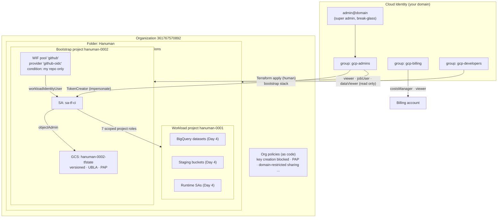
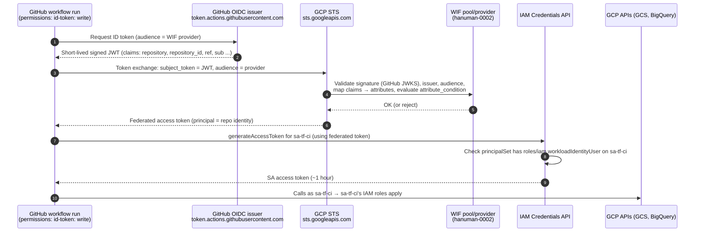

# Day 2 & Day 3 Explained: Bootstrap, State, Org Policy, and Keyless CI on GCP

> **Audience:** a senior GCP data engineer stepping into an architect role.
> **Goal:** understand *why* each Day 2–3 decision exists, explain it in a design review, rebuild it on a new org, and recognize when a different design is the right call.
> **Repo:** `bq-ai-analyst` · **Org:** `361767570892` · **Folder:** `Hanuman` · **Region:** `us-east4`

---

## 0. How to read this document

Each non-trivial decision uses the same template:

| Section | What it answers |
|---|---|
| **What we do** | The decision in one or two sentences |
| **Why it exists** | The problem it solves, and what breaks without it |
| **How it works mechanically** | Enough detail to reproduce it |
| **Alternatives** | Real options, with fit and cost |
| **When to choose differently** | Concrete triggers |
| **Pitfalls** | What actually goes wrong |
| **How to verify** | The observable proof |

### Glossary (acronyms defined once, used throughout)

| Acronym | Meaning | One-line role in this build |
|---|---|---|
| **IaC** | Infrastructure as Code | Infra described in versioned files (Terraform) |
| **IAM** | Identity and Access Management | Who can do what on which resource |
| **SA** | Service Account | A non-human identity |
| **GCS** | Google Cloud Storage | Holds Terraform state |
| **ADC** | Application Default Credentials | How Terraform and SDKs find your credentials |
| **WIF** | Workload Identity Federation | Lets external identities (GitHub) get GCP tokens without keys |
| **OIDC** | OpenID Connect | Standard for signed identity tokens (JWTs) |
| **JWT** | JSON Web Token | The signed token GitHub issues to a workflow run |
| **STS** | Security Token Service | GCP API that exchanges an external token for a GCP token |
| **ADR** | Architecture Decision Record | A short doc recording a decision and its reasoning |
| **UBLA** | Uniform Bucket-Level Access | Buckets use IAM only, no per-object ACLs |
| **PAP** | Public Access Prevention | Buckets can never be made public |
| **CMEK** | Customer-Managed Encryption Keys | Encryption keys you control in Cloud KMS |
| **VPC-SC** | VPC Service Controls | Network-style perimeter around Google APIs to stop data exfiltration |
| **CI/CD** | Continuous Integration / Continuous Delivery | Automated test, plan, and deploy on Git events |
| **PR** | Pull Request | Proposed change reviewed before merge |
| **GitOps** | Git as the source of truth for infra; changes flow only through Git | The operating model this repo is moving toward |

### As-built vs. original instructions

The original Day 2–3 instructions changed during execution. This document explains the **as-built** system:

| Original instruction | As built | Why it changed |
|---|---|---|
| Bootstrap project `hanuman-bootstrap-0001` | `hanuman-0002` | Naming choice; project IDs are permanent, so pick a convention early |
| Import legacy `iam.disableServiceAccountKeyCreation` | Imported **7** existing policies, including the **managed** `iam.managed.disableServiceAccountKeyCreation`; the legacy one is intentionally unset | The new org shipped managed constraints; the legacy one was effectively `false` |
| Hand-write imported policy config | `terraform plan -generate-config-out=...` | Generated config matches live state exactly, so import is a no-op |
| Single apply for policies + WIF | Two staged applies | Isolates failures; a pasted multi-command block once ran `rm` after a failed apply |
| `auth@v2`, `setup-gcloud@v2`, `ubuntu-latest` | `@v3` (Node 24), `ubuntu-24.04`, Dependabot | Node 20 deprecation and a scheduled runner-image migration |
| Terraform files at repo root (accidentally) | Moved to `infra/bootstrap/` | Room for `infra/envs/dev` without two stacks colliding |

---

## 1. The big picture

### 1.1 Resource and trust layout



### 1.2 GitHub Actions → GCP token flow



**Read the diagram as two trust decisions.** STS asks, "Is this token really from GitHub, for *my* repo?" (the attribute condition). IAM Credentials asks, "Is this identity allowed to become `sa-tf-ci`?" (the `workloadIdentityUser` binding). Both must pass, and that's defense in depth.

---

## 2. Mental models

### 2.1 Terraform state is the real product

**What we do:** Treat the state file as the authoritative record of what Terraform manages, and protect it like a database: remote, locked, versioned, private.

**Why it exists:** `.tf` files describe *intent*. Terraform can't look at GCP and know which bucket it created versus one a colleague made by hand. State is the **mapping** from addresses in code (`google_storage_bucket.tfstate`) to real resource IDs (`hanuman-0002-tfstate`), plus the last-known attributes of each.

> **Composer analogy:** your DAG files are intent; Composer's metadata DB records what actually ran. Lose the metadata DB and the scheduler doesn't know what's done, so it re-runs, backfills blindly, or collides with existing outputs. Lose Terraform state and the next `apply` tries to **create everything again**, colliding with "already exists" errors or creating duplicates.

**How it works mechanically:**

| Part of state | Purpose |
|---|---|
| `lineage` | UUID identifying this state's history; prevents mixing up two unrelated states |
| `serial` | Increments on every write; prevents overwriting a newer state with an older one |
| `resources[].instances[].attributes` | Last-known real attributes, including **sensitive values in plaintext** (generated passwords, keys, connection strings) |
| `outputs` | Values other stacks or humans read |

Every `plan` does three things: **refresh** (read real resources), **diff** (compare real vs. code), and **propose** (create, update, delete). State is what makes the diff possible.

**Alternatives:**

| Approach | Good fit | Bad fit | Operational cost |
|---|---|---|---|
| Terraform with state (what we do) | Anything long-lived and shared | — | Must protect and lock state |
| Imperative scripts (`gcloud` in bash) | One-off setup, tiny labs | Anything that must converge or be reviewed | Low at first, high later (no drift detection) |
| Config Connector / Crossplane (Kubernetes as the state store) | Teams already running GKE, wanting continuous reconciliation | Teams without Kubernetes skills | Needs a cluster |
| Google Infrastructure Manager (managed Terraform runs) | Teams wanting Google to host runs and state | Teams wanting full control of the pipeline | Lower ops, less flexibility |

**When to choose differently:** if infra must *continuously* self-heal against manual edits, a reconciling controller (Config Connector) beats run-on-merge Terraform. If you can't operate a state bucket safely, use a managed service.

**Pitfalls:** state committed to Git (leaks secrets); two people applying at once without locking (corrupted state); "fixing" errors by deleting resources from state (`terraform state rm`) so Terraform forgets things that still exist (orphans that keep billing).

**How to verify:** `terraform state list` matches what you expect, and `terraform plan` shows `No changes`.

---

### 2.2 The bootstrap chicken-and-egg problem

**What we do:** Create the state bucket with Terraform using **local** state, then migrate that state *into* the bucket it just created.

**Why it exists:** remote state needs a bucket; you want the bucket defined in code; but code needs somewhere to keep state *before* the bucket exists. Something has to go first.

**How it works mechanically:**
1. A human creates the bootstrap project and enables APIs (the only clicks/CLI outside Terraform).
2. `terraform apply` with no backend writes `terraform.tfstate` locally; this creates the bucket.
3. Add `backend "gcs"`, run `terraform init -migrate-state`: Terraform copies local state into `gs://hanuman-0002-tfstate/bootstrap/default.tfstate`.
4. Delete the local copy. From here, the bucket holds the state *of itself*.

**Alternatives:**

| Approach | Good fit | Bad fit | Operational cost |
|---|---|---|---|
| Local first, then migrate (ours) | Small orgs, learning, full control | Teams needing zero manual steps | One-time manual step |
| Create bucket with a `gcloud` script, then Terraform with remote state from day 1 | Teams wanting the bucket outside Terraform's blast radius | Teams wanting *everything* in code | Bucket config can drift unmanaged |
| HCP Terraform (formerly Terraform Cloud) holds state | Multi-cloud teams; no bucket to manage | Strict data-residency or no-SaaS policies | Subscription cost, vendor dependency |
| Google's foundation blueprints (e.g., `terraform-example-foundation` bootstrap stage) | Enterprises standing up a full landing zone | Small labs (too heavy) | High upfront complexity, low long-term |

**When to choose differently:** large orgs should adopt a published foundation blueprint rather than hand-rolling. Regulated orgs that forbid SaaS state storage should not use HCP Terraform without a self-hosted agent and residency guarantees.

**Pitfalls:** forgetting to delete the local state (two sources of truth); running `-migrate-state` against a bucket that already has state from another stack (Terraform prompts, and answering wrong overwrites).

**How to verify:** `gcloud storage ls gs://hanuman-0002-tfstate/bootstrap/` shows `default.tfstate`; no `terraform.tfstate` remains locally.

---

### 2.3 Human-applied vs. CI-applied Terraform

**What we do:** Split infra into two stacks with different operators:

| Stack | Applied by | Contains | Change frequency |
|---|---|---|---|
| `infra/bootstrap` | Humans in `gcp-admins` | State bucket, org policies, group IAM, WIF, CI SA | Rare |
| `infra/envs/dev` (Day 4) | CI as `sa-tf-ci` (or admins impersonating it) | Datasets, buckets, runtime SAs | Frequent |

**Why it exists:** the bootstrap stack *creates the CI identity and its permissions*. If CI could modify the bootstrap stack, CI could grant itself any permission, and a compromised pipeline would own the org. Keeping bootstrap human-applied caps the **blast radius** (how much damage one compromised credential can do) of the pipeline.

**How it works mechanically:** `sa-tf-ci` has `objectAdmin` on the state bucket and roles on `hanuman-0001` only. It has no org-level or folder-level roles, so it physically cannot change org policies, group IAM, or its own WIF binding.

> Note: `sa-tf-ci` can technically read and write *all* objects in the state bucket, including the `bootstrap/` prefix. That's a known gap; see §6 (per-prefix IAM Conditions or a separate bucket for bootstrap state).

**Alternatives:**

| Approach | Good fit | Bad fit | Operational cost |
|---|---|---|---|
| Two stacks, human bootstrap (ours) | Most orgs | — | Bootstrap changes need a human with elevated access |
| Everything CI-applied with one powerful SA | Tiny teams wanting speed | Any org that cares about pipeline compromise | Low effort, very high blast radius |
| Everything human-applied | Pre-CI teams | Teams that want review + audit + repeatability | High toil, inconsistent applies |
| Tiered CI: separate "foundation pipeline" with its own SA and manual approval | 20+ engineers, many envs | Small teams | More pipelines to maintain |

**When to choose differently:** once several people change foundation config weekly, move bootstrap to its own pipeline with mandatory multi-person approval rather than laptop applies.

**Pitfalls:** "temporary" grants of org roles to the CI SA that never get removed; admins applying workload stacks with their own credentials (bypasses the audit trail of the CI identity).

**How to verify:** `gcloud organizations get-iam-policy 361767570892 | grep sa-tf-ci` returns nothing.

---

### 2.4 Least privilege: a design constraint, not a checkbox

- **Checkbox thinking:** "We removed Owner, so we're least-privilege." The SA still holds six admin roles that combine into Owner-equivalent power.
- **Design-constraint thinking:** "What is the worst thing this identity can do if stolen, and is that acceptable?" Then you shape *architecture* (separate projects, separate stacks, impersonation, org policies) so the answer is acceptable even when individual roles are broad.

Day 2–3 applies the second approach. The CI SA's roles *are* broad (see §4.6), but:
- they're confined to one project,
- the bootstrap stack is out of reach,
- org policies cap what even an admin role can do (no SA keys, no public buckets, no non-US resources),
- no long-lived credential exists to steal.

**The architect's question for any grant:** *"If this credential leaks at 2 a.m., what's the worst case, and which control stops it?"*

---

## 3. Day 2 decisions

### 3.1 A dedicated bootstrap project

**What we do:** State, WIF, and the CI SA live in `hanuman-0002`, separate from the workload project `hanuman-0001`.

**Why it exists:**
1. **Blast radius:** an engineer with broad rights in the workload project can't tamper with state or the CI identity.
2. **Lifecycle:** you can delete and recreate workload projects freely; the identity and state survive.
3. **Clarity of IAM:** "who can touch state" is answered by one small project's IAM policy.

> **BigQuery analogy:** like keeping a pipeline's audit and control tables in a separate admin dataset so that a `DROP SCHEMA` on the analytics dataset can't erase the record of what ran.

**How it works mechanically:** `gcloud projects create hanuman-0002 --folder=<FOLDER_ID>`, link billing, enable the control-plane APIs (`iam`, `iamcredentials`, `sts`, `storage`, `orgpolicy`, `cloudresourcemanager`, `serviceusage`, `cloudbilling`).

**Alternatives:**

| Approach | Good fit | Bad fit | Operational cost |
|---|---|---|---|
| One bootstrap project for all envs (ours) | 1–5 envs, one team | Strict per-environment isolation mandates | One extra project |
| State and CI SA inside each workload project | Throwaway labs | Anything multi-env; CI can't create its own project | Lowest effort, worst isolation |
| Bootstrap project per environment (`bootstrap-dev`, `bootstrap-prod`) | Regulated prod, separate prod admins | Small teams | More projects and pipelines |
| Separate "seed" + "CI/CD" projects (Google foundation pattern) | Enterprise landing zones | Learning setups | Highest complexity |

**When to choose differently:** if prod and non-prod must have **different administrators** (common in PCI/HIPAA), split bootstrap per environment so dev admins can't touch prod state.

**Pitfalls:** project IDs are permanent and globally unique, so a bad naming convention lives forever; forgetting to enable APIs in the bootstrap project and accidentally billing org-level API calls to the workload project (which happened here: `orgpolicy.googleapis.com` was enabled on `hanuman-0001` because gcloud used it as the quota project).

**How to verify:** `gcloud projects describe hanuman-0002 --format="value(parent.type,parent.id)"` shows the `Hanuman` folder.

---

### 3.2 The state bucket and its mandatory controls

**What we do:** `hanuman-0002-tfstate` in `us-east4`, with versioning, a lifecycle rule, UBLA, PAP, and `force_destroy = false`.

**Why each control is mandatory:**

| Control | Problem it solves | What breaks without it |
|---|---|---|
| **Versioning** | Every state write becomes a new object generation | A bad apply, a bug, or a manual overwrite corrupts state with no way back |
| **Lifecycle: keep 10 newer versions** | Bounds storage growth from versioning | Thousands of versions accumulate silently |
| **UBLA** | Access is controlled by bucket IAM only | Per-object ACLs create hidden access paths nobody audits |
| **PAP enforced** | Bucket can never be made public | State contains plaintext secrets; one mistaken `allUsers` grant leaks them |
| **`force_destroy = false`** | `terraform destroy` can't delete a bucket that still has objects | A careless destroy wipes the record of all infrastructure |
| **Region `us-east4`** | Co-located with workloads, inside the residency policy | — |
| **Labels** | Cost attribution and inventory | Unattributed spend in billing exports |

**How it works mechanically:** the GCS backend stores each workspace's state at `<prefix>/<workspace>.tfstate` and takes a lock by creating `<prefix>/<workspace>.tflock` with a conditional write. Only one writer can create the lock object, which gives you mutual exclusion without a separate lock table.

**Alternatives for retention:**

| Approach | Good fit | Bad fit | Cost |
|---|---|---|---|
| Keep N newer versions (ours: 10) | Frequent applies | Compliance needing time-based retention | Predictable |
| Delete noncurrent after N days | Audit wants "90 days of history" | Very frequent applies (many versions) | Time-bounded |
| Bucket retention policy / lock | Regulated: state history must be immutable | Labs (can't clean up) | Irreversible once locked |
| Rely on GCS soft delete only | Never for state | — | Short window, not a versioning substitute |

**When to choose differently:** regulated environments add **CMEK** on the bucket and a time-based retention policy; teams with many stacks use one bucket per trust domain rather than one shared bucket.

**Pitfalls:** granting broad `storage.admin` at project level, which silently includes the state bucket; assuming encryption at rest makes state "safe" (anyone with read access sees plaintext secrets).

**How to verify:** `gcloud storage buckets describe gs://hanuman-0002-tfstate --format="yaml(versioning,iamConfiguration,lifecycle)"`.

---

### 3.3 Backend choice: GCS vs. local vs. HCP Terraform vs. S3

**What we do:** the GCS backend with the bucket name passed at init (`-backend-config`), not hardcoded.

**Why it exists:** state must be shared (CI and humans), locked (no concurrent applies), durable (versioned), and access-controlled (IAM). GCS gives all four natively on GCP.

**Alternatives:**

| Backend | Good fit | Bad fit | Operational cost |
|---|---|---|---|
| **Local** | Single person, throwaway experiments | Anything shared or long-lived | None, but no locking or sharing |
| **GCS** (ours) | GCP-centric teams | Multi-cloud teams wanting one control plane | Low: a bucket and IAM |
| **HCP Terraform** | Multi-cloud; teams wanting policy checks, run history, private registry | No-SaaS or strict residency regimes | Per-seat or per-resource subscription |
| **S3 (+ native lockfile; DynamoDB locking in older setups)** | AWS-centric teams | GCP-only teams | Low on AWS, awkward cross-cloud |
| **OpenTofu with client-side state encryption** | Teams needing state encrypted *before* it leaves the runner | Teams standardized on Terraform/HCP | Key management overhead |

**When to choose differently:** multi-cloud with a central platform team → HCP Terraform or a self-hosted equivalent. Very high-sensitivity secrets in state → encrypt state client-side, or better, keep secrets out of Terraform (Secret Manager, generated outside).

**Pitfalls:** hardcoding the bucket name in `backend.tf` (blocks reusing the code in another org); multiple stacks accidentally sharing the same `prefix` (they overwrite each other's state).

**How to verify:** `terraform init` prints `Successfully configured the backend "gcs"`.

---

### 3.4 What `terraform init -migrate-state` really does

**What we do:** after adding `backend "gcs"`, run `init -migrate-state` once, then delete the local files.

**How it works mechanically:**
1. Init sees the backend changed (local → GCS).
2. It reads the current local state and acquires locks.
3. It writes the state to `gs://…/bootstrap/default.tfstate`, **preserving `lineage` and `serial`**. Same history, new home.
4. It records the backend config in `.terraform/terraform.tfstate` (a local *pointer*, not your infra state).
5. The old `terraform.tfstate` is **left in place**, which is why you delete it manually.

**Why it matters:** if the local file stays, someone may later run Terraform from a directory without the backend config and apply against the stale local state, believing it's authoritative.

**Alternatives:** `terraform state push` (manual, error-prone, can overwrite newer state), or recreating the stack with remote state and importing everything (slow, risky). Migration is the safe path.

**Pitfalls:** migrating into a non-empty location (answer "no" to the overwrite prompt unless you're certain); losing the local file *before* confirming the remote copy exists.

**How to verify:** the remote object exists, `terraform state list` from a fresh clone returns the same resources, and `terraform plan` shows `No changes`. That last check is exactly what you did after moving the stack into `infra/bootstrap/`.

---

### 3.5 What goes in Git, and why

| File | In Git? | Reason |
|---|---|---|
| `*.tf` | ✅ | The intent, reviewed via PR |
| `.terraform.lock.hcl` | ✅ | Pins exact provider versions and checksums so Cloud Shell, laptops, and CI run **identical** provider binaries. Without it, CI may pull a newer provider with different behavior. It's also a supply-chain control: checksums detect a tampered provider download. |
| `terraform.tfvars.example` | ✅ | Documents required inputs with placeholders |
| `terraform.tfvars` | ❌ | Per-environment values; in general tfvars is where secrets creep in. In this repo it only holds IDs, but ignoring it by pattern prevents the day someone adds a password. |
| `*.tfstate`, `*.tfstate.*` | ❌ | State is a **secret-bearing artifact** (plaintext sensitive attributes) and is owned by the backend, not Git. Git history is permanent, so a committed secret is effectively public forever. |
| `.terraform/` | ❌ | Local plugin cache and backend pointer; machine-specific |

**Alternative:** some teams commit non-secret per-env tfvars (e.g., `envs/dev/dev.tfvars`) for full GitOps reproducibility. That's valid when a secrets policy guarantees no secrets ever enter tfvars, ideally enforced by a scanner such as gitleaks in pre-commit and CI.

**Pitfall you hit:** a `.gitignore` template excluded `.terraform.lock.hcl`. The fix was removing the rule, not `git add -f`, because forcing it once leaves the trap for the next stack.

**How to verify:** `git check-ignore -v infra/bootstrap/terraform.tfvars` prints a rule; the same command for `.terraform.lock.hcl` prints nothing.

---

### 3.6 IAM via Google Groups, not individual users

**What we do:** grant roles to `gcp-admins`, `gcp-billing`, `gcp-developers`; put people in groups.

**Why it exists:**

| Lifecycle event | With groups | With individual grants |
|---|---|---|
| **Joiner** | Add to a group, inherit the full, reviewed access set | Someone must remember every grant across every resource |
| **Mover** (changes team) | Move between groups | Old grants linger ("access creep") |
| **Leaver** | Remove from groups (or suspend in Cloud Identity) | Hunt for grants across projects; some are always missed |
| **Audit** | "Who can do X?" = one group's membership | Read every IAM policy in the org |
| **Break-glass** | A small, monitored admin group | Ad-hoc Owner grants that never get revoked |

> **BigQuery analogy:** granting dataset access to a group instead of 40 user emails, the same reason authorized views and groups beat per-user ACLs in a warehouse.

**How it works mechanically:** members are written as `group:gcp-admins@<domain>`. IAM resolves group membership at request time, so membership changes take effect without touching any IAM policy (allow a few minutes for propagation).

**Alternatives:**

| Approach | Good fit | Bad fit | Cost |
|---|---|---|---|
| Groups managed manually in Admin console (ours) | Small orgs | Large orgs needing joiner/mover/leaver automation | Low |
| Groups synced from an enterprise IdP (Okta, Entra ID) | Enterprises with HR-driven provisioning | Labs | Sync configuration |
| Workforce Identity Federation (no Cloud Identity users at all) | Orgs that won't duplicate identities in Google | Simple setups | Different IAM principal syntax, feature gaps |
| Per-user grants | Never, beyond a lone individual | Everything else | Hidden, compounding cost |

**Pitfalls:** codifying IAM bindings in Terraform but managing group *membership* by hand means the real access decision lives outside Git (acceptable here; at scale, manage membership in the IdP with its own approvals); nesting groups so deeply nobody can tell who's effectively an admin.

**How to verify:** as your daily identity, `bq query` works, but `bq mk --dataset hanuman-0001:test_ds` fails with a permission error.

---

### 3.7 Why each group has exactly these roles

#### `gcp-admins`

| Role | Scope | Real-world task | Deliberately does NOT allow |
|---|---|---|---|
| `roles/orgpolicy.policyAdmin` | Org | Apply org policies via the bootstrap stack | Granting IAM, creating projects, reading data |
| `roles/resourcemanager.folderAdmin` | Folder | Manage folder structure and folder-level IAM | Anything outside the `Hanuman` folder |
| `roles/owner` | Folder | **Break-glass**: fix anything in lab projects during incidents | Org-level changes |

> Gap to note in a design review: the super admin still holds `roles/resourcemanager.organizationAdmin` **individually** (Cloud Identity grants it at org creation). The clean end state codifies that grant on `gcp-admins` and removes the individual binding. `roles/owner` on the folder is broad, which is acceptable for a one-person lab and is the first thing to replace with narrower roles plus a time-bound break-glass process at team scale.

#### `gcp-billing`

| Role | Real-world task | Deliberately does NOT allow |
|---|---|---|
| `roles/billing.costsManager` | Create budgets and alerts, manage cost exports | Linking or unlinking projects, changing payment methods |
| `roles/billing.viewer` | Read spend, invoices, account details | Any modification |

This separates *seeing and governing cost* from *changing who pays*, the FinOps separation of duties.

#### `gcp-developers` (your daily identity)

| Role | Scope | Real-world task | Deliberately does NOT allow |
|---|---|---|---|
| `roles/viewer` | Folder | See resources and configs in the console | Creating or changing anything |
| `roles/bigquery.jobUser` | Folder | Run queries (jobs billed to the project) | Creating datasets or tables |
| `roles/bigquery.dataViewer` | Folder | Read table data and metadata | Writing data, changing schemas or IAM |

**Design principle: humans read, pipelines write.** Any change to infra must go through Terraform, either via CI or via an admin impersonating the CI SA. That makes the audit trail complete by construction.

> Honest caveat: `dataViewer` at **folder** level lets developers read *every* dataset, including `raw_thelook` with PII. Also, basic roles like `roles/viewer` carry legacy dataset-access mappings in BigQuery (newly created datasets grant project readers `READER` by default). Phase 2–3 narrows this with dataset-level grants and policy tags on PII columns.

---

### 3.8 `user_project_override` and `billing_project`

**What we do:** the Google provider sets `user_project_override = true` and `billing_project = hanuman-0002`.

**Why it exists:** some Google APIs are **client-quota** APIs: quota and billing are charged to a *quota project* chosen by the caller, not to the resource being changed. With user credentials (ADC), that quota project is otherwise whatever gcloud defaults to. These two settings make the provider send the `X-Goog-User-Project: hanuman-0002` header, so:
- org-level calls (org policy, Resource Manager, billing budgets, Service Usage) are attributed to the bootstrap project,
- the relevant API only needs to be enabled in the bootstrap project,
- you avoid confusing "API not enabled on project X" errors.

**How this connects to BigQuery work:** BigQuery *job* billing is set by the project the job runs in, not by this header. But BigQuery-adjacent control-plane APIs (Data Catalog / Dataplex taxonomies for policy tags, Resource Manager, org policy, Service Usage) behave like the APIs above. You'll see this again in Week 3 when creating policy tag taxonomies.

**Pitfall you hit:** `gcloud org-policies list` asked to enable `orgpolicy.googleapis.com` on `hanuman-0001`, because gcloud's own quota project defaulted to the active project. The fix is `gcloud config set billing/quota_project hanuman-0002`, the CLI equivalent of the provider setting.

**When to choose differently:** when Terraform runs as a service account whose home project already has the APIs enabled, these settings matter less. Keep them anyway for predictable attribution.

**How to verify:** the plan or apply works without enabling APIs in the workload project, and API metrics in `hanuman-0002` show the org-policy calls.

---

## 4. Day 3 decisions

### 4.1 Org policies belong in code

**What we do:** every org policy, both the ones Google created by default and the ones we added, is a Terraform resource in `infra/bootstrap`.

**Why it exists:**

| Need | Console-managed policies | Policies as code |
|---|---|---|
| **Drift detection** | Silent; someone loosens a policy and nobody notices | `terraform plan` shows the change |
| **Review** | One admin clicks, no second pair of eyes | PR review before apply |
| **Audit** | Admin Activity logs only (who, when) | Logs *plus* Git history (who, when, **why**: the PR description) |
| **Scale** | Repeat clicks per folder or org | Same module for every folder or org |
| **Recovery** | Reconstruct from memory | Re-apply |

**How it works mechanically:** `google_org_policy_policy` resources use the Org Policy v2 API. The policy's `name` is deterministic: `<parent>/policies/<constraint>` (e.g., `organizations/361767570892/policies/storage.publicAccessPrevention`). Boolean constraints use `rules { enforce = "TRUE" }`; list constraints use `rules { values { allowed_values = [...] } }`.

**Alternatives:**

| Approach | Good fit | Bad fit | Operational cost |
|---|---|---|---|
| Console | Exploration, emergencies | Anything you must defend in an audit | Invisible drift |
| Terraform (ours) | Most orgs | — | Needs `orgpolicy.policyAdmin` for whoever applies |
| Policy-as-code engines (OPA / Sentinel / Checkov) evaluating Terraform plans | Preventing bad *configurations* before apply | Replacing org policies (they don't enforce at runtime) | CI integration |
| Custom org policy constraints (CEL-based) | Rules Google doesn't ship, e.g., "BigQuery datasets must have CMEK" | Simple needs covered by built-ins | Writing and testing CEL |

**Key distinction for design reviews:** **org policies enforce at runtime** (the API refuses), while **plan-time scanners** (Checkov, OPA) catch issues before apply. They complement each other: scanners give fast feedback in PRs, org policies are the backstop for anything created outside Terraform.

**Pitfalls:** managing the same policy in two places (console *and* Terraform) so they fight; applying org-level policies without checking effects on existing workloads (use **dry-run** specs first in production orgs).

**How to verify:** `gcloud org-policies list --organization=361767570892` matches the Terraform resources, and `terraform plan` shows `No changes`.

---

### 4.2 The three headline policies

#### A. Service account key creation blocked (`iam.managed.disableServiceAccountKeyCreation`)

**What it prevents:** creating downloadable JSON private keys for any SA in the org.

**Why:** an SA key is a long-lived password (valid until someone deletes it) for a non-human identity. Keys get emailed, committed to Git, baked into container images, and left on laptops. Leaked cloud credentials are a common root cause of cloud incidents, typically followed by crypto-mining on the victim's bill or data exfiltration.

**As-built note:** your org enforces the **managed** constraint (`iam.managed.*`, built on the newer custom-constraint engine). The legacy `iam.disableServiceAccountKeyCreation` is effectively `false` and intentionally not set; setting both is redundant. Record this in ADR 0001.

**Realistic incident it stops:** a developer creates a key "just to test locally", and it ends up in a public repo; automated scanners find it within minutes.

#### B. Public Access Prevention (`storage.publicAccessPrevention`)

**What it prevents:** granting `allUsers` or `allAuthenticatedUsers` access to any bucket or object.

**Why:** misconfigured public buckets are one of the most common data-exposure patterns in cloud. Your state bucket holds secrets, and your staging buckets will hold PII from `users`.

**Realistic incident it stops:** someone makes a bucket public to share one file with a vendor, and the bucket also contains a customer extract.

#### C. Resource locations (`gcp.resourceLocations = in:us-locations`, on the folder)

**What it prevents:** creating location-bearing resources (buckets, datasets, and more) outside the US.

**Why a set (`in:us-locations`) and not just `us-east4`:**
- **Residency is a legal/jurisdictional control** ("customer data stays in the US"), so the natural boundary is a **country or region group**, not one data center. Choosing `us-east4` is a separate *engineering* decision (latency, service availability, cost) that belongs in an ADR, not a guardrail.
- Different services need different location granularities. The public `thelook_ecommerce` dataset lives in the **US multi-region**, so the export stage bucket must be in `US`. Restricting to only `us-east4` would block that legitimate step. Later you may also need another US region for disaster recovery or for model availability.
- `in:us-locations` is a **value group**: it includes the US multi-region, all US regions, and their zones, and Google maintains the group as new US regions launch.

**What it does NOT do:** it is checked at *creation time* for supported resources only; it doesn't move existing resources, doesn't constrain global resources, and doesn't stop data being copied out by someone with read access. Residency ≠ exfiltration prevention; that's VPC-SC's job (Week 4).

**Realistic incident it stops:** an engineer creates a BigQuery dataset in `EU` for a quick test and copies customer data into it, a cross-border transfer your contracts may prohibit.

**Alternatives (for all three):**

| Approach | Good fit | Bad fit | Cost |
|---|---|---|---|
| Org policies (ours) | Hard, runtime guarantees | Rules needing context (e.g., "only for prod") | Low |
| Detective controls (Security Command Center findings, alerts) | Visibility on what slipped through | Prevention | Alert fatigue |
| Plan-time scanning only | Fast feedback | Anything created outside Terraform | Bypassable |
| Training and documentation | Culture | Any guarantee | Free, unreliable |

**When to choose differently:** for location, an EU or multi-country business uses `in:eu-locations` or explicit country groups per folder; sovereign-cloud requirements may need Assured Workloads rather than org policy alone.

**Pitfalls:** policy propagation takes minutes, so a test right after apply may "succeed" falsely; folder-level location policies surprise teams whose tools default to `US` multi-region or `global`.

**How to verify:** the three fail-by-design tests in §4.9.

---

### 4.3 State adoption: importing existing policies

**What we do:** bring 7 policies that Google created at org creation (secure-by-default) under Terraform management, **without changing them**.

**Why it exists:** in real enterprises you almost never start from zero. There are console-created buckets, hand-made IAM, policies from a previous team. **State adoption** means teaching Terraform "this resource already exists, and from now on you manage it" without destroying and recreating it.

**Key concepts:**

| Term | Meaning |
|---|---|
| **Drift** | Real infrastructure differs from what code and state describe (manual console edits, default-created resources) |
| **Unmanaged resource** | Exists in GCP, absent from state; Terraform doesn't know about it |
| **Import** | Write an existing resource's ID and attributes into state, linked to a resource address in code |
| **Idempotent import** | After import, `plan` shows **0 changes**, meaning code exactly describes reality |

**Why "just create it" fails:** an org policy's identity is deterministic (`organizations/<id>/policies/<constraint>`). There can only be one per constraint per resource. Terraform, not knowing it exists, calls *Create*, and the API returns **`ALREADY_EXISTS` (409)**. The same applies to buckets (globally unique names), datasets, and anything with a user-chosen ID.

**Why "delete it, then recreate" is wrong:** for a security policy, deletion opens a window with **no protection**, and if the apply fails midway, the window stays open.

**How it works mechanically (as built):**
1. Inventory: `gcloud org-policies list --organization=...` showed 7 existing policies.
2. Write 7 `import {}` blocks (`to` = resource address, `id` = policy name).
3. `terraform plan -generate-config-out=org_policies_existing.tf`: Terraform reads each live policy and **writes the matching resource config for you**.
4. Plan gate: **`7 to import, 2 to add, 0 to change, 0 to destroy`**. Zero *changes* proves the generated config matches reality.
5. Apply, then delete the `import {}` blocks (their job is done; they're no-ops afterward).
6. Re-plan: `No changes`.

**Alternatives:**

| Approach | Good fit | Bad fit | Operational cost |
|---|---|---|---|
| `import {}` blocks + `-generate-config-out` (ours; Terraform ≥ 1.5) | Bulk adoption, reviewable in a PR | Very old Terraform versions | Low; the plan previews the import |
| `terraform import` CLI | One-off imports, older versions | Teams (not reviewable, mutates state immediately, no preview) | Error-prone at scale |
| Recreate (delete + create) | Disposable, non-security resources in dev | Security controls, data stores, anything with dependents | Downtime or protection gap |
| Leave unmanaged | Resources owned by another team | Anything you're accountable for | Permanent blind spot |
| Bulk export tools (`gcloud beta resource-config bulk-export --resource-format=terraform`) | Large brownfield estates | Small, known sets | Generated code needs heavy cleanup |

**When to choose differently:** if another team owns a resource, *don't* import it; reference it with a data source instead. Two Terraform stacks managing the same resource will fight forever.

**Pitfalls you hit, and lessons:**
- **The import file was deleted before a successful apply**, which turned "7 to import" into "7 to add" (that would have failed with `ALREADY_EXISTS`). **Rule: remove import blocks only after `Apply complete!`.**
- **Cosmetic drift on the WIF provider** (`display_name` existed live but not in code). **Rule: make code match reality; don't "apply away" a diff you haven't read.**
- **Generated config can include read-only fields** (like `etag`) that must be removed before planning.
- A plan with `0 to destroy` but a surprise `~ update` on a security policy deserves a full read of the diff before approval.

**How to verify:** after apply and import-block removal, `terraform plan` shows `No changes`.

---

### 4.4 Workload Identity Federation end-to-end

#### 4.4.1 Why long-lived SA keys are an anti-pattern

| Problem | With an SA key | With WIF |
|---|---|---|
| **Lifetime** | Valid until manually deleted | Tokens expire in about an hour |
| **Rotation** | Manual, often never done | Nothing to rotate |
| **Leakage surface** | Stored in CI secrets, laptops, images, logs | Nothing stored; tokens minted per run |
| **Attribution** | Logs show the SA, not *which* repo or run used it | Logs show the federated principal (repo, ref) *and* the SA |
| **Exfiltration** | A copied key works from anywhere, any time | A stolen token dies within the hour and can't be renewed without a fresh GitHub-signed JWT for your repo |
| **Revocation** | Find and delete the key; hope there are no copies | Remove the binding or tighten the condition |

#### 4.4.2 How the token exchange works

1. **Workflow asks for an identity.** `permissions: id-token: write` lets the run request an OIDC token from GitHub. The auth action sets the token's *audience* to your WIF provider's resource name.
2. **GitHub signs a JWT** valid for minutes, with claims describing the run: `repository` (`owner/repo`), `repository_id` (numeric), `repository_owner_id`, `ref` (`refs/heads/main`), `sub` (e.g., `repo:owner/repo:ref:refs/heads/main`), `workflow`, `actor`, and others.
3. **Token exchange at STS.** The action sends the JWT to `sts.googleapis.com` (OAuth 2.0 token exchange). STS uses the **pool/provider** config to:
   - verify the signature with GitHub's public keys (from the issuer `https://token.actions.githubusercontent.com`),
   - check issuer and audience,
   - apply `attribute_mapping` (e.g., `attribute.repository = assertion.repository`),
   - evaluate `attribute_condition`; if false, **reject**.
4. **STS returns a federated token** representing the external principal (e.g., `principal://…/subject/repo:owner/repo:ref:refs/heads/main`).
5. **Impersonation.** The action calls the IAM Credentials API `generateAccessToken` for `sa-tf-ci`. IAM checks that the federated principal is covered by a `roles/iam.workloadIdentityUser` binding on the SA. Ours binds `principalSet://…/attribute.repository/<owner>/bq-ai-analyst`.
6. **SA access token (~1 h).** Subsequent `gcloud` / `bq` / Terraform calls run as `sa-tf-ci`, and **its** roles apply.

#### 4.4.3 Why `attribute_condition` is mandatory

GitHub's OIDC issuer is **shared by every repository on GitHub**. A valid signature proves "GitHub issued this", not "*your* repo issued this". Without a condition, the provider accepts tokens from *any* repo. Then the only protection is the SA binding, and one sloppy binding (e.g., `principalSet://…/*` covering the whole pool) means **any GitHub user's public repo can mint GCP credentials as your SA**.

The condition `assertion.repository == "<owner>/bq-ai-analyst"` rejects all other repos **at STS**, before any IAM binding is considered. Two independent gates are defense in depth. (Google's documentation for GitHub providers requires a condition for this reason.)

#### 4.4.4 Why `repository_id` beats the repository name (repo-rename squatting)

The attack:
1. Your condition trusts the **name** `alice/bq-ai-analyst`.
2. You rename your GitHub account to `alice-dev`, or delete the repo.
3. The name `alice/bq-ai-analyst` becomes available. An attacker registers user `alice` and creates a repo `bq-ai-analyst`.
4. Their workflows mint tokens with `repository = "alice/bq-ai-analyst"`, which **matches your condition**, and they get `sa-tf-ci`.

Numeric `repository_id` (and `repository_owner_id`) are assigned once and never reused, so a recreated repo with the same name gets a **different** ID and fails the condition. Phase 2 change:

```hcl
attribute_mapping = {
  "google.subject"                = "assertion.sub"
  "attribute.repository_id"       = "assertion.repository_id"
  "attribute.repository_owner_id" = "assertion.repository_owner_id"
  "attribute.ref"                 = "assertion.ref"
}
attribute_condition = "assertion.repository_id == \"<numeric-id>\" && assertion.repository_owner_id == \"<numeric-owner-id>\""
```
Find the IDs with `gh api repos/<owner>/bq-ai-analyst --jq '.id, .owner.id'`. Bind the SA to `principalSet://…/attribute.repository_id/<id>`.

Going further, add **ref restrictions** (only `refs/heads/main` may *apply*; PR branches may only *plan* with a read-only SA) so a malicious PR branch can't apply infra.

#### 4.4.5 Alternatives to WIF

| Approach | Good fit | Bad fit | Operational cost / risk |
|---|---|---|---|
| **WIF → SA impersonation** (ours) | Most CI on GitHub, GitLab, Azure DevOps, etc. | — | Low; one-time setup |
| **Direct WIF** (grant roles directly to the `principalSet`, no SA) | Fewer moving parts; Google increasingly supports it | Services that don't accept federated principals; teams that want an SA as the stable audit identity | Lower; some API gaps |
| **SA key stored as a CI secret** | Legacy CI with no OIDC support | Anything with a security review | High: leak, rotation, attribution problems |
| **Self-hosted runners on GCE/GKE with an attached SA** | Private networking needs (VPC-SC, private endpoints), heavy builds | Small teams (you now operate runners) | Runner patching; *every* job on the runner gets the SA |
| **Cloud Build triggers with its own SA** | GCP-native CI, VPC-SC-friendly | Teams standardized on GitHub Actions | Separate CI system to learn |
| **Other OIDC IdPs** (GitLab, Azure DevOps, Terraform Cloud workload identity) | Those platforms | — | Same pattern, different claims and issuer |
| **OAuth user flow / personal credentials in CI** | Never | Everything | Ties infra to a person; breaks on offboarding |

**When to choose differently:** if VPC-SC perimeters must block access from the public internet, GitHub-hosted runners (public IPs) can't reach protected APIs, so you'd move to self-hosted runners inside the perimeter, or Cloud Build private pools, still without keys.

**Pitfalls:** forgetting `id-token: write` (the action fails to get a token); binding the SA to the whole pool; an overly broad condition (e.g., `repository_owner` only, which trusts *every* repo in your account, including forks of public code you later create).

**How to verify:** the `wif-smoke` run is green, and Cloud Audit Logs for the state bucket show `principalSubject` as your repo's federated identity with `sa-tf-ci` as the acting principal.

---

### 4.5 One CI SA, and admins impersonate it

**What we do:** `sa-tf-ci` is the only identity with write access to the workload project. Admins hold `roles/iam.serviceAccountTokenCreator` on it and run local Terraform **as** the SA (`--impersonate-service-account`), instead of holding write roles themselves.

**Why it exists:**
1. **One write path.** Whether a change comes from CI or an admin's laptop, it's executed by the same identity with the same permissions, so "works locally, fails in CI" permission bugs disappear.
2. **Audit clarity.** Logs show `sa-tf-ci` as the actor *and* the delegation chain (`serviceAccountDelegationInfo`) naming the human. You get both "what identity did it" and "who was behind it".
3. **Offboarding.** Remove a person from `gcp-admins`, and they lose impersonation immediately. There are no keys or personal grants to hunt down.
4. **No standing privilege.** An admin's credentials alone can't modify workloads; impersonation is an explicit, logged act.

> **Dataflow analogy:** you don't run Dataflow jobs with your personal identity in production; jobs run as a worker SA with exactly the permissions the pipeline needs. Same idea for infrastructure changes.

**Alternatives:**

| Approach | Good fit | Bad fit | Cost |
|---|---|---|---|
| One CI SA + human impersonation (ours) | 1 env, small team | Multiple envs with different trust levels | Low |
| Per-environment CI SAs (`sa-tf-dev`, `sa-tf-prod`) | 2+ envs; prod needs approval gates | Single env | More bindings |
| Separate plan (read-only) and apply SAs | PR plans from untrusted branches | Tiny setups | Two SAs per env |
| Admins with direct write roles | Never as a standard | — | Shadow changes, weak audit |
| Just-in-time privileged access (time-bound grants with approval) | Regulated orgs, break-glass | Learning setups | Approval workflow |

**Pitfalls:** granting TokenCreator at **project** level (lets admins impersonate *every* SA in the project, including future ones); forgetting that impersonation is also a privilege escalation path, so review who holds TokenCreator as carefully as who holds Owner.

**How to verify:** `gcloud storage ls gs://hanuman-0002-tfstate --impersonate-service-account=sa-tf-ci@hanuman-0002.iam.gserviceaccount.com` succeeds; without the flag, a developer identity can't write.

---

### 4.6 The CI SA's roles, one by one

All seven are granted on **`hanuman-0001` only**.

| Role | What it grants | What could go wrong if the SA is compromised | Narrower alternative (later) |
|---|---|---|---|
| `roles/bigquery.admin` | Create, delete, and update datasets and tables; set dataset IAM; run jobs | Delete datasets; grant an outsider dataset access (domain policy limits *who*) | `bigquery.dataOwner` on specific datasets + a custom role for dataset creation |
| `roles/storage.admin` | Create, delete, and configure buckets and objects, including bucket IAM | Delete staging data; PAP still blocks public exposure | `storage.admin` scoped by IAM Conditions on bucket name prefix |
| `roles/iam.serviceAccountAdmin` | Create and delete SAs; set IAM policy *on* SAs | Grant itself TokenCreator on a more privileged SA, an **escalation path** | Custom role: create SAs, but not set their IAM policy |
| `roles/iam.serviceAccountUser` | "actAs": attach SAs to resources (Cloud Run, Composer, Dataflow) | Deploy code that runs as any SA in the project and inherit its permissions | Grant on specific SAs, not the whole project |
| `roles/resourcemanager.projectIamAdmin` | Modify the project IAM policy | **Grant itself `roles/owner`**, the classic escalation | IAM Condition limiting which roles it may grant (below) |
| `roles/logging.configWriter` | Create and modify sinks and exclusions | Exclude Data Access logs (hide activity), or sink logs to an attacker project | Restrict sink destinations by org policy; alert on sink and exclusion changes |
| `roles/serviceusage.serviceUsageAdmin` | Enable and disable APIs | Enable costly APIs (mining-style abuse) or disable APIs to break services | Enable required APIs in bootstrap; drop this role from CI |

**Why `projectIamAdmin` is the big one, and the mitigation.** An identity that can *set* project IAM can grant itself anything. IAM Conditions can restrict a role grant to modifying only specific roles ("delegated role grants"):

```hcl
resource "google_project_iam_member" "ci_project_iam_limited" {
  project = var.workload_project
  role    = "roles/resourcemanager.projectIamAdmin"
  member  = "serviceAccount:${google_service_account.tf_ci.email}"
  condition {
    title       = "only-grant-approved-roles"
    description = "CI may only grant/revoke these roles"
    expression  = "api.getAttribute('iam.googleapis.com/modifiedGrantsByRole', []).hasOnly(['roles/bigquery.dataViewer','roles/bigquery.jobUser','roles/run.invoker'])"
  }
}
```

Now the SA can grant `bigquery.jobUser` to the runtime SA (needed on Day 4) but **cannot** grant `roles/owner`, even to itself.

> **Architect framing:** these roles are a deliberate trade-off. Learning speed now, tightened in Phase 2. The org policies, project boundary, and keyless auth already cap the worst case. Say that explicitly in design reviews: *"Broad within a box, and the box is small."*

---

### 4.7 The `iam.allowedPolicyMemberDomains` gotcha

**What it is:** a secure-by-default list constraint that only allows IAM grants to principals belonging to **your Cloud Identity customer** (the `C0…` ID). It prevents "domain-restricted sharing" mistakes like granting access to a personal Gmail account.

**Why a WIF binding *can* fail:** a `principalSet://iam.googleapis.com/…` member isn't a user or group in your directory. Depending on the constraint version and how it classifies federated principals, the binding may be rejected with a domain or customer restriction error. (Google has introduced a managed variant, `iam.managed.allowedPolicyMembers`, that can explicitly allow principal sets.) **In this build the binding succeeded**, so the gotcha didn't trigger, but you must recognize it on the next org.

**Correct mitigation:** a **scoped exception**. Override the policy only on the bootstrap project (where WIF bindings live), ideally by explicitly allowing your customer ID *plus* the specific workload identity pool principals, rather than allowing everything.

**Wrong mitigation:** disabling the constraint org-wide. That reopens the door for every project to grant access to arbitrary external accounts, trading one binding for org-wide exposure.

**Rule of thumb:** *exceptions go to the narrowest scope that fixes the problem, are written in code, and are named in an ADR.*

---

### 4.8 The smoke test, and why "variables only, no secrets" matters

**What we do:** a `workflow_dispatch` workflow authenticates via WIF, lists the state bucket, and lists BigQuery datasets. GitHub stores four **variables** (`WIF_PROVIDER`, `TF_CI_SA`, `TF_STATE_BUCKET`, `PROJECT_ID`) and **zero secrets**.

**Why it matters:**
- These values are **identifiers, not credentials**. Knowing the provider name and SA email gives an attacker nothing: they still need a GitHub-signed token *for your repo*.
- **CI secrets are a prime supply-chain target.** In March 2025, the compromised `tj-actions/changed-files` action dumped CI secrets into public workflow logs across many repositories. Repos using WIF instead of stored keys had no long-lived cloud credential in their secrets to leak.
- Fewer secrets means less rotation work and nothing to expire on a Friday night.

**Supply-chain hygiene that complements it (as built):** pinned major versions of the Google actions (v3, Node 24), pinned runner image `ubuntu-24.04`, and Dependabot PRs for action and provider updates. **Next step:** pin third-party actions to **commit SHAs**, because tags can be moved by an attacker who compromises the action repo.

**Pitfalls:** granting `id-token: write` at workflow level to every job (scope it to jobs that need cloud access); running privileged workflows on `pull_request_target` from forks.

**How to verify:** GitHub repo settings show no secrets, and the smoke run is green.

---

### 4.9 Fail-by-design tests as positive evidence

**What we do:** deliberately attempt forbidden actions and require them to fail.

| Test | Expected result (as observed) | Control proven |
|---|---|---|
| Create an SA key for `sa-tf-ci` | `FAILED_PRECONDITION … CUSTOM_ORG_POLICY_VIOLATION` (`iam.managed.disableServiceAccountKeyCreation`) | No long-lived credentials |
| Create a bucket in `europe-west1` | `412 … violates constraint gcp.resourceLocations` | US residency |
| Bind `allUsers` to a bucket | `412 … public access prevention is enforced` | No public data |
| Impersonated `ls` of the state bucket | Success | Admins act through the CI identity |

**Why an architect frames it this way:** a control that has never been seen to fire is a *belief*, not a control. Negative tests turn configuration into **evidence**: something an auditor, a security reviewer, or a new teammate can re-run. They're also regression tests: if someone later loosens a policy, the test starts *succeeding*, and that success is the alarm.

**Mature version:** automate these in a scheduled CI job ("guardrail canaries") that fails the pipeline if any forbidden action succeeds, and clean up immediately if one does.

---

## 5. Cross-cutting: blast radius and supply-chain risk

| Choice | Blast radius | Supply-chain risk |
|---|---|---|
| Separate bootstrap project | ⬇ Workload compromise can't reach state or CI identity | — |
| Human-applied bootstrap | ⬇ Pipeline compromise can't change org policy or its own permissions | ⬇ |
| Org policies | ⬇ Caps damage from *any* identity, including admins | — |
| Groups not users | ⬇ Faster, complete revocation | — |
| WIF instead of keys | ⬇ No portable credential to steal | ⬇ Nothing in CI secrets to leak |
| `attribute_condition` on repo (→ repo ID) | ⬇ Only one repo can federate | ⬇ Squatting closed with IDs |
| Single CI SA with broad roles in one project | ⬆ Within `hanuman-0001`, near-owner | ⬆ A malicious merged change runs with these rights |
| Lock file committed | — | ⬇ Provider checksum verification |
| Actions pinned to tags (not SHAs) | — | ⬆ Tag-move attacks still possible → pin SHAs |
| `sa-tf-ci` can write any prefix in the state bucket | ⬆ CI could tamper with bootstrap state | — → separate bucket or conditions |

---

## 6. How this evolves in Phase 2

| Item | Change | Why |
|---|---|---|
| WIF condition | `repository_id` + `repository_owner_id`, plus `ref` rules | Closes squatting; only `main` applies |
| Plan vs. apply identities | `sa-tf-plan` (read-only, PRs) and `sa-tf-apply` (main only, environment approval) | Untrusted PR code can't change infra |
| `projectIamAdmin` | IAM Condition with `modifiedGrantsByRole` | Removes self-escalation |
| `serviceAccountUser` | Granted per SA, not per project | Limits actAs |
| State isolation | Bootstrap state in its own bucket (or IAM Conditions on object prefix) | CI can't touch bootstrap state |
| Per-env CI SAs | One per environment as envs are added | Env-level blast radius |
| Super admin hygiene | Org admin role on `gcp-admins` only; super admin used only for break-glass | No individual standing grants |
| Developer data access | Dataset-level grants + policy tags on PII | Folder-wide `dataViewer` is too broad |
| Org policy rollout | Dry-run specs before enforcing new constraints | Safe changes in shared orgs |
| VPC-SC | Perimeter around `hanuman-0001` in dry-run, then enforced | Exfiltration prevention (residency alone isn't enough) |
| Actions | Pin to commit SHAs | Tag-move supply-chain attacks |
| BigQuery quota | Custom daily quota after leaving the free trial | Hard cost cap |

---

## 7. Rebuild from scratch on a new org (condensed runbook)

1. **Identity:** Cloud Identity Free on a domain; super admin with 2SV or passkey; daily user; groups `gcp-admins`, `gcp-billing`, `gcp-developers`.
2. **Hierarchy:** folder; bootstrap and workload projects in it; link billing; budget alerts.
3. **Session hygiene:** `scripts/env.sh` with all IDs; `source` it each session; set the gcloud quota project to bootstrap.
4. **Bootstrap stack, pass 1 (local state):** versions/provider (`user_project_override`, `billing_project`), state bucket, group IAM → `apply`.
5. **Migrate state:** add `backend "gcs"` → `init -migrate-state` → delete local state → `plan` = No changes.
6. **Git hygiene:** commit `.tf`, lock file, `tfvars.example`; ignore tfvars, state, `.terraform/`.
7. **Org policies:** inventory → `import {}` + `-generate-config-out` → add new policies → plan gate (`N to import, M to add, 0 to change`) → apply → remove import blocks → `No changes`.
8. **WIF + CI SA:** pool, provider (condition on repo), SA, bindings, state IAM, workload roles → apply in its own stage → `No changes`.
9. **GitHub:** variables only; smoke workflow with `id-token: write`; pinned actions and runner; Dependabot.
10. **Prove it:** run the fail-by-design tests and the impersonation test; screenshot; record in ADRs.

> **Operating rules learned the hard way:** run commands one at a time and read each result; never remove import blocks before a successful apply; read every `~ update` on a security resource before approving; on Cloud Shell network errors, retry with `-parallelism=4` or restart Cloud Shell.

---

## 8. Decision log (ADR-style)

| # | Decision | Rationale | Alternatives rejected | Revisit if |
|---|---|---|---|---|
| 1 | Own Cloud Identity org on a domain | Unlocks org policies, folders, groups, VPC-SC | Gmail-only project (no org node); employer sandbox (approval dependency) | Moving work into an employer-governed org |
| 2 | Dedicated bootstrap project | Isolates state and CI identity from workloads | State in workload project; per-env bootstrap | Prod and non-prod need different admins |
| 3 | GCS backend with versioning, UBLA, PAP, `force_destroy=false` | Native locking, IAM, durability on GCP | Local state; HCP Terraform; S3 | Multi-cloud platform team forms |
| 4 | Local-then-migrate bootstrap | Everything in code, minimal manual steps | Script-created bucket; SaaS state | Adopting a foundation blueprint |
| 5 | Commit lock file; ignore tfvars and state | Reproducible providers; state and tfvars may hold secrets | Committing per-env tfvars | Secret scanning is enforced and tfvars proven secret-free |
| 6 | IAM via groups; humans read, pipelines write | Joiner/mover/leaver, audit, complete change trail | Per-user grants; developers with write | Enterprise IdP sync or workforce federation |
| 7 | Bootstrap human-applied; workloads CI-applied | CI can't grant itself power | Single all-powerful pipeline | Bootstrap changes become frequent → dedicated approved pipeline |
| 8 | All org policies in Terraform, existing ones imported | Drift detection, review, audit "why" | Console management; recreate | Central security team owns policies in its own repo |
| 9 | Managed key-creation constraint; legacy unset | Matches secure-by-default org | Setting both | Google deprecates or changes constraint families |
| 10 | `gcp.resourceLocations = in:us-locations` on folder | Residency is a country-level control; US multi-region needed for public data | Single region (`us-east4` only) | Customers or contracts require a single region or another country |
| 11 | WIF with repo-scoped condition, SA impersonation | No keys; two independent trust checks | SA keys; self-hosted runners; direct WIF | VPC-SC requires private runners; direct WIF covers all needed APIs |
| 12 | One CI SA with broad roles in one project, admins impersonate it | Speed now, small box, full audit chain | Admins with direct write; many SAs now | Second environment added, or before any real data lands → split plan/apply, add IAM Conditions |

---

## 9. Self-check quiz

1. Why does deleting Terraform state *not* delete any infrastructure, and why is that dangerous?
2. What exactly breaks if the state bucket has no versioning?
3. Why is bootstrap human-applied while workload infra is CI-applied?
4. Why commit `.terraform.lock.hcl` but not `terraform.tfvars`?
5. Why does creating an org policy that already exists fail, and why is delete-then-recreate the wrong fix?
6. In the WIF flow, what are the two independent checks before a workflow can act as `sa-tf-ci`?
7. Describe the repo-rename squatting attack and the fix.
8. Why `in:us-locations` instead of `us-east4` for the location policy?
9. Which CI SA role enables self-escalation, and how do you constrain it?
10. A WIF binding fails with a domain-restriction error. What do you do, and what must you not do?

<details>
<summary><strong>Answers</strong></summary>

1. State only records the mapping; resources keep running (and billing). The next `apply` doesn't know they exist, so it tries to recreate them (failing with "already exists" or creating duplicates), and orphans drift unmanaged.
2. Any bad write (a bug, a failed apply, a manual overwrite, `state push`) is unrecoverable. With versioning, you restore the previous generation.
3. Bootstrap creates the CI identity and its permissions. If CI could change bootstrap, a compromised pipeline could grant itself org-wide power. Human-applied bootstrap caps the pipeline's blast radius.
4. The lock file pins provider versions and checksums for reproducibility and supply-chain integrity. tfvars hold per-environment values and often secrets; state contains plaintext sensitive attributes and Git history is permanent.
5. The policy's name is deterministic (one per constraint per resource), so Create returns `ALREADY_EXISTS`. Deleting first opens a window with no protection, which stays open if the apply fails. Import adopts it with zero changes.
6. STS validates the token and evaluates `attribute_condition` (is this my repo?); IAM checks that the federated principal has `roles/iam.workloadIdentityUser` on the SA.
7. If trust is based on `owner/repo` and the owner renames or deletes it, an attacker can re-register the same name and mint matching tokens. Numeric `repository_id` / `repository_owner_id` are never reused, so a new repo with the same name fails the condition.
8. Residency is a jurisdictional (country) requirement; region choice is an engineering decision. Services need different location granularities: the public dataset lives in the US multi-region, and DR or model availability may need other US regions. The value group also tracks new US regions.
9. `roles/resourcemanager.projectIamAdmin`, which can grant itself `roles/owner`. Constrain it with an IAM Condition using `iam.googleapis.com/modifiedGrantsByRole` and `hasOnly([...approved roles])`.
10. Confirm `iam.allowedPolicyMemberDomains` is the cause, then add a scoped exception on the bootstrap project only (ideally allowing your customer ID plus the specific pool principals), in code, recorded in an ADR. Never disable the constraint org-wide.

</details>

---

## 10. What I'd do differently at scale

| Choice | 5 engineers | 50 engineers | 5 environments | Regulated (HIPAA / PCI) |
|---|---|---|---|---|
| **Org setup** | As built | Foundation blueprint; folders per business unit | Folder per env (`dev`, `stg`, `prod`) | Assured Workloads where required; separate prod folder with its own admins |
| **Bootstrap** | One project; laptop applies by `gcp-admins` with peer review | Dedicated foundation pipeline with multi-person approval | Still one foundation layer; per-env workload stacks | Per-env bootstrap; prod bootstrap changes need change tickets |
| **State** | One bucket, prefixes per stack | Bucket per trust domain; IAM Conditions per prefix | Separate state per env, never shared | CMEK, retention policy, access via approved pipeline only; access logs reviewed |
| **Identity** | Groups in Admin console | IdP-synced groups (Okta/Entra); access requests with approval | Env-specific groups (`prod-readers`, ...) | Just-in-time privileged access; quarterly access reviews; no standing prod write |
| **CI identities** | `sa-tf-plan` + `sa-tf-apply` | Per-team, per-env SAs; platform team owns templates | `sa-tf-<env>-plan/apply`, prod behind environment approval | Prod apply from protected branch only; signed commits; two-person rule |
| **WIF condition** | `repository_id` + `ref` | Org-level reusable workflows; condition on `job_workflow_ref` | Condition per env (branch/environment claims) | Same, plus private runners inside VPC-SC |
| **CI SA roles** | Add IAM Conditions; split actAs | Custom roles per team; no `*Admin` roles in CI | Narrower in prod than dev | Least-privilege custom roles, reviewed and attested |
| **Org policies** | As built + dry-run first | Owned by security team in its own repo; custom CEL constraints | Stricter in prod folder (e.g., CMEK required) | CMEK required, restricted service usage, VPC-SC enforced, detective controls in Security Command Center |
| **Residency** | `in:us-locations` | Per-BU folders with their own location sets | Same per env | Explicit regions per contract; DR region pre-approved in ADR |
| **Supply chain** | SHA-pinned actions, Dependabot | Internal actions mirror, allowlisted actions only | Same | Provenance and attestations; restricted marketplace actions |
| **Guardrail tests** | Manual fail-by-design checks | Scheduled guardrail canaries in CI | Per env | Evidence exported for auditors on a schedule |
