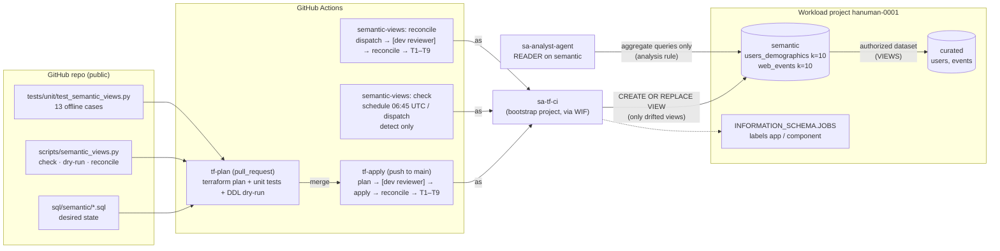

# Phase 2 · W1 Day 3–4 — Semantic views owned by CI: deploy, drift detection, reconcile

> Repo: `bq-ai-analyst` · Dates: 2026-10-29 → 2026-10-30 · `main` at close: `000e795`
> PRs covered: #33 (`625db6b`, deploy + drift reconcile + PR dry-run), #34 (`000e795`, scheduled check + dispatch reconcile)
> Decision this implements: [ADR-0002](../adr/0002-semantic-view-ownership.md) (Option 3, CI-run DDL + drift job)

This file contains **no** organization ID, project number, folder ID, billing account, Cloud Identity customer ID, domain, or personal email. Project IDs (`hanuman-0001` workload, `hanuman-0002` bootstrap) appear on purpose; they were recorded as accepted risk on Day 9.

---

## Contents

- [0. How to read this document](#0-how-to-read-this-document)
- [0.5 Review of Day 3–4: what I would change](#05-review-of-day-34-what-i-would-change)
- [1. Architecture on one page](#1-architecture-on-one-page)
- [2. Concepts primer](#2-concepts-primer)
- [3. Build-from-scratch walkthrough](#3-build-from-scratch-walkthrough)
- [4. Artifact-by-artifact deep dive](#4-artifact-by-artifact-deep-dive)
- [5. Decision tables](#5-decision-tables)
- [6. Verification](#6-verification)
- [7. Break-it labs](#7-break-it-labs)
- [8. Troubleshooting](#8-troubleshooting)
- [9. Reuse kit](#9-reuse-kit)
- [10. Self-test](#10-self-test)
- [11. Glossary and further reading](#11-glossary-and-further-reading)
- [12. Self-test answers](#12-self-test-answers)
- [13. What I was unsure about (verify these)](#13-what-i-was-unsure-about-verify-these)

---

## 0. How to read this document

**Audience.** A data engineer who knows BigQuery well, knows what Terraform does, and has used Git mainly as commit/push. You are moving into an architect role, so every choice here comes with its alternatives and the rule for switching.

**Depth.** Section 3 rebuilds Day 3–4 step by step. Section 4 explains every artifact with a fixed seven-point framework. Section 5 is the "defend the decision" material. Sections 6–7 are where you prove things to yourself; do not skip them.

**Prerequisites.** Day 3–4 sit on top of earlier work. Before starting you need, already working:

| Prerequisite | Built on | Why Day 3–4 needs it |
|---|---|---|
| Datasets `curated`, `semantic` in one region | Day 4–5 (Terraform `bigquery.tf`) | Views live in `semantic` and read `curated` |
| `curated.users`, `curated.events` tables | Day 6–7 (`sql/curated/*.sql`) | The views select from them |
| Authorized dataset: `semantic` may read `curated` (`target_types = ["VIEWS"]`) | Day 6 (Terraform) | Without it, every view query fails with access denied |
| `sa-analyst-agent` = READER on `semantic` only | Day 6 (Terraform) | The access tests impersonate it |
| Workload Identity Federation (WIF) + `sa-tf-ci` | Day 7 (bootstrap) | CI authenticates to GCP with no stored key |
| GitHub environment `dev` with a required reviewer | Day 7 | The human gate before anything changes |
| Access tests T1–T9 | Day 6–7 | The proof that privacy still holds after a deploy |
| ADR-0002 accepted | P2 Day 2 | The decision that CI owns view DDL |

**Reading paths.** Interview prep: sections 1, 5, 4 (soundbites), 10. Rebuild alone: sections 3, 9, 6. Learning: read top to bottom and do section 7.

---

## 0.5 Review of Day 3–4: what I would change

These come from reading the merged code, not from the chat. Severity is for this dev project; in production most of them go up a level.

| # | Finding | Severity | Evidence | What I would do |
|---|---|---|---|---|
| R1 | **Unmanaged views are invisible to the drift check.** The authorized-dataset grant covers *every* view in `semantic`, and the agent can read *every* view in `semantic`. The script only checks the views listed in `sql/semantic/`. A hand-created `semantic.anything` with no privacy policy would let the agent read `curated` row by row, and `check` would stay green. | **High (design)** | `bigquery.tf` L78–87 (`target_types = ["VIEWS"]`, whole dataset); `semantic_views.py` `run_check` iterates repo specs only | Add an "unmanaged objects" rule: list tables in `semantic`; anything not in the repo = drift (exit 2). Optionally alert on any non-CI DDL against `semantic` from the audit sink |
| R2 | **The approval gate lives in YAML, and WIF trusts the whole repo.** The WIF binding is `attribute.repository` only (any branch). A workflow edited on a branch and dispatched with `--ref` could drop `environment: dev` and run DDL as `sa-tf-ci` with no reviewer. Solo repo: only you have write access, so the practical risk is low today. | Medium (design) | `wif.tf` L18/L33; `semantic-views.yml` reconcile job | Restrict the `dev` environment to deployment branch `main`, and tighten WIF (attribute condition on `assertion.ref` or `assertion.environment`). Already partly in Deferred |
| R3 | **ADR-0002 text no longer matches the code.** It says the drift job compares a "query hash"; the code compares the full normalized query text exactly. It also says "curated tables stay DDL-from-CI"; curated tables are still hand-run DDL. | Medium (doc accuracy) | ADR-0002 Decision + Consequences vs `semantic_views.py` and handoff | Amend the ADR with a dated "Implementation notes" section. Don't silently edit the decision |
| R4 | **View labels are not checked.** Both view files set `labels = [("data_class", "aggregate_only")]`. A hand change to that label is not drift. | Low | `sql/semantic/*.sql` vs `evaluate()` | Compare labels too, or decide in writing that labels are informational |
| R5 | **Unpinned dependency.** `requirements-dev.txt` is one line, `google-cloud-bigquery`, no version. A breaking client release changes CI behavior with no code change. | Low | `requirements-dev.txt` | Pin (`google-cloud-bigquery==X.Y.Z`), let Dependabot propose bumps |
| R6 | **Mask step in `tf-plan.yml` is weaker than in the other workflows.** It has no `set -euo pipefail` and no empty-domain guard (an empty `DOMAIN` masks nothing). | Low | `tf-plan.yml` mask step vs `tf-apply.yml` | Copy the guarded block mechanically, same as Day 4 did for `semantic-views.yml` |
| R7 | **Small inconsistencies.** `semantic-views.yml` uses `runs-on: ubuntu-latest`; the others pin `ubuntu-24.04`. `tf-apply.yml` ends with 8 spaces and no final newline. | Cosmetic | file tails | Pin the runner image; fix the file ending. Batch with F8 |
| R8 | **No shared lock between the two deployers.** `tf-apply` (group `tf-apply-dev`) and `semantic-views` (group `semantic-views`) can both run `CREATE OR REPLACE VIEW` at the same time. | Low (solo) | `concurrency:` blocks | Already Deferred; one shared group name fixes it |
| R9 | **A red scheduled check only sends a GitHub email.** Nobody is paged. | Low (dev) | no alert step | Deferred to observability work |
| R10 | **Process: chained pastes lost evidence twice.** `rm /tmp/drift_t0` ran after the failed audit query; a reconcile was dispatched twice. | Process | Day 4 transcript | Already recorded as lessons; the rule is "one paste = one decision point" |

What went well and is worth repeating:
- The design was checked against the code *before* merge (install order, working directory, identity, project), not discovered as a failed apply.
- Every zero had a control: `DEPLOYED 0` was only accepted after the run status was confirmed `completed`.
- Negative proofs used real drift (k=10→5 and a dropped view), not a simulated flag.
- The deploy identity and project were proved from the job history (`INFORMATION_SCHEMA.JOBS`), not assumed.

---

## 1. Architecture on one page



**Elevator story (10 lines).**
1. The semantic views carry the privacy control (aggregation threshold k=10), so who creates them matters more than any other object.
2. Before Day 3 they were created by hand, outside any plan, review or drift check; the access tests were the only guard.
3. Day 2 proved Terraform cannot model `privacy_policy` (0 of 4 provider versions), so ADR-0002 chose CI-run DDL plus a drift job.
4. Day 3 wrote one Python tool with three modes: `check` (compare live to repo), `dry-run` (validate SQL), `reconcile` (redeploy only what drifted, then re-check).
5. It was tested offline first (13 unit cases), then read-only against live views (drift=0), before any CI wiring.
6. Pull requests now run the unit tests and a DDL dry-run, so a broken or weaker view fails before merge.
7. Every apply on `main` now reconciles views after Terraform and then runs T1–T9 as the agent.
8. Day 4 added detection outside merges: a daily detect-only check, plus a reviewer-gated manual reconcile.
9. A controlled drift (k lowered to 5, one view dropped) was detected locally and in CI, repaired by a reviewed reconcile, and T1–T9 passed 9/9.
10. Job history proved the repair ran as the CI identity in the workload project, and that the only hand DDL was the two logged test statements.

**Why in that order.** Decide (Day 2) → build and test offline (cheap, no risk) → read-only against live (proves the parser on real data) → wire into PRs (catch errors early) → wire into apply (enforce on every merge) → add scheduled detection (catch changes outside merges) → break it on purpose (prove detection and repair) → audit (prove identity and location).

---

## 2. Concepts primer

Only the concepts Day 3–4 rely on.

**Desired state, actual state, drift.** The *desired state* is what the repo says should exist (`sql/semantic/web_events.sql`). The *actual state* is what BigQuery has now. *Drift* is any difference between them. Example: the file says `threshold: 10`, `bq show` says `5` → drift.

**Reconcile loop.** A process that reads desired and actual state, changes only what differs, then checks again. Kubernetes controllers and GitOps tools (Argo CD, Flux) work this way. Example: two views, one drifted → one `CREATE OR REPLACE VIEW`, not two.

**Idempotent.** Running it again gives the same result and does no extra work. `CREATE OR REPLACE VIEW` is idempotent in result; the reconcile loop is idempotent in *work* too (no drift → no DDL). Day 3 proved this with `DEPLOYED 0`.

**Analysis rule / aggregation threshold.** A BigQuery view option (`privacy_policy`) that the engine enforces on every query. With `threshold: 10` and `privacy_unit_column: user_id`, a query must aggregate, and any output group with fewer than 10 distinct `user_id` values is removed. Example: `SELECT * FROM view` fails; `SELECT WITH AGGREGATION_THRESHOLD state, COUNT(*) …` returns only states with ≥10 users.

**Privacy unit.** The entity being protected. For `users_demographics` it is `user_id`; for `web_events` it is `privacy_unit` (user ID, or session ID for anonymous events).

**Authorized dataset.** A grant on dataset A (`curated`) that lets views in dataset B (`semantic`) read A, even when the person querying the view has no access to A. The grant covers *all* views in B (that is finding R1).

**Dry-run.** A query submitted with `dry_run=True`: BigQuery parses and validates it, checks permissions, estimates bytes, and does not execute it. For DDL this proves the statement is valid without changing anything.

**Exit code.** The number a program returns to the shell: `0` = success, non-zero = failure. CI steps pass or fail on it. The script uses `2` for "drift found" so it differs from a crash (`1`).

**Unit test vs integration test.** A unit test runs code with no external systems (here: no GCP calls, fake API responses). An integration test talks to the real system (here: `check` against live BigQuery, T1–T9 as the agent). Unit tests are fast and safe; integration tests prove the real wiring.

**Positive and negative control.** A negative control shows the check stays quiet when nothing is wrong (drift=0 on a clean state). A positive control shows the check fires when something is wrong (drift=2 after forced drift). A check with only one of the two proves nothing.

**GitHub Actions vocabulary.**
- *Workflow*: one YAML file under `.github/workflows/`.
- *Trigger* (`on:`): what starts it. `pull_request` = a PR is opened or updated. `push` + `paths` = a commit lands on `main` touching those paths. `schedule` = a cron time (UTC, runs from the default branch only). `workflow_dispatch` = a person starts it manually, optionally with inputs.
- *Job*: a group of steps on one fresh virtual machine (runner). Jobs don't share files unless you pass an artifact.
- *Step*: one command (`run:`) or one reusable action (`uses:`).
- *Environment*: a named deployment target (`dev`) with protection rules, such as a required reviewer. A job that names it pauses until approved.
- *Concurrency group*: runs sharing a group name wait for each other.

**Branch, pull request, squash merge, required check.** A *branch* is a separate line of commits. A *pull request (PR)* asks to merge a branch into `main`, and CI runs on it. A *squash merge* turns the PR's commits into one commit on `main`. A *required check* is a CI job (here `plan`) that must pass before the PR can merge; the repository *ruleset* enforces it.

**Workload Identity Federation (WIF).** GitHub issues a short-lived signed token (OIDC) for each run; Google trusts tokens from your repo and exchanges them for short-lived credentials of `sa-tf-ci`. No service-account key file exists anywhere.

**Job labels and `INFORMATION_SCHEMA.JOBS`.** Labels are key/value tags you attach to a BigQuery job (`component=view-deploy`). `region-us-east4.INFORMATION_SCHEMA.JOBS` lists every job in the project and region, with who ran it, statement type and labels. It is the evidence of *who did what, where*.

---

## 3. Build-from-scratch walkthrough

You start from an empty folder and a GCP project with the prerequisites in section 0. If you are starting from a truly empty project, build Days 1–7 first (`docs/day4_5.md`, `docs/day7.md`); section 9 lists the minimum. Commands go in the terminal. Python and YAML go in the editor or in a quoted heredoc (`<<'EOF'`), never pasted raw.

### Step 0 — Confirm the starting point

```bash
cd ~/bq-ai-analyst && source scripts/env.sh
git status -sb | head -1                         # expect: ## main...origin/main
bq ls --format=json semantic | jq '[.[] | select(.type=="VIEW")] | length'   # expect 2
```
**Why first:** every later proof compares against this baseline. A diverged local `main` (stray local commits) would make later `reset` commands dangerous.

### Step 1 — Check that the view files can be deployed as-is

```bash
for f in sql/semantic/*.sql; do
  printf '%s cor_view=%s privacy_policy=%s template_markers=%s\n' "$f" \
    "$(grep -ciE 'create[[:space:]]+or[[:space:]]+replace[[:space:]]+view' "$f")" \
    "$(grep -c 'privacy_policy' "$f")" \
    "$(grep -cE '\$\{|\{\{|@[a-z_]+' "$f")"
done
```
Expected (actual Day 3 output):
```
sql/semantic/users_demographics.sql cor_view=1 privacy_policy=1 template_markers=0
sql/semantic/web_events.sql cor_view=1 privacy_policy=1 template_markers=0
```
Then check the live query equals the file body after whitespace normalization:
```bash
python3 - <<'EOF'
import json, re, subprocess, pathlib
n = lambda s: re.sub(r"\s+", " ", s).strip()
for v in ["users_demographics", "web_events"]:
    live = json.loads(subprocess.check_output(["bq", "show", "--format=json", f"semantic.{v}"]))["view"]["query"]
    src = pathlib.Path(f"sql/semantic/{v}.sql").read_text()
    print(v, "live_in_file_normalized=", n(live) in n(src))
EOF
```
Expected: `True` for both. **Why before writing code:** the answers decide the design. Inline policy and no templating means "run the file"; matching text means the drift check can compare text directly.

### Step 2 — Branch

```bash
git switch -c p2-day3-semantic-deploy origin/main
```

### Step 3 — Write `scripts/semantic_views.py`

Full file as merged (`625db6b`). Create it with a quoted heredoc or the editor.

```python
#!/usr/bin/env python3
"""Semantic view deploy + drift check (ADR-0002, Option 3).

Modes:
  check      detect only; exit 0 = no drift, 2 = drift
  dry-run    dry-run every DDL file (PR check); exit 1 on failure
  reconcile  check -> deploy drifted views -> re-check; exit 1 if drift remains
Output: file names, statuses and counts only.
"""
import argparse
import json
import os
import pathlib
import re
import sys

SQL_DIR = pathlib.Path(__file__).resolve().parent.parent / "sql" / "semantic"
LABELS = {"app": "bq-ai-analyst", "component": "view-deploy"}
VIEW_RE = re.compile(r"create\s+or\s+replace\s+view\s+`?([\w.-]+)`?", re.I)
POLICY_RE = re.compile(r"privacy_policy\s*=\s*(?:'''|')(.*?)(?:'''|')", re.I | re.S)


def norm(s):
    return re.sub(r"\s+", " ", s).strip()


def parse_file(path):
    sql = path.read_text()
    m = VIEW_RE.search(sql)
    if not m:
        raise ValueError(f"{path.name}: no CREATE OR REPLACE VIEW")
    p = POLICY_RE.search(sql)
    if not p:
        raise ValueError(f"{path.name}: no privacy_policy")
    atp = json.loads(p.group(1))["aggregation_threshold_policy"]
    return {"file": path.name, "sql": sql, "table_id": m.group(1),
            "threshold": int(atp["threshold"]), "unit": atp["privacy_unit_column"]}


def load_specs():
    files = sorted(SQL_DIR.glob("*.sql"))
    if not files:
        raise SystemExit("no view files in sql/semantic")
    return [parse_file(f) for f in files]


def query_matches(file_sql, live_query):
    """Exact match: live query must be the whole body after AS (optionally wrapped in parens)."""
    f = norm(file_sql).rstrip(";").rstrip()
    q = norm(live_query)
    if not q or f.count(q) != 1:
        return False
    i = f.index(q)
    prefix, suffix = f[:i].rstrip(), f[i + len(q):].strip()
    m = re.search(r"\bAS\s*(\(?)$", prefix, re.I)
    if not m:
        return False
    return suffix == (")" if m.group(1) else "")


def find_key(obj, key):
    if isinstance(obj, dict):
        if key in obj:
            return obj[key]
        obj = list(obj.values())
    if isinstance(obj, list):
        for v in obj:
            r = find_key(v, key)
            if r is not None:
                return r
    return None


def evaluate(spec, table_type, props, view_query):
    if table_type != "VIEW":
        return "DRIFT", f"type={table_type}"
    reasons = []
    atp = find_key(props, "aggregationThresholdPolicy")
    if not atp:
        reasons.append("privacy_policy missing")
    else:
        if int(atp.get("threshold", -1)) != spec["threshold"]:
            reasons.append(f"threshold live={atp.get('threshold')} repo={spec['threshold']}")
        units = atp.get("privacyUnitColumns") or (
            [atp["privacyUnitColumn"]] if atp.get("privacyUnitColumn") else [])
        if units != [spec["unit"]]:
            reasons.append(f"privacy_unit live={units} repo={spec['unit']}")
    if not query_matches(spec["sql"], view_query or ""):
        reasons.append("query differs")
    return ("DRIFT", "; ".join(reasons)) if reasons else ("OK", "")


def check_view(client, spec):
    from google.api_core.exceptions import NotFound
    try:
        t = client.get_table(spec["table_id"])
    except NotFound:
        return "MISSING", "view not found"
    return evaluate(spec, t.table_type, t._properties, t.view_query)


def run_check(client, specs):
    bad = []
    for s in specs:
        status, why = check_view(client, s)
        print(f"{s['file']} {status} {why}".rstrip())
        if status != "OK":
            bad.append(s)
    print(f"SUMMARY views={len(specs)} drift={len(bad)}")
    return bad


def deploy(client, specs, dry):
    from google.cloud import bigquery
    cfg = bigquery.QueryJobConfig(labels=LABELS, dry_run=dry, use_query_cache=False)
    for s in specs:
        job = client.query(s["sql"], job_config=cfg)
        if not dry:
            job.result()
        print(f"{s['file']} {'DRYRUN_OK' if dry else 'DEPLOYED'}")


def main():
    ap = argparse.ArgumentParser()
    ap.add_argument("mode", choices=["check", "dry-run", "reconcile"])
    args = ap.parse_args()
    specs = load_specs()
    from google.cloud import bigquery
    project = os.environ.get("TF_VAR_PROJECT_ID") or os.environ.get("TF_VAR_project_id") or None
    client = bigquery.Client(project=project)
    if args.mode == "dry-run":
        deploy(client, specs, dry=True)
        print(f"SUMMARY dry_run_ok={len(specs)}")
        return 0
    bad = run_check(client, specs)
    if args.mode == "check":
        return 2 if bad else 0
    if bad:
        deploy(client, bad, dry=False)
        bad = run_check(client, specs)
    print(f"RECONCILE remaining_drift={len(bad)}")
    return 1 if bad else 0


if __name__ == "__main__":
    sys.exit(main())
```

### Step 4 — Write `tests/unit/test_semantic_views.py`

```python
#!/usr/bin/env python3
"""Offline tests for scripts/semantic_views.py drift logic (no GCP calls)."""
import importlib.util
import pathlib
import sys

ROOT = pathlib.Path(__file__).resolve().parents[2]
_spec = importlib.util.spec_from_file_location("sv", ROOT / "scripts" / "semantic_views.py")
sv = importlib.util.module_from_spec(_spec)
_spec.loader.exec_module(sv)


def pol(threshold="10", units=("user_id",)):
    return {"privacyPolicy": {"aggregationThresholdPolicy": {"threshold": threshold, "privacyUnitColumns": list(units)}}}


SQL = ("CREATE OR REPLACE VIEW `p.semantic.x`\n"
       "OPTIONS(privacy_policy='{\"aggregation_threshold_policy\":{\"threshold\":10,\"privacy_unit_column\":\"user_id\"}}')\n"
       "AS (\n  SELECT a, b\n  FROM `p.curated.t`\n  WHERE a > 0\n);\n")
SPEC = {"file": "x.sql", "table_id": "p.semantic.x", "threshold": 10, "unit": "user_id", "sql": SQL}
LIVE = "SELECT a, b FROM `p.curated.t` WHERE a > 0"

cases = [
    ("match paren form", sv.query_matches(SQL, "\n  SELECT a, b\n  FROM `p.curated.t`\n  WHERE a > 0\n"), True),
    ("match no-paren form", sv.query_matches("CREATE OR REPLACE VIEW v AS SELECT 1 x;", "SELECT 1 x"), True),
    ("truncated query", sv.query_matches(SQL, "SELECT a, b FROM `p.curated.t`"), False),
    ("extra clause", sv.query_matches(SQL, LIVE + " LIMIT 5"), False),
    ("empty query", sv.query_matches(SQL, ""), False),
    ("evaluate OK", sv.evaluate(SPEC, "VIEW", pol(), LIVE)[0], "OK"),
    ("threshold 5", sv.evaluate(SPEC, "VIEW", pol(threshold="5"), LIVE)[0], "DRIFT"),
    ("policy missing", sv.evaluate(SPEC, "VIEW", {}, LIVE)[0], "DRIFT"),
    ("unit changed", sv.evaluate(SPEC, "VIEW", pol(units=("session_id",)), LIVE)[0], "DRIFT"),
    ("not a view", sv.evaluate(SPEC, "TABLE", pol(), LIVE)[0], "DRIFT"),
]
specs = sv.load_specs()
cases += [
    ("repo files parsed", len(specs), 2),
    ("repo thresholds", sorted({s["threshold"] for s in specs}), [10]),
    ("repo units", sorted(s["unit"] for s in specs), ["privacy_unit", "user_id"]),
]

failed = [n for n, got, exp in cases if got != exp]
for n, got, exp in cases:
    print(f"{'PASS' if got == exp else 'FAIL'} {n}")
print(f"UNIT {len(cases) - len(failed)}/{len(cases)} passed")
sys.exit(1 if failed else 0)
```

### Step 5 — Prove it locally: offline, then read-only

```bash
python3 tests/unit/test_semantic_views.py | tail -1     # UNIT 13/13 passed
python3 scripts/semantic_views.py check;   echo "exit=$?"
python3 scripts/semantic_views.py dry-run; echo "exit=$?"
```
Expected (actual Day 3 output):
```
UNIT 13/13 passed
users_demographics.sql OK
web_events.sql OK
SUMMARY views=2 drift=0
exit=0
users_demographics.sql DRYRUN_OK
web_events.sql DRYRUN_OK
SUMMARY dry_run_ok=2
exit=0
```
**Never run `reconcile` locally.** That would be hand DDL against `semantic` from your user account, which ADR-0002 forbids. **Why this order:** unit tests prove the logic with no risk; `check` proves the parser on real API responses; `dry-run` proves the DDL is valid and your permissions work. Only then does CI get involved.

### Step 6 — Add the PR checks to `tf-plan.yml`

Append to the `plan` job, after "Plan summary":
```yaml
      - uses: actions/setup-python@v5
        with:
          python-version: "3.12"
      - name: Install Python dependencies
        working-directory: ${{ github.workspace }}
        run: pip install --quiet -r requirements-dev.txt
      - name: Semantic views — unit tests + DDL dry-run (ADR-0002)
        working-directory: ${{ github.workspace }}
        run: |
          python tests/unit/test_semantic_views.py
          python scripts/semantic_views.py dry-run
```
**Why `working-directory: ${{ github.workspace }}`:** the `plan` job sets `defaults.run.working-directory: infra/envs/dev`, so relative paths like `scripts/…` would not resolve there. The step override puts these two steps back at the repo root.

### Step 7 — Add reconcile to `tf-apply.yml`

Add two lines to `paths:`:
```yaml
      - "sql/semantic/**"
      - "scripts/semantic_views.py"
```
In the `apply` job, after `setup-python`, make the install its own step and put reconcile **before** the access tests:
```yaml
      - name: Install Python dependencies
        run: pip install --quiet -r requirements-dev.txt
      - name: Reconcile semantic views (ADR-0002)
        env:
          TF_VAR_PROJECT_ID: ${{ vars.TF_VAR_PROJECT_ID }}
        run: python scripts/semantic_views.py reconcile
      - name: Access regression (as sa-analyst-agent)
        run: python tests/access/test_semantic_access.py
```
Check before committing:
```bash
grep -nE 'defaults:|working-directory|^    env:|pip install|semantic_views|sql/semantic' .github/workflows/tf-apply.yml
```
Read it like this: `defaults` (L34) and the job `env` (L29) belong to the `plan` job, not `apply`; `pip install` comes before `reconcile`; `TF_VAR_PROJECT_ID` is set on the reconcile step. **Why the explicit project:** `sa-tf-ci` lives in the bootstrap project. A BigQuery client that guesses its project from the credentials can create jobs there, billed and logged in the wrong place.

### Step 8 — PR, merge, approve, verify

Three separate pastes. Never chain merge and verify.

```bash
git add scripts/semantic_views.py tests/unit/test_semantic_views.py .github/workflows/tf-apply.yml .github/workflows/tf-plan.yml
git diff --cached --stat                      # exactly 4 files
git commit -m "feat(semantic): CI-run view DDL with drift reconcile + PR dry-run (ADR-0002)"
git push -u origin p2-day3-semantic-deploy    # pre-push hook runs fmt + actionlint
gh pr create --base main --fill
```
```bash
gh pr checks --watch                          # re-run if "no checks reported" (race)
R=$(gh run list --branch p2-day3-semantic-deploy --workflow tf-plan.yml --limit 1 --json databaseId -q '.[0].databaseId')
gh run view "$R" --log | grep -c -f ~/private-notes/identifiers.txt                # 0
gh run view "$R" --log | grep -cE 'UNIT 13/13 passed|SUMMARY dry_run_ok=2'        # 2
```
```bash
gh pr merge --squash --delete-branch --author-email "$(git config user.email)"
```
Approve the `dev` deployment in the GitHub UI, then verify the apply run (section 6, V3). Day 3 result: run `41128477681`, `drift=0`, `remaining_drift=0`, `9/9`, `DEPLOYED 0`.

### Step 9 — Write `.github/workflows/semantic-views.yml` (Day 4)

Copy the auth and mask block mechanically from the `apply` job instead of retyping it:
```bash
git switch -c p2-day4-drift-workflow origin/main
awk '/google-github-actions\/auth@v3/{n++} n==2 && /hashicorp\/setup-terraform/{exit} n==2{print}' \
  .github/workflows/tf-apply.yml > /tmp/authmask.yml
grep -c 'Mask identifiers' /tmp/authmask.yml      # 1
```
Write the workflow with two `# AUTH_MASK` marker lines, replace them with the block, and confirm 2 mask blocks and 0 markers. The merged result:

```yaml
name: semantic-views

on:
  schedule:
    - cron: "45 6 * * *"
  workflow_dispatch:
    inputs:
      mode:
        description: "check = detect only; reconcile = redeploy drifted views (reviewer-gated)"
        type: choice
        options: [check, reconcile]
        default: check

permissions:
  contents: read
  id-token: write

concurrency:
  group: semantic-views
  cancel-in-progress: false

jobs:
  check:
    if: github.event_name == 'schedule' || inputs.mode == 'check'
    runs-on: ubuntu-latest
    timeout-minutes: 10
    steps:
      - uses: actions/checkout@v5
      - uses: google-github-actions/auth@v3
        with:
          workload_identity_provider: ${{ secrets.GCP_WIF_PROVIDER }}
          service_account: ${{ vars.GCP_TF_SA }}
      - name: Mask identifiers
        env:
          TF_VAR_ADMINS_GROUP: ${{ secrets.TF_VAR_ADMINS_GROUP }}
          MASK_SELFTEST: ${{ vars.MASK_SELFTEST }}
        run: |
          set -euo pipefail
          PN="$(gcloud projects describe "${{ vars.TF_VAR_PROJECT_ID }}" --format='value(projectNumber)')"
          DOMAIN="${TF_VAR_ADMINS_GROUP#*@}"
          [[ -n "${PN:-}" && -n "${DOMAIN:-}" ]] || { echo "mask: empty lookup"; exit 1; }
          echo "::add-mask::${PN}"
          echo "::add-mask::${DOMAIN}"
          if [[ "${MASK_SELFTEST:-}" == "true" ]]; then echo "mask-selftest ${PN} ${DOMAIN}"; fi
      - uses: actions/setup-python@v5
        with:
          python-version: "3.12"
      - name: Install Python dependencies
        run: pip install --quiet -r requirements-dev.txt
      - name: Drift check (ADR-0002, detect only)
        env:
          TF_VAR_PROJECT_ID: ${{ vars.TF_VAR_PROJECT_ID }}
        run: python scripts/semantic_views.py check

  reconcile:
    if: github.event_name == 'workflow_dispatch' && inputs.mode == 'reconcile'
    runs-on: ubuntu-latest
    timeout-minutes: 15
    environment: dev
    steps:
      - uses: actions/checkout@v5
      - uses: google-github-actions/auth@v3
        with:
          workload_identity_provider: ${{ secrets.GCP_WIF_PROVIDER }}
          service_account: ${{ vars.GCP_TF_SA }}
      - name: Mask identifiers
        env:
          TF_VAR_ADMINS_GROUP: ${{ secrets.TF_VAR_ADMINS_GROUP }}
          MASK_SELFTEST: ${{ vars.MASK_SELFTEST }}
        run: |
          set -euo pipefail
          PN="$(gcloud projects describe "${{ vars.TF_VAR_PROJECT_ID }}" --format='value(projectNumber)')"
          DOMAIN="${TF_VAR_ADMINS_GROUP#*@}"
          [[ -n "${PN:-}" && -n "${DOMAIN:-}" ]] || { echo "mask: empty lookup"; exit 1; }
          echo "::add-mask::${PN}"
          echo "::add-mask::${DOMAIN}"
          if [[ "${MASK_SELFTEST:-}" == "true" ]]; then echo "mask-selftest ${PN} ${DOMAIN}"; fi
      - uses: actions/setup-python@v5
        with:
          python-version: "3.12"
      - name: Install Python dependencies
        run: pip install --quiet -r requirements-dev.txt
      - name: Reconcile semantic views (ADR-0002)
        env:
          TF_VAR_PROJECT_ID: ${{ vars.TF_VAR_PROJECT_ID }}
        run: python scripts/semantic_views.py reconcile
      - name: Access regression (as sa-analyst-agent)
        run: python tests/access/test_semantic_access.py
```
Commit, PR, wait for `plan`, merge (as in Step 8). Merging does **not** start `tf-apply`, because this file is not in its `paths`.

### Step 10 — Baseline, controlled drift, detect, repair (Day 4)

```bash
gh workflow run semantic-views.yml -f mode=check
B=$(gh run list --workflow semantic-views.yml --limit 1 --json databaseId -q '.[0].databaseId')
gh run watch "$B" --exit-status >/dev/null; echo "baseline_exit=$?"       # 0
```
Logged test exception (the only hand DDL allowed against `semantic`):
```bash
date -u +%FT%TZ > ~/private-notes/scratch/drift_t0    # [SUGGESTION] Day 4 used /tmp and lost it; keep evidence here, delete at day close
cat > /tmp/drift.sql <<'EOF'
ALTER VIEW `hanuman-0001.semantic.users_demographics`
SET OPTIONS (privacy_policy = '{"aggregation_threshold_policy": {"threshold": 5, "privacy_unit_column": "user_id"}}');
DROP VIEW `hanuman-0001.semantic.web_events`;
EOF
bq query --use_legacy_sql=false --label=app:bq-ai-analyst --label=component:drift-test "$(cat /tmp/drift.sql)" >/dev/null; echo "ddl_exit=$?"
python3 scripts/semantic_views.py check; echo "exit=$?"     # drift=2, exit=2
```
Detect in CI (red is the pass condition):
```bash
gh workflow run semantic-views.yml -f mode=check
C=$(gh run list --workflow semantic-views.yml --limit 1 --json databaseId -q '.[0].databaseId')
gh run watch "$C" --exit-status >/dev/null; echo "check_exit=$?"           # non-zero
gh run view "$C" --log | grep -cE 'threshold live=5 repo=10|web_events.sql MISSING|SUMMARY views=2 drift=2'   # 3
```
Repair (approve `dev` in the UI while it waits). Dispatch **once**:
```bash
gh workflow run semantic-views.yml -f mode=reconcile
R=$(gh run list --workflow semantic-views.yml --limit 1 --json databaseId -q '.[0].databaseId')
gh run watch "$R" --exit-status >/dev/null; echo "reconcile_exit=$?"       # 0
gh run view "$R" --log | grep -c 'DEPLOYED'                                  # 2
gh run view "$R" --log | grep -cE 'RECONCILE remaining_drift=0|SUMMARY 9/9 passed'   # 2
python3 scripts/semantic_views.py check; echo "exit=$?"                      # drift=0, exit=0
```
**Why this order:** baseline first, so a red check later can only be caused by your drift. Local detection before CI separates "the logic works" from "the workflow works". Repair last, then re-check, then T1–T9, so the repair is proven to restore privacy, not only to recreate objects.

### Step 11 — Audit who ran DDL, and where

```bash
bq query --use_legacy_sql=false --format=pretty '
SELECT IF(user_email LIKE "sa-tf-ci@%", "ci", "other") AS who,
       statement_type,
       (SELECT value FROM UNNEST(labels) WHERE key = "component") AS component,
       COUNT(*) AS n
FROM `region-us-east4`.INFORMATION_SCHEMA.JOBS
WHERE creation_time >= TIMESTAMP_SUB(CURRENT_TIMESTAMP(), INTERVAL 12 HOUR)
  AND statement_type IN ("CREATE_VIEW", "ALTER_VIEW", "DROP_VIEW")
  AND REGEXP_CONTAINS(query, r"(?i)\bsemantic\.")
GROUP BY 1, 2, 3 ORDER BY 1, 2'
```
Actual Day 4 result:
```
| ci    | CREATE_VIEW    | view-deploy | 2 |
| other | ALTER_VIEW     | drift-test  | 1 |
| other | DROP_VIEW      | drift-test  | 1 |
```
Read: the CI repair created exactly 2 views; the only non-CI DDL is the 2 logged test statements. Because this query reads the workload project's job history, the CI jobs ran in the workload project.

---

## 4. Artifact-by-artifact deep dive

Skipped as trivial: `timeout-minutes` values, `python-version: "3.12"`, `pip install --quiet`, the `permissions:` block (unchanged pattern from Day 7: `contents: read`, `id-token: write` for WIF).

### 4.1 `sql/semantic/*.sql` as the single source of truth

1. **What it is:** two DDL files, each one `CREATE OR REPLACE VIEW … OPTIONS(privacy_policy=…, labels=…) AS SELECT …`.
2. **Why here:** the privacy rule must be reviewed in a PR and deployed by a machine. One file per view makes the diff of a policy change one line.
3. **Why this form:** policy inline (not applied by a second `ALTER`) means one statement creates a view that is never unprotected, even for a second. Fully qualified names (`hanuman-0001.semantic.x`) mean the file runs the same regardless of the client's default project. No templating means the file you review is exactly what runs.
4. **Alternatives:** (a) templated SQL (`${project}`) rendered at deploy time: wins with several environments (dev/stage/prod), loses on reviewability, since the reviewed text is not the executed text. (b) policy applied by a separate `ALTER VIEW SET OPTIONS`: wins if many views share one policy file, loses because there is a window where the view exists without a policy. (c) Dataform `.sqlx` with `bigquery.additionalOptions`: wins with many objects and dependencies, loses on setup cost for 2 views (ADR-0002).
5. **Trade-offs:** hardcoded project ID = no multi-environment reuse until templated; accepted for one dev project.
6. **If skipped (policy not inline):** a view created without `privacy_policy` is a normal view; the agent can `SELECT *` from it through the authorized dataset. Nothing errors; it's a silent privacy failure.
7. **Soundbite:** "Each governed view is one reviewed DDL file with its privacy rule inline. The file that's reviewed is byte-for-byte the file that's executed, and there's no moment when the view exists without its policy."

### 4.2 `semantic_views.py`: three modes and exit codes

1. **What it is:** one Python tool with modes `check` (0 clean / 2 drift), `dry-run` (0 / 1), `reconcile` (0 / 1).
2. **Why here:** the same comparison logic serves the PR (validate), the merge (enforce), and the schedule (detect). One tool means one definition of drift.
3. **Why this form:** a separate exit code for drift (`2`) lets a caller tell "drift found" apart from "script crashed" (`1`, or a Python traceback). `reconcile` redeploys **only** drifted views, so a clean run does zero DDL (proved: `DEPLOYED 0`). The client library is used instead of the `bq` CLI so tests can import the logic and runners need no Cloud SDK for Python steps.
4. **Alternatives:** (a) a bash loop running `bq query < file` for every file on every apply: wins on simplicity, loses because it always redeploys (noise in audit logs) and cannot detect drift. (b) Terraform `null_resource` + `local-exec` running `bq`: wins on keeping one tool, loses because Terraform cannot see the view's real state, so drift stays invisible. (c) Dataform release + workflow config: wins at scale (dependencies, assertions), loses on ops cost for 2 views.
5. **Trade-offs:** custom code to own (146 lines + tests). Blast radius limited: it only touches objects named in `sql/semantic/`.
6. **If skipped:** views remain hand-run DDL; a dropped or weakened view is found by T1–T9 at best, after the fact, and only on a merge that triggers tests.
7. **Soundbite:** "One small reconciler with three modes: validate on PRs, enforce on merge, detect on a schedule. It changes only what drifted, so a clean run is a no-op and the audit log stays meaningful."

### 4.3 `parse_file()` and the two regexes

1. **What it is:** reads each file and extracts the view ID (`VIEW_RE`) and the policy JSON (`POLICY_RE`), then the threshold and privacy unit.
2. **Why here:** the drift check needs the *expected* threshold and unit from the same file that gets deployed, never from a second config file that could disagree.
3. **Why this form:** `POLICY_RE` accepts `'…'` and `'''…'''` quoting (both are valid BigQuery string literals). A file with no policy raises `ValueError`, so the tool **fails closed**: it refuses to proceed (lab L6 proved this).
4. **Alternatives:** (a) a proper SQL parser (`sqlglot`): wins on robustness to unusual formatting, loses with an extra dependency and weaker handling of BigQuery-specific `OPTIONS`. (b) a YAML manifest listing view → threshold → unit: wins on readability, loses because it can disagree with the DDL.
5. **Trade-offs:** regexes are brittle to exotic formatting (two statements in one file: only the first is read). Acceptable with a strict "one view per file" convention.
6. **If skipped:** expected values would be hardcoded in the script, and a PR changing the file would not change what the check expects.
7. **Soundbite:** "Expected policy values are parsed from the deployable file itself, so the spec and the check can't disagree, and a file missing its policy stops the pipeline."

### 4.4 `query_matches()`: exact match, not substring

1. **What it is:** returns True only if the live view's query is the *entire* body after `AS` in the file (optionally wrapped in parentheses), after collapsing whitespace.
2. **Why here:** the first draft check (`live in file`) would accept a **truncated** live query, because a prefix of the file is a substring of the file.
3. **Why this form:** `f.count(q) != 1` rejects empty and repeated matches; the prefix must end in `AS` or `AS (`; the suffix must be empty or `)`. Whitespace normalization tolerates line-break reformatting; it does **not** tolerate token changes (lab L4: a space before a comma is drift).
4. **Alternatives:** (a) store a hash of the normalized body at deploy time (in a label or a table) and compare hashes: wins when files are templated, loses because it needs a write on every deploy and a second store. (b) compare `INFORMATION_SCHEMA.VIEWS.view_definition`: same text, different access path, no gain. (c) compare the full DDL (`INFORMATION_SCHEMA.TABLES.ddl`): wins because it includes options, loses because BigQuery reformats it, so exact comparison breaks.
5. **Trade-offs:** strict comparison catches every edit, including harmless ones; a reformatted file causes one redeploy on the next merge, which is fine.
6. **If skipped (substring check):** someone replaces a view with a shortened query (for example removing a `WHERE` that filters a sensitive population); `check` stays green.
7. **Soundbite:** "Drift detection must use exact match. A truncated query is a substring of the original, so 'contains' would pass a weakened view."

### 4.5 `evaluate()` and `find_key()`: what counts as drift

1. **What it is:** given the live table metadata, it returns `OK` or `DRIFT` with reasons: not a VIEW, policy missing, threshold differs, privacy unit differs, query differs. A missing view returns `MISSING` from `check_view()`.
2. **Why here:** these are exactly the ways the privacy guarantee can break.
3. **Why this form:** `find_key()` searches the whole API object for `aggregationThresholdPolicy`, so it doesn't depend on the exact nesting path. The threshold is compared as `int(...)` because the API returns it as a string (`"10"`). Units accept both `privacyUnitColumns` (list) and `privacyUnitColumn` (string).
4. **Alternatives:** (a) check only the threshold: wins on simplicity, loses because changing the privacy unit to a non-identifying column defeats k. (b) also check labels, description, schema: wins on completeness (R4), costs more false alarms.
5. **Trade-offs:** **does not detect views that aren't in the repo (R1).** That is the most important gap.
6. **If skipped (threshold only):** `privacy_unit_column` changed from `user_id` to `country` keeps k=10 but now counts countries, not people; nearly every group passes.
7. **Soundbite:** "Drift is defined by the privacy guarantee: object type, policy present, threshold, privacy unit, and the query itself. The known gap is objects that exist live but not in the repo; the next fix is to treat those as drift too."

### 4.6 Job labels `app` / `component`

1. **What it is:** `QueryJobConfig(labels={"app": "bq-ai-analyst", "component": "view-deploy"})` on every deploy and dry-run job.
2. **Why here:** cost reporting (`ops_audit.v_query_cost_daily` groups by these labels) and audit filtering.
3. **Why this form:** reuses the Day 8 label scheme, so no new reporting is needed.
4. **Alternatives:** (a) filter by service account only: wins with one SA per purpose, loses here because `sa-tf-ci` also runs Terraform. (b) a query comment tag (`/* view-deploy */`): searchable in query text, but not a first-class, indexed field.
5. **Trade-offs:** none meaningful; labels are free.
6. **If skipped:** CI DDL is indistinguishable from other `sa-tf-ci` jobs in cost and audit views.
7. **Soundbite:** "Every machine-issued job carries app and component labels, so cost and audit questions are one GROUP BY away."

### 4.7 Explicit project (`TF_VAR_PROJECT_ID`)

1. **What it is:** the reconcile and check steps set `TF_VAR_PROJECT_ID`; the script passes it to `bigquery.Client(project=…)`. It also reads the lowercase `TF_VAR_project_id` that `tf-plan.yml` exports.
2. **Why here:** `sa-tf-ci` lives in the bootstrap project. Without an explicit project, the client picks a default from the environment or credentials. [ASSUMPTION] In this setup that default would be the bootstrap project.
3. **Why this form:** reuses the repo variable that Terraform already uses, so there's one source of truth for the project ID.
4. **Alternatives:** (a) `GOOGLE_CLOUD_PROJECT` env var: standard for Google client libraries, but a second name for the same value. (b) a `--project` CLI flag: explicit per call, more to type in each workflow.
5. **Trade-offs:** the script has to read two spellings until F8 (lowercase vars in `tf-plan.yml`) is fixed.
6. **If skipped:** jobs bill to and log in the bootstrap project (invisible in `v_query_cost_daily`), or fail with `403 … bigquery.jobs.create` if `sa-tf-ci` can't create jobs there. The views themselves would still be correct because names are fully qualified, which makes it easy to miss.
7. **Soundbite:** "Never let a client library guess the project in CI. Set it explicitly, then prove the job landed there from the job history."

### 4.8 Unit tests (13 offline cases)

1. **What it is:** a plain Python script (no pytest) that loads the module from its path and checks 10 synthetic cases plus 3 assertions on the real repo files.
2. **Why here:** the drift logic is the safety mechanism, so it needs its own tests, including the cases that must say DRIFT.
3. **Why this form:** no GCP calls, so it runs in milliseconds on every PR. The repo assertions (`thresholds == [10]`) mean a PR lowering k fails CI (lab L5: `UNIT 12/13`, exit 1). Plain script: same `PASS/FAIL` + `UNIT n/m` output style as the access tests.
4. **Alternatives:** (a) pytest with fixtures: better reporting at scale, one more dependency. (b) only integration tests against live BigQuery: real, but slow, and they need credentials on every PR.
5. **Trade-offs:** `repo thresholds == [10]` hardcodes policy in a test. That is intentional: changing k then requires two edits, which a reviewer will notice.
6. **If skipped:** a regression in `query_matches()` (say, back to substring) passes CI, and the first sign is a weakened view that `check` calls OK.
7. **Soundbite:** "The safety check has its own tests, including negative cases. The tests also pin the privacy threshold, so lowering k fails CI unless someone deliberately changes the test too."

### 4.9 `tf-plan.yml` additions (PR gate)

1. **What it is:** setup-python, install, unit tests, `dry-run`, appended to the existing required `plan` job.
2. **Why here:** the `plan` job is already the required check, so a broken view blocks the merge without a new ruleset entry.
3. **Why this form:** step-level `working-directory: ${{ github.workspace }}` overrides the job default `infra/envs/dev`. Appended **after** Terraform, so a Terraform failure is reported first.
4. **Alternatives:** (a) a separate `semantic` job: runs in parallel, but becomes a second required check to add to the ruleset. (b) a path-filtered workflow: runs less, but path filters plus required checks leave the check stuck at "Expected" (Day 8 lesson).
5. **Trade-offs:** about 20 s added to every PR; acceptable.
6. **If skipped:** a syntax error in a view file is found on `main` during apply, after merge, with the reviewer already approved.
7. **Soundbite:** "View DDL is dry-run on every PR inside the existing required check, so broken SQL can't reach main and there's no extra check to configure."

### 4.10 `tf-apply.yml`: paths and step order

1. **What it is:** `paths` gains `sql/semantic/**` and `scripts/semantic_views.py`; the `apply` job runs install → reconcile → access tests after `terraform apply`.
2. **Why here:** a merged view change must deploy; every apply must re-assert the views.
3. **Why this form:** reconcile **after** Terraform (grants and authorized dataset in place first), **before** T1–T9 (tests prove the result). The install got its own step so it runs before reconcile (originally it was inside the test step). The DDL runs as `sa-tf-ci`; only the test script impersonates the agent, in code.
4. **Alternatives:** (a) a separate `semantic-deploy` workflow on push: decoupled from Terraform, but grants and views could deploy in the wrong order. (b) reconcile in the `plan` job: runs before the reviewer approves, which defeats the gate.
5. **Trade-offs:** coupling. A view-only change still runs a Terraform plan and needs the `dev` approval. That's acceptable: same gate for every production-affecting change.
6. **If skipped (wrong order):** reconcile before install → `ModuleNotFoundError: No module named 'google.cloud'`; tests before reconcile → tests validate the old views.
7. **Soundbite:** "Order is part of the design: infrastructure and grants first, then the views that depend on them, then tests that prove privacy still holds, all behind one human approval."

### 4.11 `semantic-views.yml` triggers: schedule + dispatch

1. **What it is:** `schedule: "45 6 * * *"` (daily 06:45 UTC) and `workflow_dispatch` with input `mode: check | reconcile`.
2. **Why here:** the apply-time reconcile only runs when someone merges. A hand change on a quiet week would go unnoticed for days.
3. **Why this form:** minute 45, not 0, avoids the top-of-hour rush (GitHub documents that scheduled runs can be delayed under load). A `choice` input means a typo can't create an unknown mode. The default is `check`, the safe mode.
4. **Alternatives:** (a) Cloud Scheduler → Cloud Run job running the same script: wins when you need GCP-native alerting and no dependency on GitHub, loses because it's another deploy target and identity to manage. (b) a Composer DAG: wins if Composer already runs your platform, loses on cost for one daily check. (c) BigQuery audit-log alert on any DDL to `semantic` (log-based metric + alert policy): wins on detection speed (minutes), complements rather than replaces the state check.
5. **Trade-offs:** GitHub disables schedules in public repos after 60 days with no repository activity; detection depends on GitHub availability.
6. **If skipped:** detection latency = time to the next merge.
7. **Soundbite:** "Apply-time reconcile covers changes that come through Git. A daily detect-only run covers changes that don't, and a manual reconcile repairs them behind the same approval."

### 4.12 Jobs `check` vs `reconcile` and `environment: dev`

1. **What it is:** two jobs with `if:` conditions; `check` runs on schedule or `mode=check`; `reconcile` runs only on `mode=reconcile` and names `environment: dev`.
2. **Why here:** detection should be automatic; repair changes production objects and needs a human.
3. **Why this form:** **detect automatically, repair with approval.** A scheduled auto-heal would silently undo an emergency change made by an admin, and it would also hide that the change happened.
4. **Alternatives:** (a) auto-reconcile on schedule: wins on recovery time, loses on auditability and can fight a human mid-incident. (b) detect-only with a ticket: wins on governance, loses on recovery time.
5. **Trade-offs:** repair needs a person online. Fine for dev; in production, pair it with paging.
6. **If skipped (no environment on reconcile):** anyone who can dispatch workflows can run DDL as `sa-tf-ci` without review. Note R2: the gate is only as strong as the WIF and environment branch rules behind it.
7. **Soundbite:** "Detection is automatic and repair is gated. Auto-heal would quietly erase evidence of an out-of-band change and could fight an engineer during an incident."

### 4.13 `concurrency: semantic-views`, `cancel-in-progress: false`

1. **What it is:** runs of this workflow queue instead of overlapping, and a running repair is never cancelled.
2. **Why here:** two reconciles at once could interleave check and deploy.
3. **Why this form:** `false` because cancelling a half-finished DDL run leaves an unknown state.
4. **Alternatives:** (a) share the group `tf-apply-dev` with `tf-apply`, which closes R8. (b) no concurrency: fine for check-only, risky for reconcile.
5. **Trade-offs:** a stuck run blocks the queue until timeout (15 min).
6. **If skipped:** duplicate dispatches (which happened on Day 4) run in parallel instead of in sequence.
7. **Soundbite:** "Deploy workflows queue and never cancel mid-run, and ideally every deployer of the same objects shares one lock."

### 4.14 Auth + mask block, copied mechanically

1. **What it is:** the `google-github-actions/auth@v3` step plus the "Mask identifiers" step (project number and domain masked, empty-lookup guard, optional self-test), copied with `awk` from the `tf-apply` apply job.
2. **Why here:** every job that authenticates can print identifiers; each job needs its own mask step (Day 9/P2 Day 1 lesson).
3. **Why this form:** a copy by tool, then counting (`Mask identifiers` = 2, markers = 0), avoids the retyping drift that left `tf-plan.yml` with a weaker version (R6).
4. **Alternatives:** (a) a composite action in `.github/actions/auth-mask/`: one definition, used everywhere, best once there are 3+ workflows. (b) a reusable workflow (`workflow_call`): heavier, and jobs are less flexible.
5. **Trade-offs:** the copy pattern means 4 copies to keep in sync. A composite action is the better next step.
6. **If skipped:** project number or domain in a public Actions log.
7. **Soundbite:** "Security boilerplate is copied by tool and counted, never retyped. The next step is a composite action, so there's one definition."

### 4.15 The controlled drift test (logged exception)

1. **What it is:** two admin DDL statements against `semantic` (`ALTER VIEW` k=10→5, `DROP VIEW web_events`), labelled `component=drift-test`, then detection and repair.
2. **Why here:** a detector that has never fired is unproven (positive control).
3. **Why this form:** two different drift types (policy weakened, object missing) in one script, so one run proves both paths. The labels make the test identifiable in the audit afterwards.
4. **Alternatives:** (a) test in a scratch dataset with a copy of the views: no production impact, but it doesn't prove the real workflow against real objects. (b) unit-test only: proves the logic, not the wiring, identity, or project.
5. **Trade-offs:** a short window (minutes) with k=5 live and one view missing, dev only. That was accepted and recorded.
6. **If skipped:** you believe the detector works.
7. **Soundbite:** "We broke production-shaped objects on purpose, with labelled and logged DDL, to prove detection and repair end to end, then used job history to prove nothing else changed."

### 4.16 The `INFORMATION_SCHEMA.JOBS` audit query

1. **What it is:** groups DDL jobs on `semantic` in the last 12 h by CI/other, statement type, and `component` label.
2. **Why here:** proves *who* ran the repair, *where* (workload project), and that no other DDL happened.
3. **Why this form:** filters on `statement_type` and query text, because this view has no `ddl_target_table` column (the first attempt failed with `Unrecognized name: ddl_target_table`). The statement-type filter also excludes `SCRIPT` parent jobs; the child jobs carried the script's labels.
4. **Alternatives:** (a) the audit-log sink in `ops_audit` (Day 8): org-grade, includes failures, longer retention, more complex JSON. (b) Cloud Logging Explorer: good for a one-off look, not repeatable as code.
5. **Trade-offs:** `INFORMATION_SCHEMA.JOBS` covers one project and one region, with about 180 days of history.
6. **If skipped:** "it deployed" is an assumption about identity and location.
7. **Soundbite:** "We proved the repair from job history: two CREATE_VIEW jobs by the CI identity with the deploy label in the workload project, and the only other DDL was our two labelled test statements."

### 4.17 Merge discipline (process artifact)

1. **What it is:** merge with `gh pr merge --squash --delete-branch --author-email "$(git config user.email)"`, read the result, then verify in a separate paste.
2. **Why here:** Day 2 showed that a failed merge chained with `reset` and verify commands runs them against a stale `main`.
3. **Why this form:** `--author-email` makes the merge commit use the noreply address (F2); split pastes make each result a decision point.
4. **Alternatives:** (a) merge in the web UI: works now that the account default email is noreply. (b) auto-merge (`--auto`): merges when checks pass, good once there are several required checks.
5. **Trade-offs:** slower by a few seconds; it prevents the "verified the wrong commit" class of mistake.
6. **If skipped:** a verification reports green for the previous commit.
7. **Soundbite:** "Merging and verifying are separate steps, and verification always checks that the run's commit equals main's HEAD."

---

## 5. Decision tables

### 5.1 Who owns view DDL

| Approach | Taken? | Wins when | Loses when | Switch rule |
|---|---|---|---|---|
| CI-run DDL + reconciler (this) | ✅ | Few views, policy options Terraform can't model, small team | Many views with dependencies; several environments | >5 views, or DAG ordering needed, or 2+ environments |
| Terraform `google_bigquery_table` | ❌ | Provider supports every option you need | `privacy_policy` absent (0/4 versions): an update could drop it silently | Provider schema gains `privacy_policy` (re-check at each major upgrade, with a positive control) |
| Dataform | ❌ (for now) | Many SQL objects, dependencies, assertions, scheduled builds | 2 views; new service, SA and CI wiring | Curated layer needs orchestration, or views >5 |
| Hand-run DDL | ❌ (before Day 3) | Prototyping, one person, minutes to live | Any review, audit, or drift requirement | Never, once privacy depends on the object |

### 5.2 How drift is handled

| Approach | Detection latency | Recovery | Use when |
|---|---|---|---|
| None | Never | Manual | Never for governed objects |
| Reconcile on apply only | Next merge | Automatic on merge | Busy repos where merges happen daily |
| + scheduled detect, gated repair (this) | ≤24 h | Human-approved | Governed objects, small team, audit matters |
| Scheduled auto-heal | ≤ schedule interval | Automatic | Many objects, strong change control elsewhere, objects never edited by hand |
| + audit-log alert on any DDL | Minutes | Human | Regulated data; add on top of a state check |

Switch rule: move to minute-level alerting when the data is regulated or the time a weakened view can stay live matters (a breach notification clock, for example).

### 5.3 How the query is compared

| Method | Taken? | Switch rule |
|---|---|---|
| Exact normalized text vs file body | ✅ | Works while files are not templated |
| Stored hash (label or table) written at deploy | ❌ | When files are templated per environment |
| SQL AST comparison (`sqlglot`) | ❌ | When harmless reformatting causes noisy redeploys |
| Compare `INFORMATION_SCHEMA.TABLES.ddl` | ❌ | Avoid: BigQuery reformats DDL |

### 5.4 Deploy identity

| Identity | Taken? | Wins | Loses | Switch rule |
|---|---|---|---|---|
| `sa-tf-ci` (bigquery.admin) | ✅ | No new identity; already WIF-trusted | Broad rights; Terraform and DDL share one identity | Team > 1 or audit requires separation of duties |
| Dedicated `sa-view-deployer` with a custom role (create/update views in `semantic` only) | ❌ | Least privilege, clearer audit | One more SA, binding and WIF mapping | First compliance review, or Deferred custom-role work |
| Human admin | ❌ | None for steady state | No review, no reproducibility | Break-glass only, logged |

### 5.5 Where scheduled detection runs

| Runner | Taken? | Switch rule |
|---|---|---|
| GitHub Actions `schedule` | ✅ | Fine while GitHub is your control plane |
| Cloud Scheduler → Cloud Run job | ❌ | Need GCP-native alerting, VPC-SC, or independence from GitHub |
| Composer DAG task | ❌ | Composer already runs the platform and owns the curated layer |

---

## 6. Verification

| # | Proves | Command | Pass | How to read it |
|---|---|---|---|---|
| V1 | Logic, offline | `python3 tests/unit/test_semantic_views.py \| tail -1` | `UNIT 13/13 passed` | Any `FAIL` line names the case |
| V2 | Live views match repo | `python3 scripts/semantic_views.py check; echo $?` | `drift=0`, `0` | `DRIFT <reason>` or `MISSING` names the view; exit 2 = drift |
| V3 | Apply run reconciled and tested the right commit | `export H=$(git rev-parse origin/main)` then `gh run list --workflow tf-apply.yml --limit 1 --json databaseId,headSha,status,conclusion -q '.[0] \| "\(.databaseId) \(.headSha == env.H) \(.status) \(.conclusion)"'` | `<id> true completed success` | `false` = you are reading a different commit's run; stop |
| V4 | No identifiers in a log | `gh run view "$A" --log \| grep -c -f ~/private-notes/identifiers.txt` | `0` | Non-zero = hard stop, never print the matches |
| V5 | Reconcile outcome | `gh run view "$A" --log \| grep -cE 'SUMMARY views=2 drift=0\|RECONCILE remaining_drift=0\|SUMMARY 9/9 passed'` | `3` | Missing line tells you which stage didn't run |
| V6 | No-op when clean | `gh run view "$A" --log \| grep -c DEPLOYED` | `0` on clean, `2` after Day 4 drift | Valid only after V3 says `completed` |
| V7 | Detector fires | dispatched `check` under drift | exit non-zero, 3 reason lines | Red is the pass condition |
| V8 | Identity and location | Step 11 query | `ci CREATE_VIEW view-deploy 2` + test rows only | Any extra row is a finding |
| V9 | Privacy holds as the agent | access tests in CI | `SUMMARY 9/9 passed` | T1/T6 must fail non-aggregate queries; T4/T5/T8 must be denied |

**Console checks.**
- BigQuery console → `semantic.users_demographics` → *Details*: "Analysis rules" (or privacy policy) shows aggregation threshold 10 and privacy unit `user_id`.
- GitHub → Actions → `semantic-views`: scheduled runs appear daily after 06:45 UTC (start time can lag).
- GitHub → Settings → Environments → `dev`: a required reviewer is listed. Check the "Deployment branches" setting too (R2).

---

## 7. Break-it labs

Rules: offline labs run on a copy (`git archive HEAD … | tar -x` into a scratch folder). Live labs only touch a **scratch dataset**, never `semantic`; the Day 4 drift test was the one logged exception.

| # | Experiment | Predict first | What actually happens | What it teaches |
|---|---|---|---|---|
| L1 | In a copy, call `sv.query_matches(SQL, "SELECT a, b FROM \`p.curated.t\`")` (body missing its `WHERE`) | ? | `False` (unit case "truncated query") | Why exact match beats substring |
| L2 | Run `reconcile` twice with no drift (in CI) | Second run deploys again? | Day 4 stray run `41132337589`: `completed success`, `DEPLOYED 0` | Reconcile is idempotent in work, not only in result |
| L3 | In a copy, change `"threshold": 10` → `5` in `users_demographics.sql`, run the unit tests | Pass? | `FAIL repo thresholds`, `UNIT 12/13 passed`, exit 1 (run while writing this doc) | Lowering k is blocked at PR time unless the test is changed too, a deliberate two-edit change |
| L4 | In a copy, compare the live body with one space added before a comma | Normalization ignores it? | `False` (drift). Normalization collapses runs of whitespace; it doesn't ignore new whitespace between tokens | Know exactly what your normalizer tolerates |
| L5 | In a copy, remove the `privacy_policy` line from `web_events.sql` and run the unit tests | Script skips that view? | `ValueError: web_events.sql: no privacy_policy`, non-zero exit | The tool fails closed: an unprotected view can't be deployed by it |
| L6 | Read-only: compare `bq ls semantic` object count with the number of files in `sql/semantic/` | Equal? | Today 2 = 2. The script never compares them (R1) | Find the gap before an attacker or a tired admin does; write that rule next |
| L7 | In a scratch dataset `lab_tmp`: create a view with `privacy_policy` k=10 over a small inline `SELECT` (use any column as the privacy unit), then `SELECT * FROM` it, then `SELECT WITH AGGREGATION_THRESHOLD …` | Both work? | Record it: expect the non-aggregate query to fail and groups under k to vanish (T1/T9 behavior). Drop `lab_tmp` after | See the engine enforcement yourself, outside the governed dataset |
| L8 | Locally, in a subshell: `( unset TF_VAR_PROJECT_ID TF_VAR_project_id; export GOOGLE_CLOUD_PROJECT=hanuman-0002; python3 scripts/semantic_views.py dry-run; echo exit=$? )` | Same result? | Record it: either the dry-run jobs are created in the bootstrap project or it fails with a permission error. The subshell changes nothing persistent | Why §4.7 sets the project explicitly |

For L8, confirm afterwards that your shell is unchanged: `echo "$GOOGLE_CLOUD_PROJECT"` should print the workload project.

---

## 8. Troubleshooting

**Errors actually hit on Day 3–4**

| Symptom | Cause | Fix |
|---|---|---|
| `Unrecognized name: ddl_target_table at [8:7]` | Column doesn't exist in `INFORMATION_SCHEMA.JOBS` here | Filter by `statement_type IN (...)` and `REGEXP_CONTAINS(query, r"(?i)\bsemantic\.")` (Step 11) |
| Evidence file `/tmp/drift_t0` gone after a failed query | `rm` was in the same paste and ran anyway | Keep evidence under `~/private-notes/scratch/`; delete only at day close, in its own paste |
| Two reconcile runs for one repair | `gh workflow run` dispatched twice | Dispatch once, then `gh run list --workflow semantic-views.yml --limit 2` before any re-dispatch |
| `grep -c DEPLOYED` = 0 on a run you hadn't approved | Logs of a waiting run aren't readable; grep prints 0 | Check `gh run view <id> --json status,conclusion` first; only `completed` logs count |
| `check_exit=1` looked like a failure | Under forced drift, a red detector is the pass condition | Write the expected exit code next to each command before running it |
| Design risks caught before merge: install inside the test step; no project on the reconcile step | Moving steps without re-checking each job's install order, working directory and env | Read `grep -n` output per job before merging (Step 7) |
| Fetch output shows `dependabot/... (forced update)` | Dependabot rebased its own PR branch | Not an error; it's parked in Deferred |

**Likely next errors**

| Symptom (typical text) | Cause | Fix |
|---|---|---|
| `ModuleNotFoundError: No module named 'google.cloud'` | Install step missing or after reconcile | Separate install step before reconcile |
| `403 Access Denied: ... bigquery.jobs.create` | Client defaulted to a project where the SA can't run jobs | Set `TF_VAR_PROJECT_ID` on the step (§4.7) |
| View query fails with access denied on `curated` | Authorized-dataset grant missing, or view created in another dataset | `terraform plan` should show `semantic_reads_curated`; views must live in `semantic` |
| `HTTP 422: Workflow does not have 'workflow_dispatch' trigger` | Workflow file not yet on the default branch, or a typo in `on:` | Merge first; dispatch from `main` |
| Scheduled run never appears | Schedules run only from `main`; GitHub disables them after 60 days without repo activity; the start can lag | Check Actions → workflow → "enable"; don't expect exact minute timing |
| `no checks reported on the '<branch>' branch` | Race right after `gh pr create` | Re-run `gh pr checks --watch` |
| `the base branch policy prohibits the merge` | Required check `plan` not yet green | Wait; never `--admin` |
| `exit=2` from `check` locally with `query differs` after a harmless reformat | Exact match after whitespace collapse; a token-level change counts | Merge the reformat, and the next apply reconciles it |
| actionlint fails in pre-push | Workflow schema error (unknown key, bad expression) | Fix the YAML; never `--no-verify` |

---

## 9. Reuse kit

**Values to change for a new project**

| Value | Where | Here | New project |
|---|---|---|---|
| Workload project ID | view files (fully qualified names), repo var `TF_VAR_PROJECT_ID` | `hanuman-0001` | TODO |
| Region for `INFORMATION_SCHEMA` | audit query | `region-us-east4` | TODO (same as the datasets) |
| Datasets | view files, authorized-dataset grant | `curated`, `semantic` | TODO |
| View names | `sql/semantic/<view>.sql` | `users_demographics`, `web_events` | TODO, one file per view |
| Threshold k | view files + unit test assertion | `10` | TODO (both places) |
| Privacy unit per view | view files + unit test assertion | `user_id`, `privacy_unit` | TODO |
| Job labels | `LABELS` in the script | `app=bq-ai-analyst`, `component=view-deploy` | TODO |
| CI service account | repo var `GCP_TF_SA` | `sa-tf-ci` | TODO (or a dedicated deployer, §5.4) |
| WIF provider | secret `GCP_WIF_PROVIDER` | secret | TODO |
| Environment name | `environment:` in workflows | `dev` | TODO, with a required reviewer and deployment branch `main` |
| Schedule | `cron:` | `45 6 * * *` | TODO, off the hour |
| Runner image | `runs-on:` | mixed (R7) | `ubuntu-24.04` everywhere |

**Starter skeleton**

```text
repo/
├── sql/semantic/
│   └── TODO_view.sql                 # one CREATE OR REPLACE VIEW per file, policy inline
├── scripts/semantic_views.py         # copy from §3 Step 3; change LABELS
├── tests/unit/test_semantic_views.py # copy from §3 Step 4; change the repo assertions
├── requirements-dev.txt              # google-cloud-bigquery==TODO (pin it)
└── .github/workflows/
    ├── plan.yml                      # PR: unit tests + dry-run inside the required check
    ├── apply.yml                     # main: apply → reconcile → access tests (env TODO)
    └── semantic-views.yml            # schedule check + dispatch reconcile
```

```sql
-- sql/semantic/TODO_view.sql
CREATE OR REPLACE VIEW `TODO_PROJECT.semantic.TODO_VIEW`
OPTIONS (
  privacy_policy = '{"aggregation_threshold_policy": {"threshold": TODO_K, "privacy_unit_column": "TODO_UNIT"}}',
  labels = [("data_class", "aggregate_only")]
) AS
SELECT TODO_UNIT, TODO_DIMENSIONS
FROM `TODO_PROJECT.curated.TODO_TABLE`;
```

```yaml
# .github/workflows/semantic-views.yml (skeleton; copy auth+mask from your apply job by tool)
name: semantic-views
on:
  schedule: [{ cron: "TODO_MIN TODO_HOUR * * *" }]
  workflow_dispatch:
    inputs:
      mode: { type: choice, options: [check, reconcile], default: check }
permissions: { contents: read, id-token: write }
concurrency: { group: TODO_SHARED_DEPLOY_GROUP, cancel-in-progress: false }
jobs:
  check:
    if: github.event_name == 'schedule' || inputs.mode == 'check'
    runs-on: ubuntu-24.04
    steps:
      - uses: actions/checkout@v5
      # AUTH_MASK (copied, then counted)
      - uses: actions/setup-python@v5
        with: { python-version: "3.12" }
      - run: pip install --quiet -r requirements-dev.txt
      - env: { TF_VAR_PROJECT_ID: "${{ vars.TF_VAR_PROJECT_ID }}" }
        run: python scripts/semantic_views.py check
  reconcile:
    if: github.event_name == 'workflow_dispatch' && inputs.mode == 'reconcile'
    runs-on: ubuntu-24.04
    environment: TODO_ENV
    steps:
      - uses: actions/checkout@v5
      # AUTH_MASK
      - uses: actions/setup-python@v5
        with: { python-version: "3.12" }
      - run: pip install --quiet -r requirements-dev.txt
      - env: { TF_VAR_PROJECT_ID: "${{ vars.TF_VAR_PROJECT_ID }}" }
        run: python scripts/semantic_views.py reconcile
      - run: python tests/access/TODO_access_tests.py
```

**Order for a new project:** prerequisites (§0) → view files → script + unit tests → local V1/V2 → PR gate → apply wiring → scheduled workflow → forced drift (L-style, logged) → audit query → write the ADR's implementation notes.

---

## 10. Self-test

1. Why does `reconcile` redeploy only drifted views instead of all views on every apply?
2. Why is substring matching wrong for comparing a live view query to the file?
3. What if someone changes `privacy_unit_column` from `user_id` to `country` but keeps k=10? Would `check` catch it, and why does it matter?
4. Compare Terraform, Dataform and CI-run DDL for these two views. Which wins, and what would make you switch?
5. Why does `check` exit 2 on drift instead of 1?
6. What if `TF_VAR_PROJECT_ID` is missing on the reconcile step? Why could the views still look correct?
7. Why does the scheduled job only detect, and not repair?
8. What does the unit test `repo thresholds == [10]` protect against, and why is hardcoding policy in a test acceptable here?
9. An admin creates `semantic.debug_copy AS SELECT * FROM curated.users` with no policy. What happens with today's code, and what would you add?
10. Why does the reconcile step come after `terraform apply` and before the access tests?
11. You see `DEPLOYED 0` in a reconcile log. What must you check before treating that as evidence?
12. How did Day 4 prove the repair ran as the CI identity in the workload project?

Answers are in section 12.

---

## 11. Glossary and further reading

**Glossary**
- **ADR (Architecture Decision Record):** a short dated document stating a decision, its context, options and consequences.
- **Aggregation threshold:** minimum number of distinct privacy units per output group; smaller groups are removed.
- **Analysis rule:** an engine-enforced policy on a BigQuery view (`privacy_policy` option).
- **Authorized dataset:** grant letting views in one dataset read another dataset.
- **Blast radius:** how much breaks if this component misbehaves.
- **Composite action:** a reusable bundle of workflow steps in a repo folder.
- **Control (positive/negative):** a test case that should fire / should stay quiet, proving the check works.
- **Desired / actual state:** what the repo declares vs what exists.
- **Drift:** difference between desired and actual state.
- **Dry-run:** validate a query without running it.
- **Environment (GitHub):** named target with protection rules such as required reviewers.
- **Fail closed:** on unexpected input, stop instead of proceeding.
- **Idempotent:** repeatable with the same result and no extra effect.
- **Job label:** key/value tag on a BigQuery job.
- **OIDC token:** short-lived signed identity token GitHub issues per run.
- **Privacy unit:** the entity counted for the threshold.
- **Reconcile:** change actual state to match desired state, only where they differ.
- **Required check:** CI job that must pass before merge.
- **Ruleset:** GitHub branch protection configuration.
- **Squash merge:** merge a PR as one commit.
- **WIF (Workload Identity Federation):** keyless trust from an external identity provider to a GCP service account.

**Further reading (by official title or section)**
- BigQuery docs: "Restrict data access using analysis rules"; "AGGREGATION_THRESHOLD clause"; "Authorized datasets"; "CREATE VIEW statement" (OPTIONS list, `privacy_policy`); "ALTER VIEW SET OPTIONS statement"; "Dry run queries"; "JOBS view" (INFORMATION_SCHEMA); "Add labels to resources" (job labels).
- Python client: `google-cloud-bigquery` reference: `Client.query`, `QueryJobConfig` (`dry_run`, `labels`), `Client.get_table`.
- GitHub Actions docs: "Events that trigger workflows" (`schedule`, `workflow_dispatch`); "Workflow syntax for GitHub Actions" (`jobs.<job_id>.if`, `defaults.run`, `concurrency`); "Managing environments for deployment" (required reviewers, deployment branches); "About security hardening with OpenID Connect".
- Google Cloud docs: "Workload Identity Federation with deployment pipelines"; README of `google-github-actions/auth`.
- Terraform docs: "Command: providers schema".
- Repo: [ADR-0002](../adr/0002-semantic-view-ownership.md), `docs/day7.md` (CI and WIF), `docs/day9.md` (masking).

---

## 12. Self-test answers

1. A clean run should create zero jobs. That keeps the audit log meaningful (any `CREATE_VIEW` means something changed), avoids needless risk, and makes the run idempotent in work. Proved by `DEPLOYED 0` on Day 3 and on the stray Day 4 run.
2. A truncated query (for example with its `WHERE` removed) is a substring of the original. Substring matching would call a weakened view OK. Exact match requires the live query to be the entire body after `AS`.
3. Yes: `evaluate()` compares the unit and reports `privacy_unit live=[...] repo=user_id`. It matters because k would then count countries, not people, so almost every group passes the threshold and individuals become identifiable.
4. CI-run DDL wins today: Terraform can't model `privacy_policy` (0/4 schema hits), so it could silently drop the policy, and Dataform's setup cost isn't justified for 2 views. Switch to Terraform when the provider schema gains `privacy_policy`; to Dataform at >5 views, DAG needs, or several environments.
5. To separate "drift found" (an expected, actionable state) from "the script crashed" (1 or a traceback). Callers and humans can react differently.
6. The client picks a default project from the environment or credentials (the SA's home is the bootstrap project), so jobs could run or bill there, or fail with a permission error. The views would still be created in the right place because the DDL uses fully qualified names, which is why the mistake is easy to miss. Day 4's job-history query is the proof that it didn't happen.
7. Repair changes production objects. Auto-heal could undo an emergency change mid-incident and would hide that an out-of-band change happened. Detection is automatic; repair needs an approver.
8. It blocks a PR that lowers k (lab L3: 12/13). Hardcoding is deliberate: changing the privacy threshold then takes two coordinated edits, which a reviewer can't miss.
9. Today `check` stays green because it only looks at repo files, and the authorized-dataset grant plus the agent's READER role on `semantic` would let the agent read `curated` row by row through that view. Add a rule: any object in `semantic` not in the repo = drift (exit 2). Add an audit-log alert on non-CI DDL to `semantic`.
10. After: the authorized dataset and grants (Terraform) must exist before views that depend on them. Before the tests: T1–T9 must test the views as they now are, as the agent.
11. That the run's `status` is `completed` (a waiting run's log isn't readable, so grep prints 0), that its `headSha` equals `main`'s HEAD for apply runs, and that a positive line such as `RECONCILE remaining_drift=0` is present.
12. `INFORMATION_SCHEMA.JOBS` in the workload project's region showed 2 `CREATE_VIEW` jobs by `sa-tf-ci@…` with label `component=view-deploy`. Their presence in that project's job history proves location; the user email proves identity. The only other DDL rows were the 2 labelled test statements.

---

## 13. What I was unsure about (verify these)

1. **`dev` environment deployment-branch setting.** I can't see repo settings. If it allows any branch, R2 is more real. Check Settings → Environments → `dev` → Deployment branches.
2. **Default project of the BigQuery client under WIF without the explicit env var.** I inferred it would be the bootstrap project (the SA's home). The explicit setting makes this moot; lab L8 would show the actual behavior.
3. **Labs L7 and L8 outcomes** are predictions; the table says "record it". L1–L6 outcomes are actual (unit tests, Day 4 runs, or offline runs while writing this doc).
4. **Exact error texts** in "Likely next errors" are typical messages, not ones captured in this project.
5. **Whether the first scheduled run has fired** (first possible: 2026-10-31 06:45 UTC). Check `gh run list --workflow semantic-views.yml --event schedule --limit 1`.
6. **DDL cost.** I believe `CREATE OR REPLACE VIEW` and dry-runs bill 0 bytes. Confirm in `ops_audit.v_query_cost_daily` filtered on `component='view-deploy'`.
7. **Whether `CREATE OR REPLACE VIEW` keeps view-level IAM.** It doesn't matter here (access is dataset-level, and T1–T9 passed after replacement), but it matters if you ever add per-view IAM.
8. **`INFORMATION_SCHEMA.JOBS` retention** (about 180 days) is from memory of the docs; confirm in "JOBS view".
## Post-review status (2026-11-10)
- F14 closed in #N (unmanaged objects = drift, reconcile never drops; probe-proven).
- F16 closed by this PR (ADR-0002 implementation notes).